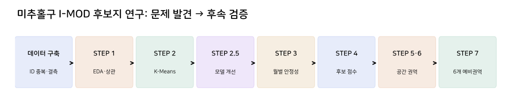

# 연구 정리본

# **STEP 0. 공공데이터 확보와 결합 단위 결정**

핵심 질문: 정류장별 수요·공급 통계를 공간정보·노선정보와 연결할 때 같은 정류장을 정확히 가리키는가?

| 데이터/출처 | 내용·규모 | 역할 |
| --- | --- | --- |
| 인천 대중교통 통계 API | 4~6월 시간대별 승차량·운행횟수 | 수요·공급 본체 |
| 전국 버스정류장 표준정보 | 인천 7,484개 중 미추홀구 502개 추출 | ID·좌표·행정 경계 |
| 인천 버스노선별 정류장 현황 | 26,308행×14열 (2026.06.30) | 노선 ID·순번·상하행 |
| 정류장별 이용승객 현황 | 7,373행×8열 | 보완·교차참조 자료 |
| 버스정보관리시스템 노드현황 | 31,827행×15열 | 노드·위치 참고 |

**수집·결합 구조**

- 버스정류장 좌표를 미추홀구 행정경계에 공간 결합하여 미추홀구 정류장 502개를 추출했다.
- 시간대별 통계는 정류장 ID가 아니라 정류장명·노선 조합을 포함하며, 상·하행 중복과 순번 누락 가능성이 있었다.
- 승차량과 운행횟수는 각각 독립 집계하고, 이름별 합계를 합칠 때 수치가 복제되지 않는지 검증했다.

다음 문제  |  286개 정류장명 중 148개는 복수 물리 정류장 ID에 대응했다. 정류장명별 통계를 특정 한쪽 방향의 정류장에 배정하면 공간 오분류·중복 수요가 발생할 수 있다.

---

# **STEP 0. 품질검사와 Stop Group 통합 원칙**

| 검증 항목 | 확인된 결과 | 처리 원칙 |
| --- | --- | --- |
| 관측일 | 90일 | 6월 11일은 의도적으로 제외 |
| 시간별 행 | 617,760행 | 286×90×24 유지 |
| 날짜·정류장명·시간 중복 | 0행 | 동일 집계 단위 보장 |
| 승차량·운행횟수 결측 | 0건 | 빈값과 실제 0 구분 |
| 승객>0, 운행=0 | 3,143건 | 오류·집계 시점 검토 플래그 |
| 정류장명 단일 좌표 가능 | 249개 | 대표 위치 부여 |
| 복수 물리 그룹 또는 명칭 불일치 | 35개+2개 | 좌표 확정 보류 |
| 고유 노선 수 미매칭 | 2개 | 0이 아닌 결측 유지 |

전체 분석 기간은 2026년 4월 1일부터 6월 30일까지이며, 6월 11일은 사전에 정한 기준에 따라 분석 대상에서 제외하였다. 이에 따라 유효 관측일은 총 90일이다. 또한 4월 29~30일의 노선정보 누락은 기존 데이터 처리 조건에서 의도적으로 유지한 사항으로, 임의 보간하지 않았다. 이러한 처리는 데이터의 연속성과 노선정보의 시점별 완전성에 제약을 남기므로 이후 해석에서 구분하였다.

**왜 Stop Group이 필요했나**

한 정류장명이 도로 양쪽의 상·하행 정류장 ID 여러 개에 연결될 수 있었다. 원본 승객수가 이미 같은 이름의 전체 수요라면 이를 각 ID에 동일하게 복제하는 순간 전체 승객수가 부풀려진다. 따라서 시간별 승차·운행량은 이름 단위로 한 번만 보존하고, 좌표는 공간적으로 구별 가능한 정류장군에만 부여했다.

연구 단위의 구분  |  286개 정류장명 기준 분석 단위 중 249개는 단일 물리 정류장 또는 공간적으로 인접한 정류장군으로 확인되어 대표 위치를 설정할 수 있었다. 나머지 35개는 동일 정류장명에 공간적으로 분리된 복수의 정류장군이 존재했고, 2개는 정류장명 매칭이 불가능하여 대표 위치 설정을 보류했다. 따라서 대표 위치가 설정된 경우에도 해당 좌표가 실제 승객의 탑승 위치를 정확히 나타내는 것은 아니다.

---

**이 단계가 STEP 1을 가능하게 한 이유**

원본 수치를 다시 합산한 결과 기존 통합본 617,760행과 승차량·운행횟수가 일치하여, 이후 EDA·군집화의 입력값 재현성을 확인했다. 단, 집계 재현성이 원천 API의 사실 정확성까지 입증하는 것은 아니다.

# 전체 파이프라인



# **STEP 1. 기초 EDA: 수요·공급의 불균형 탐색**

연구 목적: 정류장군별 수요 규모, 운행 공급, 이용 강도, 시간적 수요 변동의 분포를 확인하고 특정 값에 집중된 데이터를 진단한다.


| 변수 | 중앙값 | 최대 | IQR 이상치 수 |
| --- | --- | --- | --- |
| 일평균 승차량 | 266.81명 | 10,306.46명 | 23 |
| 일평균 운행횟수 | 371.77회 | 2,734.92회 | 10 |
| 운행당 승객수 | 0.715 | 11.463 | 11 |
| 수요 변동계수 | 0.803 | 3.317 | 16 |
| 시간적 불일치 | 0.195 | 0.863 | 15 |

**해석**

- 일평균 승차량 중앙값은 266.81명인 반면 최대값은 10,306.46명으로, 정류장군 간 수요 규모의 차이가 매우 크게 나타났다.
- 운행횟수와 운행당 승객수 역시 일부 높은 값에 집중되는 우측 편향 분포를 보였다.
- 이러한 분포는 소수의 대형 정류장군이 거리 기반 군집화 결과에 영향을 줄 가능성을 보여준다.

```
**연구적 의의**
- K-Means를 적용하기 전에 변수별 분포와 이상치를 검토해야 한다는 근거를 확보했다.
- 이후 로그 변환, 스케일링 방식 및 극단값 포함 여부를 비교하는 STEP 2·2.5의 필요성을 확인했다.
```

후속 질문  |  왜도가 큰 변수들을 같은 가중치로 사용하는 것이 적절한가? 서로 의미가 비슷한 지표들이 군집 거리 계산에 중복 반영되지 않는가? → STEP 1 상관분석·STEP 2 전처리 비교로 진행.

---

# **STEP 1. 파생변수와 Pearson·Spearman 진단**

| 범주 | 파생변수 | 분석적 의미 |
| --- | --- | --- |
| 수요 규모 | avg_daily_passengers | 일평균 실제 승차 규모 |
| 공급 규모 | avg_daily_operations | 일평균 노선 운행 횟수 |
| 이용 강도 | passengers_per_operation | 승차량/운행횟수 |
| 시간 집중 | demand_cv_hour_profile | 24시간 수요 분포의 변동계수. 시간대별 평균 승차량의 표준편차를 평균으로 나눈 값 |
| 시간 불일치 | temporal_mismatch | 정류장군별 24시간 수요 비중과 운행 비중 사이의 차이를 측정한 지표 |
| 저공급 시간 | low_supply_hour_ratio_lt1avg | 시간대별 일평균 운행횟수가 1회 미만인 시간의 비율 |
| 요일 차이 | weekend_weekday_demand_ratio | 주말 일평균 승차량을 평일 일평균 승차량으로 나눈 값 |
| 접근성 | unique_route_count | 동일 정류장명에 연결된 물리적 정류장의 고유 노선 ID 수 |

저공급 시간 비율은 운행횟수가 적은 시간의 비중을 나타내는 상대적 운영 특성 지표이다. 다만 야간 미운행 시간도 포함될 수 있으므로 수요가 존재하는 시간의 공급 부족을 직접 나타내지는 않는다. 시간적 불일치 역시 승차량과 운행횟수의 시간 분포 차이를 측정하며, 실제 수송능력 부족과 구분하여 해석한다.


| 변수 관계 | Pearson | Spearman | 결론 |
| --- | --- | --- | --- |
| 운행횟수 ↔ 고유 노선 수 | 0.896 | 0.897 | 공급 특성 중복 가능 |
| 수요 CV ↔ 시간 불일치 | 0.947 | 약 0.93 | 시간 특징 중복 가능 |
| 승차량 ↔ 노선 수 | 0.705 | 0.763 | 규모와 접근성 관련 |
| 시간 불일치 ↔ 주말/평일 비율 | −0.191 | −0.614 | 비선형/극단값 점검 |

**결과 해석**

- 일평균 운행횟수와 고유 노선 수는 Pearson 0.896, Spearman 0.897로 높은 상관관계를 보였다.
- 수요 변동계수와 시간적 불일치 역시 Pearson 약 0.947로 매우 강한 양의 상관관계를 나타냈다.
- 두 변수쌍을 모두 군집화에 투입하면 공급 규모와 시간적 변동 특성이 중복 반영될 가능성이 있다.
- 반면 시간적 불일치와 주말/평일 수요 비율은 Pearson -0.191, Spearman -0.614로 차이가 나타나, 선형 상관만으로 변수 관계를 판단하기 어려웠다.

```
**연구적 의의**
- 상관분석을 단순한 변수 삭제 기준이 아닌 입력변수 설계의 진단 도구로 활용했다.
- 이후 중복 변수 유지·제거 및 대체 모델을 비교할 근거를 확보했다.
```


상관계수는 삭제 규칙이 아니라 진단 도구다. 운행횟수와 노선 수는 상관이 높지만 공급 규모와 네트워크 다양성이라는 개념적 차이가 있다. 따라서 제거 전후를 비교하기로 결정했다.

# **STEP 2. K-Means 기준 실험: 낮은 분리도 발견**

연구 질문: 상관관계와 왜도가 존재하는 286개 정류장군을 K-Means로 의미 있게 나눌 수 있을까?

| 설계 요소 | 실험 내용 |
| --- | --- |
| 변수 조합 | A(기본 5개), B(+요일), C(+노선 수), D(시간 불일치 대신 CV) |
| 전처리 | 로그 변환 적용/미적용 |
| 이상치 | 전체 286개/극단값 1개 제외(민감도용) |
| 군집 수 | K=3~8 |
| 총 실험 | 96개 |


위 그래프는 특정 변수 조합과 전처리 조건에서 K값에 따른 실루엣 변화를 나타낸 결과로, 아래 표의 초기 기준 모델 A와 동일한 실험 조건이 아니다. 따라서 두 결과의 절대적인 실루엣 값을 직접 비교하기보다, 군집 수 변화와 변수·전처리 조건에 따른 성능 차이를 확인하는 자료로 활용하였다.

| 주요 모델 | Silhouette | 최소 군집 | 특징 |
| --- | --- | --- | --- |
| A, 원자료, K=3 | 0.2918 | 7 | 초기 기준 |
| B, 원자료, K=3 | 0.2914 | 15 | 군집 규모 개선 |
| C, 원자료, K=3 | 0.2639 | 22 | 노선 수 추가 |
| B, 이상치 1개 제외, K=3 | 0.3229 | 19 | 대상 285개로 변경 |

**결과 해석**

- 탐색한 조건에서는 K가 증가할수록 실루엣 계수가 전반적으로 낮아지는 경향이 나타났다.
- 그러나 동일한 K값에서도 변수 조합과 이상치 처리에 따라 군집 분리도가 달라졌다.
- 초기 기준 모델 A의 K=3 실루엣은 0.2918이었으며, 7개·102개·177개의 불균형한 군집이 형성됐다.

```
**연구적 의의**
- 높은 실루엣 계수만으로 군집의 적절성을 판단할 수 없음을 확인했다.
- 이에 군집 크기, 전처리 방식, 알고리즘과 결과 안정성을 함께 비교하는 STEP 2.5로 연구를 확장했다.
```

문제 발견  |  높은 실루엣과 좋은 모델은 다르다. 일부 K에서는 1~3개짜리 군집이 만들어졌고, 기준 A의 K=3 역시 7/102/177개로 불균형했다. → STEP 2.5 추가 비교 필요.

---

# **STEP 2.5. 왜 개선 실험을 다시 설계했는가**

STEP 2의 가장 큰 문제는 “실루엣 0.3 전후” 자체보다, 점수를 올릴 때 극단값만 별도 군집으로 떨어질 위험과 전처리 조건에 대한 민감성이었다.

| 실험 축 | 수준 | 의도 |
| --- | --- | --- |
| 변수 구성 | 4종 | 중복 변수 제거·대체 |
| 스케일러 | Standard / Robust | 이상치 영향 진단 |
| 로그 변환 | 있음 / 없음 | 왜도 완화 |
| PCA | 원본 / 설명분산 90% | 노이즈·중복 구조 축소 |
| 알고리즘 | K-Means / GMM | 거리·분포 가정 비교 |
| 군집 수 | 3~8 | 과도한 세분화 방지 |
| 조합 | 384개 | 동일 대상 286개 비교 |

**선정 기준**

- Silhouette, Davies–Bouldin, Calinski–Harabasz 등 분리도 지표와 함께 최소 군집 크기를 확인했다.
- 초기값 변화 및 80% 재표본 조건에서 Adjusted Rand Index(ARI)를 비교해 군집 할당의 안정성을 점검했다.
- PCA로 축소한 공간에서 측정한 실루엣과 원본 공간의 실루엣을 직접 동일 조건처럼 비교하지 않았다.


그림: 전체 실험의 조건별 모델 비교(원본 STEP 2.5 산출물)

# **STEP 2.5. 성능 개선 결과와 선택하지 않은 해**

| 모델 | Silhouette | 군집 크기 | 결정 |
| --- | --- | --- | --- |
| 6변수 Robust+PCA KMeans | 0.4588 | 3/34/249 | 극소수 군집으로 보류 |
| 8변수 Standard+PCA KMeans | 0.3530 | 25/65/196 | 기준 후보 |
| 8변수 Standard 원본 KMeans | 0.3407 | 25/64/197 | 비교 후보 |
| 8변수 Standard+PCA GMM | 0.3312 | 24/52/210 | 비교 후보 |
| 대체 6변수 Standard+PCA GMM | 0.3275 | 22/56/208 | 안정성 비교 후보 |


**결과 해석**

- 최고 실루엣 0.4588을 기록한 모델은 군집 크기가 3개·34개·249개로 극단적으로 불균형했다.
- 반면 전체 8변수와 StandardScaler, PCA를 적용한 K-Means 모델은 실루엣 0.3530을 기록하면서 최소 군집 크기 25개를 유지했다.
- 최고점 모델이 반드시 가장 활용하기 좋은 모델은 아니라는 점이 확인됐다.

```
**연구적 의의**
- 모델 선택 기준을 단일 성능지표 최대화에서 분리도·군집 크기·안정성·해석 가능성의 종합 평가로 전환했다.
- 이를 통해 최종 군집 유형을 설명할 기준 모델과 비교 검증 모델을 구분했다.
```

| 모델 | 초기값 ARI | 80% 재표본 ARI |
| --- | --- | --- |
| 8변수 PCA K-Means | 0.981 | 0.757 |
| 8변수 원본 K-Means | 1.000 | 0.773 |
| 8변수 PCA GMM | 0.987 | 0.826 |
| 대체 6변수 PCA GMM | 0.976 | 0.857 |


의사결정  |  최고점 0.459 모델은 군집의 한쪽 쏠림이 극심하여 제외. 최소 군집 ≥15개 조건에서 0.353의 8변수 PCA K-Means를 설명 가능성과 규모 균형을 갖춘 기준 후보로 채택. 동시에 안정성이 더 높은 GMM을 보조 비교 대상으로 유지.

최종 기준 모델로 선정한 8변수 K-Means는 군집 분리도와 군집 크기의 균형을 고려한 결과이다. 그러나 일평균 운행횟수와 고유 노선 수, 수요 변동계수와 시간적 불일치처럼 높은 상관관계를 가진 변수를 동시에 포함하고 있어 일부 특성이 군집 거리 계산에 중복 반영됐을 가능성이 있다. 따라서 이 모델을 객관적으로 유일한 최적해로 해석하지 않고, 비교적 안정적으로 정류장 유형을 설명할 수 있는 탐색적 기준 모델로 활용하였다.


**결과 해석**

- 286개 정류장군은 최종 K-Means 결과에서 196개, 65개, 25개의 세 군집으로 분류됐다.
- PCA 2차원 공간에서는 군집별 분포가 서로 다른 방향으로 나타나지만, 일부 정류장군은 경계에서 중첩된다.
- 따라서 세 군집은 완전히 분리된 자연적 집단보다는 수요·공급 특성이 서로 다른 탐색적 유형으로 해석하는 것이 타당하다.

```
**연구적 의의**
- 군집화 결과를 수치적 점수뿐 아니라 실제 데이터 분포와 연결해 설명할 수 있게 됐다.
- 다음 STEP에서는 군집의 위치보다 각 군집의 실제 승차량·운행횟수·시간적 불일치 특성을 해석하도록 연구 방향을 전환했다.
```


**결과 해석**

- 군집별 상대 지표를 비교한 결과, Cluster 0은 일반적인 수요·공급 규모, Cluster 1은 낮은 수요와 높은 시간적 불일치, Cluster 2는 높은 승차량·운행횟수·노선 수를 특징으로 했다. 그러나 군집 유형이 곧 I-MOD 도입 필요도를 의미하지는 않으므로, 이후 별도의 수요 적격성과 후보 점수 평가가 필요하다고 판단했다.

```
**연구적 의의**
- 시간적 불일치가 높은 군집 전체를 I-MOD 후보로 선정하는 것은 적절하지 않다는 점을 확인했다.
- 따라서 군집 유형과 독립적으로 수요 적격성과 공급 관련 지표를 평가하는 STEP 4가 필요해졌다.
```

---

# **STEP 3. 군집 해석: 숫자에서 정류장 유형으로**

연구 목적: K-Means 3개 군집이 단순한 색상·번호가 아니라 실제 수요·공급 운영 특성의 차이를 나타내는지 검증한다.

| 특성(중앙값) | Cluster 0 | Cluster 1 | Cluster 2 |
| --- | --- | --- | --- |
| 정류장군 수 | 196 | 65 | 25 |
| 일평균 승차량(명) | 309.6 | 51.0 | 2,011.8 |
| 일평균 운행횟수(회) | 420.4 | 129.3 | 1,164.5 |
| 운행당 승객수 | 0.762 | 0.326 | 1.851 |
| 시간 불일치 | 0.179 | 0.322 | 0.158 |
| 고유 노선 수 | 4 | 1 | 13 |

**해석한 군집 유형**

- Cluster 0 — 일반 수요·공급형: 상대적으로 중간 수준의 운행과 이용량, 낮은 시간 불일치.
- Cluster 1 — 저수요·저공급·시간 불일치형: 시간적 불일치가 크지만 중앙값 수요가 매우 낮아 전체를 서비스 후보로 볼 수 없음.
- Cluster 2 — 대규모 수요·공급형: 규모가 매우 크고 다수 노선이 지나는 거점형. 버스 공급 자체도 많을 수 있음.

다음 문제  |  정류장의 “유형”과 “I-MOD 투입 필요성”은 다른 개념이다. 군집 번호를 우선순위로 바꾸지 않고, STEP 4에서 독립적인 선별 기준을 설정했다.

---

# **STEP 3. 모델 간·월별 재현성 확인**


월별 통계는 4월 30일, 5월 31일, 6월 29일을 사용한다. 매우 높은 상관계수는 안정적인 정류장 순위를 뜻하지만, 원본 API의 공통 집계 방식이 반복성을 높였을 가능성도 배제하지 않았다.

해석 경계  |  월별 3변수 군집 ARI가 높은 사실을 최종 8변수 군집의 월별 완전 재현으로 표현하지 않는다. OD·평균 대기시간·잔여 좌석이 없다는 한계도 계속 유지한다.

| 검증 | 결과 | 해석 범위 |
| --- | --- | --- |
| K-Means ↔ GMM ARI | 0.6362 | 유형이 일부 유사하나 동일하지 않음 |
| 4·5·6월 승차량 순위상관 | 0.9991~0.9992 | 정류장 수요 순위 안정 |
| 월별 운행횟수 순위상관 | 약 0.9999 | 공급 규모 순위 안정 |
| 월별 운행당 승객수 순위상관 | 0.9955~0.9974 | 이용 강도 순위 안정 |
| 3변수 규모 군집 월별 ARI | 0.985~1.000 | 최종 8변수의 월별 ARI와 다름 |

월별 승차량과 운행횟수의 순위상관이 0.999 수준으로 나타난 것은 정류장군별 상대적인 규모 순위가 거의 변하지 않았음을 보여준다. 그러나 이는 수요 규모의 안정성을 검증한 것이며, 시간적 불일치와 요일 특성까지 포함한 최종 8변수 군집의 월별 재현성을 직접 입증하는 결과는 아니다. 또한 원천 API의 집계 구조에 따른 반복성이 존재할 가능성도 있으므로, 해당 결과는 보조적 안정성 검증으로 해석하였다.

---

# **STEP 4. 적격성 선별과 후보 점수 체계**

왜 새 평가가 필요한가: Cluster 1은 시간적 불일치가 높지만 수요가 극히 낮은 정류장도 포함하고, Cluster 2는 높은 승차량만큼 공급도 많은 거점을 포함한다. 따라서 군집과 독립적인 평가가 필요했다.

| 평가 지표 | 방향 | 기본 가중치 | 역할 |
| --- | --- | --- | --- |
| 일평균 승차량 | 높을수록 ↑ | 25% | 관측 수요 규모 |
| 시간적 불일치 | 높을수록 ↑ | 35% | 시간 분포 불균형 |
| 저공급 시간 비율 | 높을수록 ↑ | 20% | 공급이 적은 시간 비중 |
| 운행당 승객수 | 높을수록 ↑ | 20% | 이용 강도 |

후보 평가에서 적용한 25%·35%·20%·20% 가중치는 실측된 정책 효과나 전문가 합의를 통해 확정한 값이 아니라 수요 규모와 시간적 특성을 함께 고려하기 위해 설정한 기준 시나리오이다. 따라서 가중합 점수는 후보 간 상대적 비교에 사용하며, 가중치의 불확실성을 보완하기 위해 별도의 민감도 분석을 수행하였다.

각 지표를 전체 286개의 백분위로 변환해 가중합했다. 기본 수요 적격성 기준은 전체 일평균 승차량 중앙값 266.81명 이상으로 정했으며, 적격 143개만 기본 우선순위표에 포함했다. 나머지 143개는 원본에서 제외하지 않았다.

| 선정 파일 | 주요 역할 |
| --- | --- |
| 02_all_286_with_scores.csv | 전체 286개의 변수·군집·평가 점수 보존 |
| 03_base_eligible_ranking.csv | 수요 적격 143개의 기본 점수 순위 |
| 06_scenario_rankings.csv | 가중치 시나리오별 순위 |
| 07_top20_sensitivity.csv | 상위 20개 중복수·Jaccard |

주의  |  백분위 가중합 점수는 상대적 “검토 우선순위”이지 실제 공급부족률·미충족 수요·I-MOD 도입 효율을 의미하지 않는다.

---

# **STEP 4. 정류장군 우선순위와 시간대 특징**

| 기본 순위 | 정류장명 | 일평균 승차량(명) |
| --- | --- | --- |
| 1 | 남중학교 | 576.1 |
| 2 | 인하대후문 | 2,666.9 |
| 3 | 롯데백화점(인천터미널) | 10,306.5 |
| 4 | 문학경기장(야구장) | 309.5 |
| 5 | 주안역 | 4,220.6 |
| 6 | 문학초등학교 | 925.8 |
| 7 | 용현3동행정복지센터·보훈병원 | 1,206.3 |
| 8 | 한양아파트 | 275.0 |
| 9 | 주안7동행정복지센터 | 1,608.4 |
| 10 | 신기·남부종합시장 | 2,182.7 |


그림: 상위 20개 기본 평가점수 및 선별 결과

**결과 해석**

- 수요 적격 기준을 충족한 정류장군 가운데 남중학교, 인하대후문, 롯데백화점(인천터미널) 등이 높은 평가점수를 기록했다.
- 상위 후보에는 대형 환승 거점뿐 아니라 특정 시간대에 수요 비중이 상대적으로 높게 나타나는 정류장도 함께 포함됐다.

```
**연구적 의의**
- 군집화 결과를 독립적인 후보 평가 체계와 연결해 실제 검토 대상을 좁혔다.
- 다만 이 점수는 상대적인 우선 검토 점수로, 실제 공급 부족이나 I-MOD 도입 효과를 의미하지 않는다.
```

| 시간대 특징 | 시간 | 수요 비중−운행 비중 |
| --- | --- | --- |
| 문학경기장(야구장) | 21시 | +17.32%p |
| 문학초등학교 | 07시 | +9.01%p |
| 남중학교 | 18시 | +6.42%p |
| 인하대후문 | 17시 | +5.65%p |

상대 비중 차이는 해당 시간의 일일 승차 비중과 운행 비중을 뺀 값이다. 관측된 버스 미탑승 비율로 해석하지 않는다. 인하대후문은 점수가 높지만 대표 좌표가 불확실해 이후 공간 결합에서 제외되는 점도 보존했다.

# **STEP 4. 점수의 자의성을 확인한 민감도 분석**

핵심 질문: 점수를 정할 때 수요와 시간 불일치에 주는 가중치를 조금만 바꾸어도 후보가 달라지는가?

| 평가 조건 | 기본 상위 20개와 교집합 | 설명 |
| --- | --- | --- |
| 기본 가중치 | 20개 | 비교 기준 |
| 균등 가중치 | 13개 | 4개 변수 동등 |
| 수요 중심 | 10개 | 규모 변수를 강조 |
| 수요 제한 없는 시간 중심 | 1개 | 적격 조건까지 변경 |


그림: 기본 후보와 다른 시나리오의 순위 차이

**결과 해석**

- 평가 지표의 가중치를 변경하면 상위 후보의 순위와 구성에 차이가 발생했다.
- 기본 상위 20개와 균등 가중치 결과의 공통 후보는 13개, 수요 중심 결과는 10개였다.
- 특히 수요 적격 기준까지 제거한 시간 중심 시나리오에서는 공통 후보가 1개에 불과했다.

```
**연구적 의의**
- 단일 가중치의 종합점수만으로 후보지를 확정하는 방법의 한계를 확인했다.
- 이후에는 여러 조건에서 반복 선정된 후보를 우선 검토하고, 이들의 공간적 연결 가능성을 분석하도록 연구를 확장했다.
```

다음 문제  |  높은 후보 점수가 “어느 거리 안에서 함께 운영할 수 있는가”를 설명하지 못한다. → STEP 5에서 좌표가 있는 후보를 공간적으로 묶었다.

---

# **STEP 5. 공간 권역화: DBSCAN 탐색과 문제 발견**

STEP 4의 기본 점수 상위 후보 중 공간 좌표가 확인되는 정류장군 40개를 추려 직선거리(Haversine)를 계산하고, 인접 후보를 서비스 검토 권역으로 연결했다.


| 조건 | 다중 정류장 권역 | 단독 후보 | 최대 권역 크기 |
| --- | --- | --- | --- |
| DBSCAN 300m | 5 | 29 | 3개 |
| DBSCAN 500m | 8 | 14 | 7개 |
| DBSCAN 800m | 4 | 2 | 28개 |

| 거리 기준 쌍 | 함께 묶인 정류장 쌍의 Jaccard |
| --- | --- |
| 300m ↔ 500m | 0.167 |
| 500m ↔ 800m | 0.106 |
| 300m ↔ 800m | 0.018 |

**결과 해석**

- DBSCAN으로 공간 후보를 묶은 결과, 500m 기준에서는 8개 다중 정류장 권역과 14개 단독 후보가 나타났다.
- 반경을 800m로 늘리자 가장 큰 권역에 28개 정류장군이 연결되는 현상이 발생했다.
- 반경별 동일 권역 배정 관계의 Jaccard 유사도도 0.018~0.167로 낮아, 권역 구성이 거리 기준에 민감함을 확인했다.

```
**연구적 의의**
- 직선거리상의 인접성만으로 안정적인 서비스 권역을 정의하기 어렵다는 한계가 드러났다.
- 이에 연쇄 연결을 제한할 수 있는 Complete Linkage를 도입해 권역 구성의 안정성을 추가 검증했다.
```

---

# **STEP 6. Complete Linkage 도입과 공간 안정성**


| 방법 | 반경 | 다중 권역 | 단독 | 최대 군집 | 최대 직경 |
| --- | --- | --- | --- | --- | --- |
| DBSCAN | 300m | 5 | 29 | 3 | 473.7m |
| DBSCAN | 500m | 8 | 14 | 7 | 1,254.2m |
| DBSCAN | 800m | 4 | 2 | 28 | 4,583.4m |
| Complete | 300m | 5 | 30 | 2 | 286.2m |
| Complete | 500m | 12 | 14 | 3 | 492.3m |
| Complete | 800m | 13 | 5 | 5 | 693.2m |

**결과 해석**

- DBSCAN은 800m에서 최대 28개 정류장군을 연결했고, 최대 권역 직경이 약 4.58km까지 증가했다.
- Complete Linkage는 같은 반경에서 최대 5개 정류장군으로 구성돼, 지나치게 긴 권역이 만들어지는 현상을 완화했다.
- 500m Complete Linkage에서는 12개 다중 권역과 14개 단독 후보가 도출됐다.

```
**연구적 의의**
- 공간 권역 선정에서 단순한 인접성보다 군집 내부의 최대 거리도 중요하다는 점을 확인했다.
- Complete Linkage 500m를 후속 평가의 기준으로 선택했으나, 실제 보행거리나 최적 서비스 반경을 검증한 것은 아니다.
```

방법 선택  |  Complete Linkage 500m를 후속 검토의 기준으로 선택했다. “500m가 실증적으로 최적 반경”이라는 주장은 하지 않는다. 실제 보행경로·도로 단절·횡단 가능성은 검증되지 않았다.

---

# **STEP 6. 공간 후보의 안정성 결과와 남은 문제**

| 권역 ID | 구성 정류장군 | 최대 거리 |
| --- | --- | --- |
| Z14 | 인하대역4번출구 · 용현고가교 · 굴다리 | 492.3m |
| Z15 | 주안남초 · 힐스테이트푸르지오주안 · 건강보험남부지사 | 491.6m |
| Z23 | 남중학교 · 인화여고 | 484.6m |
| Z07 | 시티오씨엘4단지 · 힐스테이트학익104동앞 | 391.2m |
| Z17 | 인천기계공고 · 용남시장 | 324.2m |
| Z09 | 인하대정문 · 인하대역(7번출구) | 310.1m |


그림: Complete Linkage 반경 변화에 따른 공간 군집 시각화

500m 기준에서는 12개 다중 권역과 14개 단독 후보가 산출됐다. 300m·500m·800m 세 거리 기준 모두에서 함께 묶인 정류장군 쌍은 5개뿐이었다.

| 후보 구분 | 목록 행 수 |
| --- | --- |
| 반복 선정·공간 안정성 우선 검토 | 3 |
| 추가 공간 검토 | 9 |
| 고득점 단독 후보 검토 | 4 |
| 기타 단독 후보 모니터링 | 10 |

다음 문제  |  공간적으로 가까운 정류장들이 실제 I-MOD 필요도가 높은 것은 아니다. 단독 후보도 특정 시간에 강한 수요 특성이 있을 수 있다. → STEP 7에서 26개 평가 단위의 운영 특성과 반복 선정 여부를 비교했다.

---

# **STEP 7. 26개 후보 단위의 운영 특성 평가**

검토 대상은 다중 권역 12개와 단독 후보 14개, 총 26개다. 단독 후보를 임의로 인접 권역에 붙이지 않고 동일한 평가 단위로 유지했다.

| 평가 근거 | 어떻게 비교했는가 |
| --- | --- |
| 기본 점수 | 정류장군별 백분위 평가를 권역 단위로 요약 |
| 월별 안정성 | 4월 30일·5월 31일·6월 29일의 일평균 승차량 |
| 시간대 패턴 | 수요 비중과 운행 비중의 차이가 큰 시간 확인 |
| 노선 접근성 | 경유노선 수·운행횟수 보조 확인 |
| 선정 민감도 | 4개 가중치 시나리오 상위 6위 포함 빈도 |
| 공간 신뢰성 | STEP 6 Complete Linkage 그룹 및 단독 보존 |


그림: 4개 시나리오에서의 후보 선정 반복 빈도

STEP 7 대상 시간대 데이터에서 승차량 양수·운행횟수 0인 기록 596건이 확인되었다. 이를 실제 수송 불능으로 해석하지 않고 품질 플래그로 유지했다.

선정 규칙  |  특정 가중치에서 1위라는 사실보다 여러 시나리오에 반복 등장하는지를 우선 보고, 월별 안정성·공간 단위·운행 특성을 함께 설명하는 “6개 예비 검토 권역”을 산출했다.

---

**STEP 7. 최종 6개 예비 검토 권역**

| 순서·권역 | 구성 | 상위6 반복 | 일평균 승차량 |
| --- | --- | --- | --- |
| 1 · Z06 롯데백화점 | 단독 | 4/4 | 10,306.5 |
| 2 · Z23 남중학교·인화여고 | 2개 | 4/4 | 1,042.7 |
| 3 · Z10 주안7동·신기시장 | 2개 | 3/4 | 3,791.1 |
| 4 · Z22 주안역 일대 | 2개 | 2/4 | 11,853.1 |
| 5 · Z01 문학경기장(야구장) | 단독 | 2/4 | 309.5 |
| 6 · Z02 문학초등학교 | 단독 | 2/4 | 925.8 |


**결과 해석**

- Z06 롯데백화점과 Z23 남중학교·인화여고는 4개 가중치 시나리오 모두에서 상위 6위에 포함됐다.
- Z10 주안7동·신기시장은 3회, Z22 주안역·Z01 문학경기장·Z02 문학초등학교는 각각 2회 포함됐다.
- 따라서 최종 6개 후보는 하나의 평가 기준에서 높은 점수를 얻은 장소뿐 아니라 서로 다른 조건에서 반복 선정된 후보를 포함한다.

```
**연구적 의의**

최종 6개 예비 권역은 네 가지 가중치 시나리오에서의 반복 선정 여부와 수요·공급 특성, 공간적 연결성을 함께 고려해 도출했다. 다만 반복 선정 횟수는 평가 기준 변경에 대한 상대적 안정성을 나타낼 뿐 실제 I-MOD 도입 효과를 의미하지 않는다.

따라서 롯데백화점·주안역과 같은 대형 거점은 기존 대중교통과의 연계·보완 검토형으로, 문학경기장·문학초등학교는 특정 시간대 대응 검토형으로 구분하였다. 이러한 구분 역시 운영 효과가 검증된 결과가 아닌 탐색적 분류다.
```

최종 6개 예비 권역은 단일 평가점수의 절대 순위가 아니라 가중치 변경에 대한 반복 선정 여부, 수요 규모, 월별 수요 특성, 공간적 연결성 등을 종합하여 제시한 검토 대상이다. 반복 선정 횟수가 많다는 사실은 평가 기준 변화에도 후보로 나타날 가능성이 높다는 의미이지, 실제 I-MOD 도입 효과가 높다는 의미는 아니다.
따라서 롯데백화점과 주안역처럼 기존 대중교통이 집중된 거점은 연계·보완 가능성을 검토하는 유형으로, 문학경기장과 문학초등학교처럼 특정 시간대의 상대적 수요 비중이 높은 곳은 시간대 대응 가능성을 검토하는 유형으로 구분하였다. 이러한 유형 구분은 관측된 수요·공급 특성에 기초한 탐색적 해석으로, 실제 서비스 운영 방식이 검증됐다는 의미는 아니다.


**결과 해석**

- Z06 롯데백화점과 Z22 주안역 일대는 다른 권역보다 월별 일평균 승차량이 큰 대형 거점으로 나타났다.
- 반면 Z01 문학경기장은 수요 규모가 상대적으로 작지만, 월별 변동계수 0.112로 최종 후보 가운데 가장 큰 월별 변동성을 보였다.
- 월별 수요 규모와 변동성이 다르므로 모든 후보에 동일한 I-MOD 운영 전략을 적용하기는 어렵다.

```
**연구적 의의**
- 대형 거점과 특정 시간대 수요 특성이 뚜렷한 후보를 구분해 해석할 필요성을 확인했다.
- 다만 월별 평균 자료만으로 특정 행사일의 수요 집중이나 실제 차량 부족을 입증할 수는 없다.
```

| 권역 | 월별 수요 CV | 해석할 운영 특징 |
| --- | --- | --- |
| Z06 | 0.011 | 대형 거점 · 높은 규모 |
| Z23 | 0.050 | 학교 인접 생활권 |
| Z10 | 0.019 | 생활권·시장형 |
| Z22 | 0.039 | 환승 거점형 |
| Z01 | 0.112 | 21시 수요 비중 집중 · 행사 영향 가설 |
| Z02 | 0.039 | 07시 수요 비중 집중 |

수요가 매우 큰 Z06·Z22는 버스가 이미 많이 공급될 가능성이 있어 “연계·보완 검토형”으로 보는 것이 타당하다. 반면 Z01·Z02는 특정 시간대가 특징적이지만 실제 공급 부족이 입증된 것은 아니다.


# **연구 결론·한계·파일 추적표**

최종 결론  |  286개 정류장명 기준 분석 단위에 대해 90일간 시간대별 수요·공급 데이터를 검증하고, 군집화(0.353), 독립 후보 점수, 공간 연결성·안정성, 운영 패턴을 순차적으로 평가해 최종 6개 “I-MOD 예비 검토 권역”을 도출했다.

---

**강점과 한계**

- 강점 — 시간별 617,760행과 여러 공공데이터를 통합하고, 파생변수·군집화·공간권역·민감도 실험을 재현 가능하게 남겼다.
- 군집 모델 — K-Means PCA Silhouette 0.353은 비교 가능한 구조를 보여주지만, 변수 중복과 약한 분리도 때문에 유형이 절대적으로 분리된다고 주장할 수 없다.
- 수요·공급 해석 — 상대 비중 차이, 운행당 승객수, 저공급 시간 비율은 실제 대기시간·잔여 좌석·미충족 수요를 관측한 값이 아니다.
- 공간 — 249개 좌표 확정 가능·37개 불확실; 보행경로 대신 직선거리를 사용했으므로 실제 운행 서비스 경계가 아니다.
- 추가 검증 — OD, 하차 위치, 호출 수요, 실측 배차 변동·공급 좌석, 이벤트 일정 등이 확보되면 실제 운영 시나리오의 타당도를 높일 수 있다.

**분석 파일 계보**

| 구간 | 대표 재현 자료 |
| --- | --- |
| 원본·STEP 1 | 데이터셋 확보 PDF / EDA 분석 노트북·파생변수 |
| STEP 2~2.5 | K-Means 결과 ZIP / 384개 비교 ZIP |
| STEP 3 | Interpretation ZIP: 군집별 분류표·월별 검증 |
| STEP 4 | Candidate Screening ZIP: 전체 점수·민감도 |
| STEP 5~6 | Spatial Zones ZIP / Spatial Stability ZIP |
| STEP 7 | Operational Screening ZIP: 6개 후보 검토 |

최종 사용 기준: 관측 데이터의 경험적 탐색 결과와 가정 기반 후보 평가를 명확히 분리한다. 본 보고서는 제출용 주장문이 아니라 연구 단계 사이의 의사결정과 한계를 보존한 작업 기록이다.