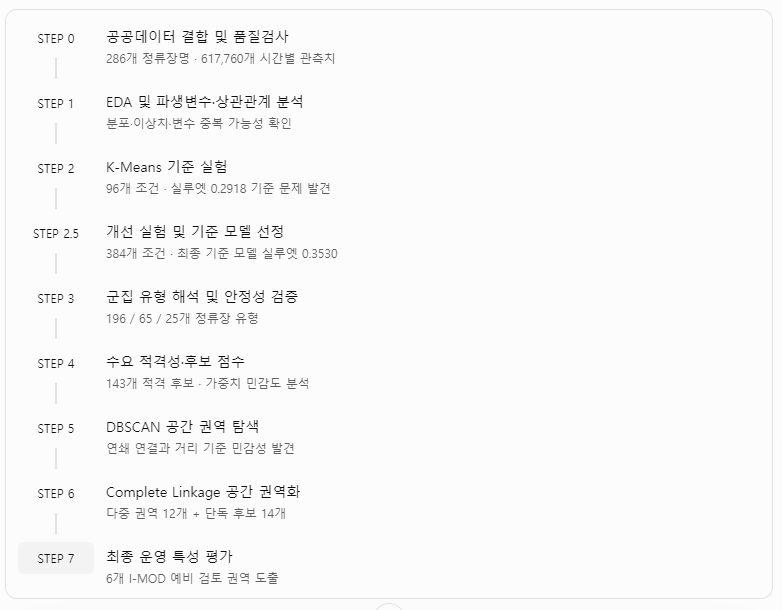

# 자세한 정리본

# 전체 파이프라인

# STEP 0. 공공데이터 확보와 결합 단위 결정

## 1. 연구 목적: 무엇을 분석하려고 했는가?

우리 연구의 최종 목적은 인천광역시 미추홀구에서 I-MOD 도입을 우선적으로 검토할 정류장 또는 권역을 선정하는 것이야.

이를 위해 가장 먼저 생각한 질문은 다음과 같아.

> 미추홀구의 기존 버스 이용 수요와 운행 공급을 비교하면, I-MOD 도입을 검토할 만한 지역을 찾을 수 있지 않을까?
> 

그런데 버스 승차량이 많다고 무조건 I-MOD가 필요한 건 아니야.

예를 들어 하루 3,000명이 이용하는 정류장에 버스가 충분히 운행된다면, 단순히 이용객이 많다는 이유만으로 추가 서비스를 도입할 근거는 부족해.

반대로 이용객이 상대적으로 적더라도 특정 시간대에 수요가 집중되고 버스 운행이 적다면 검토할 필요가 있어.

따라서 우리는 세 가지 정보를 확보해야 한다고 판단했어.

- 수요: 정류장별·시간대별 승차량
- 공급: 정류장별·시간대별 버스 운행횟수
- 공간 및 노선: 정류장의 실제 위치와 경유 노선

## 2. 어떤 데이터를 확보했는가?

보고서 1페이지에 정리된 공공데이터는 다음과 같아.

| 데이터 | 주요 내용 | 연구에서의 역할 |
| --- | --- | --- |
| 인천 대중교통 통계 API | 4~6월 시간대별 승차량·운행횟수 | 수요·공급 분석 |
| 전국 버스정류장 표준정보 | 미추홀구 정류장 502개 | 정류장 ID·좌표 |
| 인천 버스노선별 정류장 현황 | 26,308행 | 노선 ID·순번·상하행 |
| 정류장별 이용승객 현황 | 7,373행 | 교차참조 |
| 버스정보관리시스템 노드현황 | 31,827행 | 위치·노드 참고 |

여기서 핵심은 단순히 공공데이터를 여러 개 확보하는 것이 아니야.

서로 다른 데이터가 동일한 정류장을 가리키도록 정확하게 결합하는 것이 가장 중요했어.

## 3. 첫 번째 문제: 정류장명과 정류장 ID가 일치하지 않았다

실제 데이터를 결합하는 과정에서 중요한 문제가 발생했어.

버스정류장에는 고유한 ID가 존재하지만, 서로 다른 정류장이 같은 이름을 사용하는 경우가 있었어.

예를 들어 설명해 볼게.

| 정류장 ID | 정류장명 | 위치 |
| --- | --- | --- |
| 1001 | 인하대정문 | 도로 북쪽 |
| 1002 | 인하대정문 | 도로 남쪽 |

위 ID와 위치는 이해를 위한 가상 예시야.

도로 양쪽에 상행·하행 정류장이 존재하면 정류장 ID는 다르지만 이름은 같을 수 있어.

그런데 시간대별 승차량 통계가 ID별이 아니라 정류장명 기준으로 집계되어 있다면 문제가 발생해.

가령 '인하대정문'의 시간대별 승차량이 100명이라고 해보자.

이 수치를 두 정류장 ID에 각각 결합하면 어떻게 될까?

즉, 실제 승차량은 100명인데 데이터를 잘못 결합하면 200명으로 부풀려질 수 있는 거야.

이렇게 되면 이후 EDA, K-Means, 후보지 평가까지 모든 분석 결과가 왜곡될 수 있어.

실제 연구에서는 286개 정류장명 중 148개가 복수의 물리 정류장 ID와 대응한다는 사실을 확인했어.

따라서 ID만 기준으로 결합하는 방식은 적절하지 않다고 판단했지.

## 4. 해결 방법: Stop Group 개념 도입

이 문제를 해결하기 위해 우리는 분석 단위를 정류장 ID가 아닌 정류장명 기준의 Stop Group으로 설정했어.

핵심 원칙은 두 가지야.

첫째, 승차량과 운행횟수는 정류장명·날짜·시간 단위로 한 번만 보존한다.

둘째, 좌표는 해당 정류장명이 실제로 어떤 물리적 정류장군을 가리키는지 확인한 후 부여한다.

그 결과 286개 분석 단위는 다음과 같이 구분됐어.

여기서 중요한 점은 249개의 좌표를 설정할 수 있다고 해서, 그 좌표가 실제 승객 한 명 한 명의 탑승 위치를 정확히 나타낸다는 뜻은 아니라는 거야.

대표 좌표는 공간 분석을 위한 근사 위치야

그래서 우리는 수요·공급 특성 분석에는 286개 전체를 사용하되, 공간 권역화에서는 위치가 확인된 대상만 활용하는 방식으로 진행했어.

## 5. 데이터 품질검사 결과

결합이 끝났다고 바로 분석을 시작하지는 않았어.

우선 데이터의 집계 단위가 올바른지, 누락이나 중복이 있는지 확인했어.

| 검증 항목 | 결과 |
| --- | --- |
| 분석 기간 | 2026.04.01~06.30 |
| 유효 관측일 | 90일 |
| 정류장명 기준 분석 단위 | 286개 |
| 시간대별 데이터 | 617,760행 |
| 날짜·정류장명·시간 중복 | 0행 |
| 승차량·운행횟수 결측 | 0건 |
| 승차량 양수·운행횟수 0 | 3,143건 |

617,760행은 다음과 같이 계산돼.

286 * 90 * 24 = 617,760

즉, 286개 정류장명에 대해 90일간 하루 24시간의 관측 단위가 유지된 거야.

다만 승차량은 존재하지만 운행횟수는 0인 기록이 3,143건 발견됐어.

이는 실제로 버스가 운행되지 않았는데 승객이 탑승했다는 뜻으로 단정할 수 없어. 집계 시점 차이 또는 원천 데이터의 문제일 가능성이 있으므로, 해당 기록을 삭제하거나 임의 수정하지 않고 품질검사 대상으로 유지했어.

또한 6월 11일은 사전에 정한 기준에 따라 제외했고, 4월 29~30일의 노선정보 누락도 임의 보간하지 않았어. 다만 보고서에는 이러한 처리 기준을 선택한 최초의 구체적인 사유까지 제시되어 있지는 않아.

## 6. 연구자로서 이 단계에서 내린 의사결정

STEP 0에서 가장 중요한 것은 데이터를 많이 확보한 것이 아니라, 분석 단위를 명확하게 정의했다는 점이야.

처음에는 정류장 ID를 기준으로 데이터를 결합하면 된다고 생각할 수 있었어. 하지만 실제 데이터 구조를 확인하니 정류장명 하나에 여러 물리적 정류장이 대응했고, 승차량이 중복 집계될 위험이 있었지.

그래서 우리는 원본의 집계 수준을 보존하면서 공간정보를 별도로 검증하는 방식을 선택했어.

이러한 과정을 통해 이후 분석에 사용할 286개 정류장명 기준 데이터와 617,760개의 시간별 관측치를 확정할 수 있었어.

다만 이것이 원천 API의 수치가 모두 정확하다는 것을 의미하지는 않아. 우리가 검증한 것은 주로 결합 과정의 일관성과 집계 재현성이야.

# STEP 1. 기초 EDA: 수요·공급의 불균형 탐색

이번 단계에서는 내가 실제 연구를 수행한 입장에서 왜 EDA를 했는지, 변수의 분포를 어떻게 해석했는지, 이상치를 어떻게 판단했는지, 그리고 이 결과가 K-Means 설계에 어떤 영향을 주었는지 순서대로 설명할게.

이번에는 기초 EDA에 집중하고, 파생변수 간 Pearson·Spearman 상관관계는 다음 학습에서 별도로 다루자.

## 1. 왜 EDA부터 시작했을까?

STEP 0에서는 서로 다른 공공데이터를 결합하고 품질을 검사해서 최종적으로 286개 정류장명 기준 분석 단위를 확보했어.

이제 바로 K-Means를 적용할 수도 있었겠지만, 나는 그 전에 한 가지를 확인해야 한다고 판단했어.

> 미추홀구의 버스 정류장들은 수요와 공급 측면에서 얼마나 서로 다를까? 그리고 이 차이가 소수의 극단적인 정류장 때문에 발생하는 것은 아닐까?
> 

예를 들어 하루 평균 100명이 이용하는 정류장과 10,000명이 이용하는 정류장이 동일한 데이터셋에 들어 있다면, 이 둘의 수치적 차이가 다른 특성들을 압도할 가능성이 있겠지.

또 승차량과 운행횟수가 모두 높아도 특정 시간대에 수요가 집중될 수 있으니, 단순히 총량만 비교해서는 안 돼.

따라서 나는 EDA를 통해 먼저 다음과 같은 구조를 파악하려고 했어.

- 수요 규모가 정류장군별로 얼마나 다른가?
- 공급 규모도 수요와 비슷한 분포를 나타내는가?
- 운행횟수 대비 승차량은 얼마나 차이가 나는가?
- 시간대별 수요의 변동성과 수요·공급 분포의 차이는 어떠한가?
- 일부 극단값이 이후 군집화 결과를 지배할 가능성이 있는가?

여기서 EDA는 Exploratory Data Analysis, 즉 탐색적 데이터 분석이야. 모델을 적용하기 전에 데이터의 구조와 특징, 잠재적인 문제를 발견하는 과정이라고 이해하면 돼.

## 2. 분석에 사용한 5개 핵심 변수

연구 정리본 3페이지에서는 다음 변수들의 분포를 확인했어.

| 변수 | 무엇을 의미하는가? | 분석 목적 |
| --- | --- | --- |
| 일평균 승차량 | 정류장군의 하루 평균 승차 인원 | 수요 규모 |
| 일평균 운행횟수 | 하루 평균 버스 운행 횟수 | 공급 규모 |
| 운행당 승객수 | 승차량 ÷ 운행횟수 | 이용 강도 |
| 수요 변동계수(CV) | 시간별 수요의 상대적인 변동성 | 시간 집중 |
| 시간적 불일치 | 수요 시간 분포와 운행 시간 분포의 차이 | 수요·공급 시간 특성 |

중요한 건 이 변수들이 서로 다른 관점을 보여준다는 거야.

가령 일평균 승차량은 규모를 설명하고, 수요 변동계수는 하루 중 수요가 얼마나 불균등하게 나타나는지 보여줘. 시간적 불일치는 단순한 수요 변동성에서 더 나아가 버스 운행 분포와의 차이를 살펴보는 지표야.

다만 운행당 승객수가 높다고 해서 곧바로 버스가 만차라거나 공급이 부족하다는 뜻은 아니야. 실제 차량 정원, 하차 인원, 잔여 좌석을 관측한 값이 아니기 때문이지.

## 3. 변수 분포는 어떻게 분석했을까?

먼저 변수별로 히스토그램을 확인했어.

히스토그램은 일정한 값의 구간에 몇 개의 관측치가 존재하는지 보여주는 그래프야.

연구 정리본 3페이지에는 여섯 개의 분포 그래프가 배치되어 있어. 이 가운데 핵심적으로 확인한 것은 값이 작은 구간에 정류장군이 많이 몰려 있고, 일부 정류장군은 훨씬 높은 수치를 나타낸다는 점이야.

### 3-1. 우측 편향 분포 이해하기

이 그래프에서는 낮은 값에 대부분의 관측치가 집중되고, 높은 값에는 소수의 관측치만 존재하지.

이러한 분포를 **우측 편향(Right-skewed distribution)**이라고 해.

연구에서는 일평균 승차량과 운행횟수, 운행당 승객수에서 이러한 특징을 확인했어.

이것이 왜 중요할까?

K-Means는 관측치 간 거리의 영향을 받는 알고리즘이야. 따라서 변수의 분포가 극단적으로 치우쳐 있다면 소수의 큰 값이 군집 중심과 경계에 상당한 영향을 줄 수 있어.

다만 우측 편향 자체가 데이터 오류라는 뜻은 아니야. 실제로 이용객이 매우 많은 주요 거점이 존재할 수 있기 때문이야.

## 4. 실제 EDA 결과를 해석해 보자

아래 수치는 연구 정리본 3페이지의 실제 분석 결과야.

| 변수 | 중앙값 | 최대값 | IQR 이상치 수 |
| --- | --- | --- | --- |
| 일평균 승차량 | 266.81명 | 10,306.46명 | 23개 |
| 일평균 운행횟수 | 371.77회 | 2,734.92회 | 10개 |
| 운행당 승객수 | 0.715 | 11.463 | 11개 |
| 수요 변동계수 | 0.803 | 3.317 | 16개 |
| 시간적 불일치 | 0.195 | 0.863 | 15개 |

### 4-1. 중앙값이란?

중앙값(Median)은 모든 관측치를 크기순으로 정렬했을 때 가운데 위치하는 값이야.

우리 데이터는 286개이므로, 정렬한 뒤 143번째 값과 144번째 값의 평균을 계산하면 중앙값이 돼.

일평균 승차량의 중앙값이 266.81명이라는 것은 정류장군의 절반 정도가 이 값 이하의 수요를 보인다는 뜻이지.

평균과 달리 중앙값은 극단적으로 큰 관측치에 상대적으로 덜 민감하기 때문에, 우측 편향이 강한 데이터의 대표적인 수준을 파악하는 데 유용해.

### 4-2. 일평균 승차량 분석

중앙값 : 266.81명

최대값 : 10,306.46명

중앙값에 비해 최대값은 약 38.6배나 커.

나는 이 결과를 보고 미추홀구의 정류장군들이 유사한 규모로 분포하는 것이 아니라, 일부 대규모 수요 거점과 다수의 상대적으로 작은 정류장군으로 구성되어 있다고 해석했어.

그렇다면 군집화를 할 때 소수 대형 정류장군이 하나의 군집으로 분리될 가능성을 고려해야겠지.

### 4-3. 일평균 운행횟수 분석

중앙값은 371.77회, 최대값은 2,734.92회였어.

승차량과 마찬가지로 운행횟수에서도 큰 차이가 나타났지만, 최대값과 중앙값의 비율은 약 7.4배로 승차량보다 작았어.

여기서 한 가지 중요한 질문이 생겨.

수요 규모가 매우 큰 정류장에 운행 공급도 그만큼 많이 집중되어 있을까?

하지만 아직 이 단계에서 답할 수는 없어. 개별 변수의 분포를 확인한 것만으로 수요와 공급 사이의 관계를 판단할 수는 없기 때문이야.

그래서 뒤에서 상관분석이 필요해지는 거지.

### 4-4. 수요 변동계수와 시간적 불일치 분석

수요 변동계수의 중앙값은 0.803, 최대값은 3.317이야.

CV는 다음과 같이 정의할 수 있어.

CV = 표준편차 / 평균

우리 연구에서는 정류장군의 24시간 시간대별 평균 승차량 분포를 기준으로 계산한 지표야.

CV가 크면 시간대별 승차량이 평균에 비해 크게 변동한다는 뜻이야.

예를 들어 오전과 오후에 비교적 고르게 수요가 분포하는 정류장보다 출근시간에만 승차량이 집중되는 정류장에서는 CV가 높게 나타날 수 있어.

그러나 CV가 높다는 것만으로 버스 공급이 부족하다고 판단할 수는 없어. 실제 버스 운행도 수요가 집중되는 시간에 함께 집중되어 있을 수 있기 때문이지.

이것이 별도로 `temporal_mismatch`라는 시간적 불일치 지표를 분석한 이유야. 보고서에 따르면 시간적 불일치는 24시간 수요 비중과 운행 비중의 분포 차이를 측정하며, 중앙값은 0.195, 최대값은 0.863이었어.

## 5. 이상치(Outlier)는 어떻게 찾았을까?

이제 EDA에서 중요한 IQR 이상치 탐지를 공부해 보자.

이상치는 다른 관측치들과 비교했을 때 상대적으로 극단적인 값을 가진 관측치야.

우리 연구에서는 IQR(Interquartile Range, 사분위범위)을 이용해 이상치의 개수를 확인했어.

### 5-1. IQR의 개념

데이터를 작은 값부터 큰 값까지 정렬한 후 사분위수를 계산해.

- Q1: 25% 지점의 값
- Q2: 50% 지점의 값, 즉 중앙값
- Q3: 75% 지점의 값

사분위범위는 다음과 같아.

일반적인 Tukey 기준에서는 아래의 경계 밖에 있는 값을 이상치로 표시해.

## 6. 실제 연구의 이상치 탐지 결과는 무엇을 의미할까?

연구 정리본에서는 일평균 승차량에 IQR 이상치가 23개 존재한다고 나와 있어.

286개 정류장군 중 약 8%가 해당하는 셈이야.

또한 수요 변동계수에서는 16개, 시간적 불일치에서는 15개의 이상치가 발견됐어.

이 결과를 보고 나는 세 가지 가능성을 생각했어.

첫 번째는 실제 지역적 특성 때문에 나타나는 극단값이야. 예를 들어 환승 거점은 일반적인 정류장보다 승차량이 훨씬 클 수 있지.

두 번째는 시간대별 수요가 특이하게 집중되는 정류장일 가능성이야.

세 번째는 집계 오류 또는 데이터 결합 문제일 가능성이야.

다만 이 세 가지는 검토할 가설이야. STEP 1에서 이상치별 발생 원인을 실제로 확정했다는 기록은 보고서에 없어.

따라서 원인이 확인되지 않았는데 이상치를 모두 삭제하는 것은 적절하지 않아.

특히 I-MOD 후보지 선정 연구에서는 극단적인 승차량이나 시간대별 수요 집중 자체가 중요한 연구 대상일 수도 있기 때문이야.

## 7. 이상치가 K-Means에 미치는 영향

이 부분이 STEP 1에서 STEP 2로 넘어가는 핵심 연결고리야.

K-Means는 군집 내 관측치와 중심점 사이의 거리 제곱합을 줄이는 방식으로 학습해.

목적함수는 다음과 같아.

여기서 C_k는 k번째 군집, mu_k는 해당 군집의 중심을 의미해.

거리 제곱을 사용하기 때문에 중심에서 매우 멀리 떨어진 관측치는 큰 영향을 미칠 수 있어.

예를 들어 다른 정류장군들은 승차량이 100~500명 수준인데 특정 거점의 승차량이 10,000명이라면, 적절한 변환과 스케일링을 적용하지 않았을 때 군집 구조가 규모 차이에 크게 영향을 받을 수 있지.

그래서 연구에서는 다음 의사결정을 내리게 돼.

| 발견한 문제 | 다음 단계에서 검토할 방법 |
| --- | --- |
| 승차량·운행횟수의 우측 편향 | 로그 변환 |
| 변수별 수치 범위 차이 | 스케일링 |
| 일부 극단값 존재 | 이상치 포함·제외 비교 |
| 여러 변수 간 의미 중복 가능성 | Pearson·Spearman 상관분석 |

이때 주의할 점은 로그 변환이나 이상치 제거가 반드시 좋은 결과를 만든다는 보장은 없다는 것이야.

따라서 다음 단계에서 여러 조건을 비교하고, 군집 분리도와 군집 크기 등을 함께 검토하는 실험 설계가 필요해진 거야.

# STEP 1-2. 파생변수 설계와 Pearson·Spearman 상관관계 진단

학습 범위: 「연구 정리본」 PDF 4~5페이지

이번 단계는 이후 K-Means 군집화의 방향을 결정하는 중요한 과정이야.

앞선 기초 EDA에서는 정류장군별 승차량과 운행횟수에 큰 차이가 있고, 일부 변수에서 우측 편향과 이상치가 존재한다는 사실을 확인했어.

그런데 여기서 새로운 의문이 생겼어.

> 정류장군을 구분하기 위해 여러 변수를 만들었지만, 이 변수들이 정말 서로 다른 특성을 설명하고 있을까? 혹시 비슷한 정보를 중복해서 반영하고 있는 것은 아닐까?
> 

이를 확인하기 위해 8개 파생변수의 의미를 정리하고, Pearson·Spearman 상관계수를 비교했어.

이번 학습에서는 연구자가 실제로 내렸던 판단을 중심으로 설명하고, 수식과 그래프를 읽는 방법도 함께 공부해 보자.

## 1. 왜 파생변수를 설계했을까?

우리 연구의 목표는 단순히 버스 승객이 많은 정류장을 찾는 것이 아니었어.

I-MOD 도입을 검토할 만한 수요·공급 특성을 가진 정류장군을 구별하는 것이었지.

예를 들어 두 정류장군이 있다고 생각해 보자.

| 구분 | 정류장 A | 정류장 B |
| --- | --- | --- |
| 일평균 승차량 | 500명 | 500명 |
| 일평균 운행횟수 | 400회 | 400회 |
| 수요 특성 | 하루 중 비교적 고르게 분포 | 출근시간에 집중 |
| 운행 특성 | 수요와 비슷한 시간대에 집중 | 하루 중 비교적 고르게 분포 |

이 표는 개념 이해를 위한 가상 사례야.

두 정류장군의 하루 총승차량과 운행횟수는 동일해.

하지만 실제 시간대별 수요·공급 패턴은 다를 수 있어.

즉, 승차량과 운행횟수만 가지고는 두 정류장군을 충분히 구별하기 어려울 수 있다는 거야.

그래서 우리는 규모 외에도 이용 강도, 수요 집중, 시간적 불일치, 요일 차이, 노선 접근성까지 고려하기로 했어.

## 2. 연구에서 설계한 8개 파생변수

| 구분 | 변수명 | 의미 |
| --- | --- | --- |
| 수요 규모 | `avg_daily_passengers` | 일평균 승차량 |
| 공급 규모 | `avg_daily_operations` | 일평균 운행횟수 |
| 이용 강도 | `passengers_per_operation` | 승차량 ÷ 운행횟수 |
| 시간 집중 | `demand_cv_hour_profile` | 시간대별 수요 변동계수 |
| 시간 불일치 | `temporal_mismatch` | 수요와 운행의 시간 분포 차이 |
| 저공급 시간 | `low_supply_hour_ratio_lt1avg` | 일평균 운행 1회 미만인 시간의 비율 |
| 요일 차이 | `weekend_weekday_demand_ratio` | 주말/평일 일평균 승차량 비율 |
| 노선 접근성 | `unique_route_count` | 정류장명에 연결된 고유 노선 수 |

이제 변수별 의미와 계산 방식을 살펴볼게.

### 2-1. 일평균 승차량과 일평균 운행횟수

가장 기본적인 수요·공급 변수야.

정류장군 \(i\)의 날짜 \(d\), 시간 \(h\)에 관측된 승차량을 \(P_{i,d,h}\)라고 정의하자.

일평균 승차량은 다음과 같이 계산할 수 있어.

일평균 운행횟수도 같은 방식이야.

여기서 \(D=90\)은 유효 관측일 수야.

이 두 변수는 정류장군의 절대적인 수요와 공급 규모를 보여줘.

하지만 버스 운행횟수는 좌석 공급량이나 잔여 수송능력과 동일하지 않다는 점을 기억해야 해.

### 2-2. 운행당 승객수

### 2-3. 수요 변동계수(CV)

하루 중 시간대별 수요가 얼마나 변동하는지를 나타내는 변수야.

먼저 시간대별 평균 승차량을 계산해.

그리고 24시간 평균과 표준편차를 이용해 CV를 계산하는 구조야.

CV가 클수록 시간대별 수요 변화가 상대적으로 크다는 뜻이야.

여기서 표준편차를 모집단 기준으로 계산했는지 표본 기준으로 계산했는지는 연구 정리본에 명시되지 않았어. 정확한 수치 재현에는 원본 코드 확인이 필요해.

### 2-4. 시간적 불일치

이 변수는 우리 연구에서 특히 중요한 지표야.

시간적 불일치는 하루 24시간 동안 승차 수요가 분포하는 방식과 버스 운행이 분포하는 방식의 차이를 나타내.

예를 들어 18시에 하루 승차량의 20%가 발생하지만 그 시간에 하루 운행횟수의 10%만 배정된다면, 그 시간에는 수요 비중이 운행 비중보다 10%p 높은 거야.

다만 이 차이가 곧 미충족 수요를 의미하지는 않아.

### 2-5. 저공급 시간 비율

보고서에서 정의한 기준은 시간대별 일평균 운행횟수가 1회 미만인 시간의 비율이야.

이를 개념적으로 쓰면 다음과 같아.

예를 들어 24시간 중 6개 시간대에서 평균 운행횟수가 1회 미만이라면 비율은 0.25가 되는 거지.

하지만 야간처럼 수요 자체가 거의 없거나 버스가 운행하지 않는 시간도 포함될 수 있어. 그래서 이 지표를 곧바로 공급 부족률이라고 해석할 수는 없어.

### 2-6. 주말/평일 수요 비율

- 1보다 크면 주말 평균 승차량이 더 많아.
- 1보다 작으면 평일 평균 승차량이 더 많아.
- 1에 가까우면 주말과 평일의 평균 승차량이 비슷해.

이는 통근 중심 정류장과 주말 활동 중심 정류장을 구분할 때 참고할 수 있는 변수야.

### 2-7. 고유 노선 수

`unique_route_count`는 정류장명에 연결된 물리적 정류장들의 고유 노선 ID 수야.

단순히 데이터 행 수를 세는 것이 아니라, 중복 노선 ID를 제거해 계산하는 개념이지.

노선 수가 많으면 네트워크 접근성이 높은 거점일 가능성이 있어.

하지만 노선 수가 많다는 이유만으로 특정 시간에 이용할 수 있는 버스 공급이 충분하다고 판단할 수는 없어.

## 3. 왜 상관관계를 분석했을까?

이렇게 8개 변수를 구성했지만, 모든 변수가 완전히 독립적이지는 않을 거라고 생각했어.

특히 다음 관계들이 의심스러웠지.

첫째, 버스 운행횟수가 많은 정류장은 경유 노선 수도 많을 가능성이 있어.

둘째, 시간대별 수요가 불균등하게 분포하면 수요와 운행의 시간 분포 차이도 커질 가능성이 있어.

이처럼 서로 강하게 연관된 변수들을 동시에 K-Means에 입력하면 일부 특성이 군집 거리 계산에서 여러 번 반영될 수 있어.

그래서 상관관계를 분석했어.

목적은 상관계수가 높은 변수를 무조건 삭제하는 것이 아니라, 어떤 변수가 중복된 정보를 담을 가능성이 있는지 진단하는 것이었어.

## 4. Pearson 상관계수란?

Pearson 상관계수는 두 변수 사이의 선형 관계의 방향과 강도를 측정해.

수식은 다음과 같아.

- \(r=1\): 완전한 양의 선형 관계
- \(r=-1\): 완전한 음의 선형 관계
- \(r=0\): 선형 상관이 없음

여기서 선형 관계란 한 변수가 증가할 때 다른 변수도 대체로 일정한 기울기를 가진 직선 형태로 증가하거나 감소하는 관계야.

하지만 Pearson에는 한계가 있어.

일부 극단값의 영향을 크게 받을 수 있고, 직선 형태가 아닌 관계에서는 두 변수의 연관성을 충분히 나타내지 못할 수도 있어.

그래서 Spearman을 함께 사용했어.

## 5. Spearman 상관계수란?

Spearman 상관계수는 실제 변수 값 대신 각 관측치의 순위를 이용해 관계를 계산해.

Spearman은 직선 관계가 아니더라도 한 변수가 증가할수록 다른 변수가 일관되게 증가하거나 감소하는 단조 관계를 파악하는 데 유용해.

다만 Spearman도 모든 종류의 비선형 관계를 찾아내지는 못해.

## 6. 실제 상관분석 결과 해석

연구 정리본 4페이지의 Pearson·Spearman 히트맵에서 중요한 관계는 다음과 같았어.

| 변수 관계 | Pearson | Spearman | 해석 |
| --- | --- | --- | --- |
| 운행횟수 ↔ 고유 노선 수 | 0.896 | 0.897 | 공급 관련 정보 중복 가능 |
| 수요 CV ↔ 시간 불일치 | 0.947 | 약 0.93 | 시간 특징 중복 가능 |
| 승차량 ↔ 노선 수 | 0.705 | 0.763 | 규모와 접근성 관련 |
| 시간 불일치 ↔ 주말/평일 비율 | -0.191 | -0.614 | 선형·순위 관계 차이 |

### 6-1. 운행횟수와 고유 노선 수: 0.896

Pearson과 Spearman이 모두 약 0.9였어.

나는 이를 보고 경유 노선이 많은 정류장일수록 평균 운행횟수도 많은 경향이 강하다고 해석했어.

이 관계가 중요한 이유는 K-Means에서 두 변수를 모두 넣을 경우, 공급과 관련된 특성이 중복 반영될 수 있기 때문이야.

예를 들어 두 정류장의 운행횟수와 노선 수가 모두 다르면 K-Means는 두 차원에서 거리 차이를 계산해.

그러나 두 변수가 동일한 개념은 아니야.

- 운행횟수는 관측된 공급 규모에 가까워.
- 고유 노선 수는 네트워크 연결의 다양성을 설명해.

따라서 나는 상관계수가 높다는 이유만으로 하나를 바로 삭제하지 않고, 두 변수를 함께 사용한 모델과 제외한 모델을 비교하기로 했어.

### 6-2. 수요 CV와 시간적 불일치: 0.947

실제 보고서의 산점도에서 대부분의 점은 왼쪽 아래에 모여 있고, 오른쪽 위로 갈수록 수요 CV와 시간 불일치가 함께 커지는 형태가 나타나.

Pearson 상관계수는 0.947로 매우 높은 양의 상관을 보였어.

즉, 우리 데이터에서는 시간대별 수요 변동이 큰 정류장일수록 버스 운행 시간 분포와의 불일치도 커지는 경향이 강했어.

이 결과를 보고 두 지표가 시간적 특성을 상당 부분 중복해서 반영할 가능성이 있다고 판단했지.

하지만 여기서 주의해야 할 점이 있어.

수요가 집중된다는 것과 버스 운행이 수요에 맞지 않는다는 것은 본질적으로 다른 개념이야.

수요 CV는 수요만 관찰하지만, 시간 불일치는 수요와 공급을 함께 고려해.

따라서 두 변수가 높은 상관을 보였더라도 반드시 하나가 불필요한 변수라는 뜻은 아니야.

그래서 후속 실험에서는 시간 불일치를 CV로 대체하는 변수 조합까지 검토했어.

또한 산점도에는 다른 점들과 멀리 떨어진 높은 CV 관측치가 보여. 이 관측치가 Pearson 상관계수에 어느 정도 영향을 주는지 검토할 필요가 있지만, 보고서에는 해당 관측치의 영향력을 따로 계산한 결과는 없어.

### 6-3. 승차량과 고유 노선 수: 0.705

Pearson 0.705, Spearman 0.763이었어.

이 결과는 승차량이 많은 정류장군이 더 많은 노선과 연결되는 경향이 있음을 보여줘.

하지만 이것만으로 버스 노선이 많아서 승차량이 증가했다고 설명할 수는 없어.

이용객이 많이 모이는 장소에 노선이 집중적으로 공급되었을 수도 있고, 역·상업시설 같은 제3의 요인이 두 변수에 동시에 영향을 주었을 수도 있어.

즉, 상관관계는 인과관계를 입증하지 않아.

### 6-4. 시간 불일치와 주말/평일 비율: Pearson -0.191, Spearman -0.614

이번 분석에서 특히 흥미로운 결과야.

Pearson은 -0.191로 약한 음의 선형 관계였지만, Spearman은 -0.614로 상대적으로 강한 음의 순위 관계였어.

이는 두 변수 사이에 직선으로 잘 설명되지 않는 단조 경향이 존재할 가능성을 보여줘.

예를 들어 주말/평일 승차량 비율이 높은 정류장군일수록 시간 불일치가 낮아지는 경향이 일부 존재할 수 있다는 거야.

다만 Pearson과 Spearman의 차이만으로 비선형 관계의 정확한 형태를 확정할 수는 없어. 산점도와 극단값을 함께 검토해야 해.

이 분석에서 얻은 핵심 교훈은 Pearson 하나만으로 변수 관계를 판단하지 않는 것이 좋다는 점이었어.

## 7. 상관관계 히트맵은 어떻게 읽는가?

연구 정리본 4페이지에는 Pearson과 Spearman 히트맵이 나란히 있어.

히트맵을 읽을 때는 다음 순서가 좋아.

1. 대각선은 각 변수와 자기 자신의 상관관계이므로 1이야.
2. 대각선 밖에서 절댓값이 큰 상관계수를 찾아.
3. 양수인지 음수인지 확인해.
4. Pearson과 Spearman을 비교해 차이가 큰 변수쌍을 찾아.
5. 통계적 관계뿐 아니라 변수 정의가 실제로 유사한지 검토해.

예를 들어 운행횟수와 노선 수는 두 계수가 모두 약 0.9야. 이 경우 강한 양의 선형 관계와 순위 관계가 함께 관측되었다고 해석할 수 있어.

반면 시간 불일치와 주말/평일 비율은 두 계수가 크게 달라. 이런 경우에는 단순히 하나의 상관계수만 보고 판단하기보다는 관계 형태와 극단값을 더 살펴봐야 해.

여기서 일반적으로 상관계수의 절댓값 0.8 이상을 강한 관계로 보는 등의 경험적 기준이 쓰이지만, 우리 연구에서 0.8 이상인 변수를 자동 삭제하는 규칙을 적용한 것은 아니야.

## 8. 이 결과를 K-Means 변수 선택에 어떻게 반영했을까?

이것이 이번 STEP의 가장 중요한 의사결정이야.

상관분석 결과를 확인한 후 나는 변수를 무조건 삭제하는 대신, 여러 조합을 비교하는 방향을 선택했어.

보고서에 기록된 후속 STEP 2의 변수 조합은 다음과 같아.

| 실험 | 변수 구성 방향 | 검토 목적 |
| --- | --- | --- |
| A | 기본 5개 변수 | 기준 성능 확인 |
| B | 기본 변수에 요일 특성 추가 | 요일 차이의 효과 |
| C | 노선 수 추가 | 접근성 정보의 효과 |
| D | 시간 불일치를 수요 CV로 대체 | 시간 특성 변수의 대체 가능성 |

단, 보고서에는 각 조합의 전체 변수명이 모두 열거되어 있지는 않으므로 여기서는 기재된 구성 방향만 설명했어.

이렇게 설계한 이유는 명확해.

운행횟수와 노선 수의 상관관계가 높다고 해서 노선 수가 무의미하다는 것은 아니고, 수요 CV와 시간 불일치의 상관관계가 높다고 해서 둘이 완전히 동일한 변수라는 뜻도 아니기 때문이야.

따라서 실제 군집화 결과를 비교하면서 어떤 변수 조합이 더 의미 있는 정류장 유형을 만들어 주는지 확인하려고 했어.

여기서 한 가지 더 중요한 점이 있어.

K-Means에서 상관관계가 높은 변수를 함께 사용하면 특정 특성이 더 큰 비중으로 반영될 수 있지만, 높은 상관관계 자체가 K-Means를 사용할 수 없게 만드는 것은 아니야.

우리는 변수의 통계적 중복 가능성과 분석 목적에서의 의미를 함께 고려해야 했어.

# STEP 2. K-Means 기준 실험: 낮은 군집 분리도 발견

이번 STEP에서는 처음으로 K-Means를 적용해서 286개 정류장군을 수요·공급 특성에 따라 분류했어.

그런데 실제 결과에서는 두 가지 문제가 발견됐어.

첫째, 기준 모델의 실루엣 계수가 0.2918로 높지 않았어. 둘째, 286개 정류장군이 7개·102개·177개라는 불균형한 군집으로 나뉘었지.

이번에는 처음 모델을 설계한 연구자 입장에서 왜 이런 결과가 나왔는지, 어떤 실험을 진행했는지, 그리고 왜 후속 개선 실험이 필요했는지 살펴볼게.

## 1. 연구 질문: K-Means로 정류장 유형을 구분할 수 있을까?

STEP 1에서 우리는 두 가지 사실을 확인했어.

- 승차량과 운행횟수 같은 변수에 우측 편향과 이상치가 존재했어.
- 운행횟수와 노선 수, 수요 CV와 시간적 불일치처럼 상관관계가 높은 변수쌍이 존재했어.

따라서 처음부터 한 가지 변수 조합을 정하고 결과를 받아들이는 것은 적절하지 않다고 판단했어.

내가 확인하고 싶었던 것은 다음과 같아.

> 변수 구성, 로그 변환, 이상치 처리, 군집 수를 바꾸더라도 정류장군이 의미 있게 분리될까?
> 

이 질문에 답하기 위해 여러 조건을 적용한 기준 실험을 설계했어.

## 2. K-Means 알고리즘부터 이해하자

K-Means는 비슷한 특성을 가진 관측치끼리 묶는 비지도학습 알고리즘이야.

우리 연구에서는 각 정류장군을 하나의 관측치로 두었어. 정류장군마다 승차량, 운행횟수, 시간적 불일치 등의 수치형 변수가 있으므로 하나의 벡터로 표현할 수 있지.

예를 들어 세 변수만 사용한다면 다음과 같아.

여기서 \(P_i\)는 승차량, \(O_i\)는 운행횟수, \(T_i\)는 시간적 불일치야.

K-Means가 최소화하는 목적함수는 다음과 같아.

즉, 각 군집에 속한 관측치들이 해당 군집 중심에서 가능한 한 가깝도록 만드는 것이야.

하지만 이 과정에서 중요한 문제가 있어. K-Means는 거리를 기준으로 작동하므로, 변수의 크기와 분포가 결과에 직접 영향을 줄 수 있다는 점이야.

## 3. 변수 조합을 왜 4가지로 나누었을까?

연구 정리본에 기록된 변수 구성은 다음과 같아.

| 모델 | 구성 방향 | 실험 목적 |
| --- | --- | --- |
| A | 기본 5개 변수 | 기준 성능 확인 |
| B | 기본 변수 + 요일 특성 | 요일 차이 반영 효과 |
| C | 노선 수 추가 | 노선 접근성 반영 효과 |
| D | 시간 불일치 대신 CV | 시간 특징 변수 대체 |

보고서에는 모델별 전체 변수명이 모두 명시되어 있지 않아. 따라서 구체적인 입력 변수 목록을 재현하려면 실험 코드나 결과 파일을 함께 확인해야 해.

여기서는 이러한 조합을 설정한 연구적 이유에 집중해 보자.

### 모델 A: 기본 기준 모델

처음에는 가장 기본적인 수요·공급 특성으로 정류장군이 얼마나 구분되는지 확인하려고 했어.

기준 모델은 이후 다른 변수 조합의 결과를 비교하는 출발점이 되는 거지.

### 모델 B: 요일 특성 추가

주말과 평일의 수요 패턴이 다른 정류장군을 더 잘 구별할 수 있을지 확인하려는 목적이야.

예를 들어 동일한 평균 승차량을 가진 두 정류장이라도 한 곳은 평일 중심, 다른 곳은 주말 중심이라면 서로 다른 유형으로 구분할 근거가 될 수 있겠지.

### 모델 C: 노선 수 추가

STEP 1에서 운행횟수와 고유 노선 수의 Pearson 상관계수가 0.896으로 높게 나타났어.

그렇다면 노선 수를 추가하는 것이 군집을 더 잘 구별해 줄까? 아니면 공급 규모의 영향력을 중복해서 키우게 될까?

이 가능성을 실험적으로 비교하기 위한 구성이야.

### 모델 D: 시간 불일치를 CV로 대체

수요 CV와 시간 불일치의 Pearson 상관계수는 0.947이었어.

두 변수가 높은 상관을 보였으므로, 시간 불일치 대신 수요 CV를 사용했을 때 군집 구조가 어떻게 달라지는지 확인하려고 했어.

중요한 점은 변수를 많이 사용한다고 항상 더 좋은 군집이 만들어지는 것은 아니다라는 거야.

## 4. 왜 군집 수 K를 3~8로 설정했을까?

K-Means는 군집 수 K를 미리 설정해야 해.

예를 들어 K=3이면 정류장군을 세 유형으로, K=8이면 여덟 유형으로 구분하는 거야.

그렇다면 어떤 K가 가장 적절할까?

일반적으로 K를 작게 설정하면 서로 다른 특성을 가진 정류장들이 하나의 군집에 포함될 수 있어.

반대로 K를 크게 설정하면 작은 차이까지 구분되지만 군집이 지나치게 세분화될 수 있지.

이번 연구에서는 K=3부터 K=8까지 탐색했어.

| K | 예상되는 특성 |
| --- | --- |
| 3 | 비교적 넓은 유형 구분 |
| 4~5 | 중간 수준의 세분화 |
| 6~8 | 더 세밀한 유형 구분, 소규모 군집 가능성 증가 |

이는 일반적인 해석이며, 실제 결과는 데이터에 따라 달라져.

보고서에는 K=3~8을 선택한 목적을 과도한 세분화 방지와 연결하고 있지만, 왜 정확히 3과 8을 범위의 양끝으로 정했는지까지 별도로 설명하지는 않아.

## 5. 총 96개의 실험은 어떻게 구성했을까?

연구 정리본에서는 다음 조건을 비교했다고 기록되어 있어.

| 실험 요소 | 조건 수 |
| --- | --- |
| 변수 조합 | 4 |
| 로그 변환 | 2 |
| 이상치 처리 | 2 |
| K 값(3~8) | 6 |
| 총 실험 | 96 |

이상치 처리에서는 전체 286개를 사용한 경우와 극단값 1개를 제외한 285개를 사용한 경우를 비교했어

여기서 중요한 점은 전체 이상치 23개를 모두 제거한 것이 아니라는 거야.

극단값 1개 제외는 모델의 민감도를 알아보기 위한 조건이었어.

다만 96개 모든 실험 결과를 현재 정리본에서 확인할 수는 없어. 보고서에는 일부 주요 결과만 요약되어 있어.

## 9. 실제 K-Means 실험 결과

주요 실험 결과는 다음과 같아.

| 모델 | Silhouette | 최소 군집 크기 |
| --- | --- | --- |
| A, 원자료, K=3 | 0.2918 | 7 |
| B, 원자료, K=3 | 0.2914 | 15 |
| C, 원자료, K=3 | 0.2639 | 22 |
| B, 극단값 1개 제외, K=3 | 0.3229 | 19 |

### 9-1. 모델 A: Silhouette 0.2918

모델 A는 초기 기준 모델이야.

K=3 조건에서 실루엣은 0.2918이었어.

문제는 평균 실루엣 점수 자체뿐만 아니라 군집 크기였어.

7개짜리 군집은 전체의 약 2.4%에 불과해.

물론 작은 군집 자체가 잘못된 것은 아니야. 실제로 드문 특성을 가진 정류장군이 존재할 수 있기 때문이지.

하지만 우리가 정류장 유형을 구분하고 각 유형의 특징을 설명하려는 상황에서는 왜 이렇게 작은 군집이 만들어졌는지 반드시 확인해야 해.

### 9-2. 모델 B: Silhouette 0.2914

모델 B는 실루엣 계수가 0.2914로 A와 거의 비슷했어.

하지만 최소 군집 크기는 7개에서 15개로 증가했지.

이 결과는 중요한 점을 보여줘.

실루엣 계수가 비슷해도 실제 군집 구성은 달라질 수 있다는 것이야.

따라서 실루엣 하나만 보고 모델을 평가하기보다 군집 크기도 함께 살펴볼 필요가 있었어.

### 9-3. 모델 C: Silhouette 0.2639

노선 수를 추가한 모델 C에서는 실루엣이 0.2639로 낮아졌어.

반면 최소 군집 크기는 22개로 증가했지.

이 결과만으로 노선 수가 불필요한 변수라고 결론 내릴 수는 없어.

다만 노선 수를 추가하는 것이 적어도 해당 실험 조건에서 실루엣을 개선하지는 못했다는 사실을 확인했어.

이는 STEP 1에서 발견한 운행횟수와 노선 수의 높은 상관관계를 다시 검토할 필요가 있다는 근거가 되었어.

### 9-4. 모델 B, 극단값 1개 제외: Silhouette 0.3229

특히 주목한 결과야.

동일한 B 변수 구성에서 극단값 1개를 제외하자 실루엣이 0.2914에서 0.3229로 높아졌어.

최소 군집 크기도 15개에서 19개로 늘어났지.

이 결과를 통해 소수의 극단적인 정류장군이 군집 분리도에 영향을 줄 가능성을 확인했어.

하지만 이를 근거로 해당 정류장군을 최종 분석에서 제거한 것은 아니야.

이상치 제외 모델은 285개, 원자료 모델은 286개를 대상으로 하므로 점수를 동일한 표본에서 측정한 것처럼 비교해서는 안 돼.

이 실험은 극단값 처리에 따라 군집 결과가 달라질 수 있다는 민감도 진단으로 해석하는 것이 타당해.

## 10. K가 증가할수록 어떤 결과가 나왔을까?

연구 정리본 6페이지에는 K=3~8에 따른 실루엣 변화 그래프가 있어.

보고서에서는 탐색한 해당 조건에서 K가 증가할수록 실루엣이 전반적으로 낮아지는 경향이 나타났다고 설명해.

여기서 반드시 구분해야 할 점이 있어.

6페이지의 K별 변화 그래프는 위의 기준 모델 A와 동일한 실험 조건이 아니야.

따라서 그래프의 실루엣 값과 모델 A의 0.2918을 동일 조건의 결과로 비교해서는 안 돼.

이 그래프는 K값 변화에 따라 분리도가 달라진다는 경향을 확인하는 데 활용한 자료야.

또한 K가 증가하면 언제나 실루엣이 감소한다는 일반적인 법칙이 있는 것도 아니야.

실루엣은 데이터의 실제 분포, 전처리 조건, 초기값, 군집 수에 따라 달라져.

따라서 이번 연구에서 확인한 경향으로만 해석해야 해.

## 11. 왜 실루엣이 가장 높은 모델만 선택하지 않았을까?

이번 STEP에서 가장 중요한 연구적 판단이야.

우리는 I-MOD 후보지 선정에 활용할 정류장 유형을 만들고 싶었어.

그런데 실루엣이 높은 모델이 반드시 해석하기 좋은 모델은 아니야.

예를 들어 286개 정류장군이 1개·140개·145개로 나뉘었다고 생각해 보자.

만약 1개짜리 극단값 군집이 다른 관측치와 매우 멀리 떨어져 있다면 실루엣이 유리하게 나타날 수 있어. 그러나 그 작은 군집이 정말 우리가 설명하려는 운영 유형인지 검토해야 하지.

반대로 실루엣이 조금 낮더라도 각 군집이 적절한 규모를 유지하고 실제 수요·공급 특성의 차이를 설명할 수 있다면 연구 목적에 더 적합할 수 있어.

따라서 나는 다음 기준들을 함께 고려해야 한다고 판단했어.

- 군집의 분리도
- 군집 크기의 불균형
- 이상치 처리에 대한 민감성
- 변수 조합과 전처리 변화에 따른 결과 차이
- 정류장군 유형의 해석 가능성

다만 이 단계에서 군집 해석이나 안정성 검증을 모두 완료한 것은 아니야. 이런 판단을 실제로 검증하기 위해 후속 STEP 2.5를 설계하게 된 거야.

# STEP 2.5. K-Means 개선 실험과 최종 기준 모델 선정

학습 자료: 「연구 정리본」 PDF 7~9페이지

이번 STEP은 연구 전체에서 모델을 선택하는 기준이 바뀐 단계야.

STEP 2까지는 어떤 변수 조합과 군집 수에서 실루엣 계수가 높아지는지 탐색했어. 그런데 실험을 진행하면서 단순히 실루엣이 높은 모델을 선택하는 것이 적절하지 않을 수 있다는 문제를 발견했지.

실제로 이번 개선 실험에서는 다음과 같은 결과가 나왔어.

왜 실루엣이 더 높은 0.4588 모델을 선택하지 않았을까?

이 질문을 이해하려면 StandardScaler, RobustScaler, PCA, GMM, 실루엣 계수, ARI가 각각 무엇을 평가하고, 서로 어떻게 연결되는지 알아야 해.

이번에도 실제 연구를 수행한 연구자의 관점에서 문제 발견 → 실험 설계 → 결과 분석 → 최종 의사결정 순서로 설명할게.

## 1. 왜 기존 K-Means 실험을 다시 설계했는가?

이전 STEP 2에서 기준 모델 A의 결과는 다음과 같았어.

| 항목 | 결과 |
| --- | --- |
| 대상 | 286개 정류장군 |
| 군집 수 | K=3 |
| Silhouette | 0.2918 |
| 군집 크기 | 7 / 102 / 177 |

나는 이 결과에서 세 가지 문제를 발견했어.

첫 번째는 군집 분리도였어.

실루엣 계수가 0.2918이라는 것은 관측치들이 각자의 군집 내부에서 얼마나 가까운지와 다른 군집에서 얼마나 떨어져 있는지를 종합했을 때, 강한 분리 구조가 확인되었다고 보기는 어렵다는 뜻이야.

물론 실루엣 0.3이 무조건 나쁜 모델이라는 절대적인 기준은 없어.

두 번째는 군집 크기 불균형이었어.

286개 정류장군을 세 개로 나누었는데, 하나의 군집에는 7개만 포함됐어.

이는 특정 극단값들이 별도 군집을 형성했을 가능성을 검토해야 한다는 신호였지.

세 번째는 전처리와 극단값에 대한 민감성이었어.

STEP 2에서 같은 변수 구성이라도 극단값 1개를 제외하면 실루엣이 0.2914에서 0.3229로 달라졌어. 표본 자체가 변경된 비교이므로 순수한 성능 개선이라고 단정할 수는 없지만, 모델이 데이터 구성에 민감할 가능성을 보여줬지.

그래서 다음과 같은 연구 질문을 세웠어.

> 이상치와 변수 중복의 영향을 줄이면서도, 충분한 군집 분리도와 안정성을 가진 정류장 유형을 만들 수 있을까?
> 

이 질문에 답하기 위해 모델 개선 실험을 다시 설계했어.

## 2. 개선 실험에서 무엇을 변경했는가?

기존에는 주로 변수 구성, 로그 변환, 극단값 처리, K값을 비교했어.

이번에는 전처리와 알고리즘까지 실험 범위를 확장했어.

| 실험 요소 | 비교 조건 | 연구 목적 |
| --- | --- | --- |
| 변수 구성 | 4종 | 중복 변수 제거·대체 |
| 스케일러 | Standard / Robust | 이상치 영향 비교 |
| 로그 변환 | 적용 / 미적용 | 우측 편향 완화 |
| PCA | 미적용 / 설명분산 90% | 변수 중복·차원 축소 |
| 알고리즘 | K-Means / GMM | 서로 다른 군집 가정 비교 |
| 군집 수 | K=3~8 | 군집 세분화 수준 비교 |

총 실험 수는 다음과 같아.

4 * 2 * 2 * 2 * 2 * 6 = 384

즉, 동일한 286개 정류장군을 대상으로 384개 조건을 비교한 거야.

이때 중요한 연구 설계 원칙이 있어.

가능한 한 분석 대상은 동일하게 유지하고, 전처리 및 모델링 조건을 변경하면서 결과를 비교했다는 것이야.

이렇게 해야 군집 성능 차이가 정류장군을 삭제했기 때문인지, 모델 설정이 달라졌기 때문인지 혼동하는 문제를 줄일 수 있어.

## 4. PCA는 왜 추가했을까?

이번에는 PCA를 이해해 보자.

PCA는 Principal Component Analysis, 즉 주성분분석이야.

여러 변수의 정보를 새로운 축으로 재구성하여 차원을 줄이는 방법이지.

### 4-1. 기존 변수의 문제

STEP 1에서 다음과 같은 결과를 확인했어.

| 변수 관계 | Pearson |
| --- | --- |
| 운행횟수 ↔ 고유 노선 수 | 0.896 |
| 수요 CV ↔ 시간 불일치 | 0.947 |

이는 서로 다른 변수들이 강하게 연관되어 있다는 뜻이야.

K-Means에서는 이런 변수들을 모두 사용하면 비슷한 특성이 여러 차원에서 반영될 가능성이 있어.

따라서 변수 간 상관 구조를 고려하면서 데이터의 주요 변동을 표현하는 방법이 필요했어.

그중 하나로 PCA를 도입했지.

PCA를 적용하면 기존 변수들이 서로 강하게 연관된 구조를 새로운 축으로 재표현할 수 있어.

단, PCA는 실제 수요·공급 관점에서 중요한 변수만 자동으로 선택하는 방법은 아니야. 분산이 큰 방향을 선택할 뿐, I-MOD 도입 필요성과의 관계를 직접 고려하지는 않아.

## 5. 왜 K-Means 외에 GMM까지 비교했을까?

K-Means만으로 모델을 비교하면 우리가 얻는 결론은 결국 K-Means의 가정 안에서만 성립해.

그래서 다른 군집화 원리를 가진 GMM을 함께 비교했어.

GMM은 Gaussian Mixture Model, 즉 가우시안 혼합모형이야.

### 5-1. K-Means와 GMM의 차이

K-Means는 각 관측치를 가장 가까운 군집 중심에 배정해.

반면 GMM은 데이터가 여러 개의 가우시안 분포가 혼합된 형태로 생성되었다고 가정하고, 각 관측치가 각 분포에 속할 확률을 추정해.

GMM에서는 한 정류장군이 여러 군집에 속할 확률을 가질 수 있어.

예를 들어 어떤 정류장군이 일반 수요형에 속할 확률 70%, 대형 거점형에 속할 확률 30%라고 추정할 수도 있지.

최종적으로 가장 높은 확률을 가진 군집에 배정하면 K-Means와 마찬가지로 하나의 군집 번호를 얻을 수 있어.

다만 우리 정리본에는 GMM의 공분산 구조나 정규화 설정, 추정된 소속 확률 자체는 기록되어 있지 않아. 따라서 구체적인 GMM 설정까지 실제로 사용했다고 확정해서 설명하지는 않을게.

### 5-2. 우리 연구에서 GMM을 사용한 이유

처음에는 K-Means를 기준으로 정류장군을 분류했어.

그러나 K-Means는 거리와 중심점에 크게 의존하는 방법이기 때문에, 데이터의 분포 형태에 따라 다른 알고리즘이 더 안정적인 구조를 만들어낼 수도 있다고 생각했지.

그래서 GMM과 비교해 다음 질문을 확인하려고 했어.

알고리즘의 가정을 바꾸어도 유사한 정류장 유형이 도출되는가? 그리고 초기값이나 표본 구성 변화에 대해 어느 모델이 더 안정적인가?

이것이 후속 ARI 검증으로 이어졌어.

## 6. 384개 실험 결과: 어떤 모델이 가장 좋았을까?

이제 실제 실험 결과를 살펴보자.

연구 정리본 7페이지에는 주요 모델 5개가 정리되어 있어.

| 모델 | Silhouette | 군집 크기 |
| --- | --- | --- |
| 6변수 Robust+PCA K-Means | 0.4588 | 3 / 34 / 249 |
| 8변수 Standard+PCA K-Means | 0.3530 | 25 / 65 / 196 |
| 8변수 Standard 원본 K-Means | 0.3407 | 25 / 64 / 197 |
| 8변수 Standard+PCA GMM | 0.3312 | 24 / 52 / 210 |
| 대체 6변수 Standard+PCA GMM | 0.3275 | 22 / 56 / 208 |

### 6-1. 최고점 모델의 문제

가장 높은 실루엣을 기록한 모델은 6변수 RobustScaler+PCA K-Means였어.

실루엣은 0.4588로 이전 기준 모델보다 높았어.

그런데 군집 크기를 확인하자 문제가 발견됐지.

286개 중 249개, 즉 약 87.1%가 하나의 군집에 들어갔어.

반면 다른 군집은 34개, 가장 작은 군집은 단 3개였지.

이 결과를 보고 나는 다음과 같은 의문을 가졌어.

> 실루엣이 높은 이유가 정류장군의 운영 유형을 잘 구분했기 때문일까? 아니면 극단적인 특성을 가진 소수 정류장군이 멀리 떨어져 있어서일까?
> 

후자의 가능성을 배제할 수 없었어.

실제로 어느 정류장군 3개가 분리되었고 그것이 어떤 변수 때문인지는 정리본만으로 확인할 수 없어. 따라서 극단값이 원인이라고 확정할 수는 없지만, 군집 크기가 지나치게 불균형하다는 점은 분명했지.

이런 상태에서 해당 모델을 최종 기준으로 채택한다면, 대부분의 정류장을 하나의 유형으로 묶어버리게 돼.

우리가 원하는 것은 수요·공급 특성이 다른 정류장 유형을 해석하고 이후 후보지를 검토하는 것이었으므로, 최고 실루엣 모델을 보류했어.

## 6-2. 두 번째 모델은 무엇이 달랐을까?

8변수 StandardScaler+PCA K-Means 모델은 실루엣이 0.3530으로 상대적으로 낮았어.

하지만 군집 크기는 다음과 같았지.

이 모델 역시 완전히 균형 잡힌 군집을 만든 것은 아니야.

그런데 최소 군집이 25개로 늘어나고 최대 군집의 비율도 약 68.5%로 낮아졌어.

실루엣 점수는 떨어졌지만, 정류장군을 서로 다른 유형으로 해석하는 데는 더 적합할 가능성이 있었지.

여기서 모델을 평가하는 기준이 달라졌어.

실루엣을 최대화하는 모델이 아니라, 일정 수준의 분리도와 해석 가능한 군집 구조를 함께 확보하는 모델을 찾게 된 거야.

# 7. ARI란 무엇이고 왜 추가했을까?

지금까지 실루엣과 군집 크기를 비교했어.

그런데 이것만으로 모델이 안정적이라고 말할 수 있을까?

예를 들어 같은 286개 정류장군으로 K-Means를 실행했는데, 초기 중심점을 다르게 설정할 때마다 군집 구성이 크게 바뀐다면 결과를 신뢰하기 어렵겠지.

또 전체 데이터의 일부만 사용했을 때 군집 구성이 크게 바뀐다면 그 역시 불안정한 모델일 수 있어.

그래서 **ARI(Adjusted Rand Index)**를 이용해 안정성을 확인했어.

## 7-1. ARI의 기본 개념

ARI는 서로 다른 두 군집화 결과가 얼마나 비슷한지를 평가하는 지표야.

예를 들어 한 번의 실험에서는 정류장 A, B, C가 같은 군집이고, 다른 실험에서도 A, B, C가 같은 군집이라면 일관성이 높은 거야.

ARI는 단순한 일치도에서 우연히 일치할 가능성을 보정해 계산해.

여기서 RI는 Rand Index이고, \(\mathbb{E}[RI]\)는 우연에 의한 기대 일치도야.

ARI는 일반적으로 다음과 같이 해석해.

| ARI | 의미 |
| --- | --- |
| 1 | 두 군집 할당이 완전히 동일 |
| 0 근처 | 우연 수준의 일치 |
| 음수 | 우연 수준보다 낮은 일치 |

ARI는 군집 번호 자체를 비교하지 않아.

예를 들어 첫 번째 모델의 Cluster 0이 두 번째 모델에서 Cluster 2라는 이름을 갖더라도 실제 구성원이 같다면 동일한 군집화로 평가할 수 있어.

## 7-2. 이번 연구에서는 무엇을 검증했을까?

연구 정리본에는 두 가지 안정성 검증이 기록되어 있어.

첫째, 초기값 변화에 대한 안정성.

K-Means는 초기 중심점 설정에 따라 최종 결과가 달라질 수 있어.

따라서 초기값을 변경했을 때 군집 배정이 얼마나 유사한지 ARI로 비교했어.

둘째, 80% 재표본에 대한 안정성.

전체 정류장군의 80%를 사용하는 재표본 조건에서 군집 결과가 얼마나 일관적인지 확인했어.

이때 ARI는 동일한 관측치 집합에 대한 군집 할당을 비교해야 해. 재표본마다 관측치 구성이 달라진다면 공통 관측치에 대한 할당을 비교하거나 원래 관측치를 재분류하는 절차가 필요해.

다만 정리본에는 구체적인 재표본 반복 횟수, 표본 추출 방식, ARI 비교 절차가 기록되어 있지 않아. 따라서 정확한 검증 구현은 원본 코드를 통해 확인해야 해.

## 8. 실제 ARI 결과 해석

연구 정리본 8페이지에는 다음과 같은 결과가 있어.

| 모델 | 초기값 ARI | 80% 재표본 ARI |
| --- | --- | --- |
| 8변수 PCA K-Means | 0.981 | 0.757 |
| 8변수 원본 K-Means | 1.000 | 0.773 |
| 8변수 PCA GMM | 0.987 | 0.826 |
| 대체 6변수 PCA GMM | 0.976 | 0.857 |

### 8-1. 초기값 안정성

네 모델 모두 초기값 ARI가 0.976 이상으로 높았어.

이는 보고서에서 시험한 초기값 변경 조건에 대해서는 군집 구조가 대체로 유사하게 유지되었다는 뜻이야.

특히 8변수 원본 K-Means는 ARI 1.000을 기록했어.

하지만 이것이 어떤 초기값을 사용해도 항상 같은 결과가 나온다는 뜻은 아니야. 실험에서 비교한 조건에 한정된 결과야.

### 8-2. 재표본 안정성

80% 재표본에서는 차이가 더 크게 나타났어.

8변수 PCA K-Means는 0.757이었지만, 대체 6변수 PCA GMM은 0.857이었어.

즉, 보고서에 기록된 재표본 조건에서는 GMM이 K-Means보다 상대적으로 높은 일관성을 보였어.

이 결과를 보고 나는 한 가지를 더 확인했어.

> 실루엣이 가장 높은 모델과 표본 변화에 가장 안정적인 모델은 반드시 같지 않다.
> 

또한 GMM을 최종 후보에서 완전히 제외할 필요는 없다고 판단했어.

이 때문에 GMM을 후속 모델 비교 대상으로 유지했지.

## 9. 최종 기준 모델은 어떻게 선택했을까?

이제 연구의 핵심 의사결정을 정리해 보자.

우리 연구에서는 실루엣 계수, 최소 군집 크기, 초기값 안정성, 재표본 안정성, 해석 가능성을 종합적으로 살펴봤어.

특히 보고서에는 최소 군집 크기 15개 이상을 만족하는 모델을 중심으로 검토했다는 의사결정이 기록되어 있어.

이 기준은 정책적 정답이나 통계적으로 유일한 기준이라기보다는, 지나치게 작은 군집을 피하기 위해 연구에서 적용한 선택 기준이야.

여기서 중요한 질문이 하나 더 있어.

왜 재표본 ARI가 더 높은 GMM을 최종 기준 모델로 선택하지 않았을까?

보고서에서 기준 모델로 채택한 것은 8변수 PCA K-Means야. 해당 모델은 실루엣 0.3530을 기록했고 최소 군집 크기도 25개였어.

반면 GMM은 더 높은 재표본 안정성을 보이는 경우가 있었지만, 기준 K-Means보다 실루엣이 낮았어.

따라서 모델의 분리도와 군집 규모를 고려해 K-Means를 기준으로 두고, GMM을 안정성 비교에 활용하는 방식으로 정리했어.

다만 보고서에 정량적인 종합평가 가중치나 점수표가 있는 것은 아니야. 그러므로 이 선택이 모든 기준에서 유일한 최적해였다고 주장해서는 안 돼.

## 10. 이번 연구에서 아직 남아 있는 한계

여기까지 설명하면 최종 기준 모델이 충분히 타당하다고 생각할 수 있지만, 여전히 몇 가지 한계가 있어.

### 첫째, 상관관계가 높은 변수가 남아 있어.

최종 기준 모델은 8개 변수를 사용했어.

그러나 운행횟수와 노선 수, 수요 CV와 시간적 불일치처럼 높은 상관을 보인 변수들이 함께 들어 있어.

따라서 특정 특성이 중복 반영되었을 가능성을 완전히 제거하지 못했어.

### 둘째, 실루엣 0.3530은 완벽한 군집 분리를 의미하지 않아.

이 모델은 비교적 설명 가능한 군집 구조를 만들기 위한 탐색적 기준 모델이야.

실제 정류장군들이 세 개의 완전히 독립된 자연적 집단으로 구분된다고 볼 수는 없어.

### 셋째, 모델 안정성과 정책적 타당성은 달라.

ARI가 높다고 해서 I-MOD가 필요한 지역을 정확하게 찾았다는 뜻은 아니야.

ARI는 군집 할당의 일관성을 측정할 뿐, 실제 버스 공급 부족이나 I-MOD 도입 효과를 검증하지 않아.

따라서 후속 STEP에서는 군집을 실제 수요·공급 지표와 연결해 해석하고, 후보 평가를 별도로 진행해야 했어.

# STEP 3. 군집 해석: 숫자에서 정류장 유형으로

학습 자료: 「연구 정리본」 PDF 9~12페이지

이번 STEP의 핵심은 K-Means가 만든 세 군집이 실제로 어떤 버스 정류장 유형을 의미하는지 해석하고, 그 구분이 얼마나 일관적인지 검증하는 것이야.

앞선 STEP 2.5에서 우리는 다음 모델을 기준으로 선택했어.

이 모델은 286개 정류장군을 196개, 65개, 25개의 세 집단으로 분류했어.

그런데 여기서 중요한 질문이 생겨.

> Cluster 0, 1, 2라는 번호가 붙었는데, 이 번호들이 실제로 무엇을 뜻하지? 그리고 다른 알고리즘을 사용하거나 분석 월을 바꿔도 비슷한 결과가 나올까?
> 

이를 확인하기 위해 연구에서는 네 가지 분석을 진행했어.

1. PCA 시각화로 군집이 어떻게 분포하는지 확인
2. 군집별 변수 중앙값과 상대 지표를 비교하여 유형 해석
3. K-Means와 GMM의 군집 결과 비교
4. 4·5·6월 수요·공급 특성의 재현성 확인

## 1. PCA 시각화: 군집이 실제로 분리되었을까?

### 1-1. PCA 그래프를 만든 이유

K-Means에는 8개의 변수를 사용했어.

즉, 각 정류장군은 승차량, 운행횟수, 시간적 불일치 등을 포함한 다차원 공간의 한 점으로 표현돼.

하지만 사람은 8차원 공간을 직접 볼 수 없기 때문에, 결과를 이해하기 위해 2차원으로 표현할 필요가 있었어.

여기서 PCA 시각화를 활용했지.

PCA는 데이터의 분산이 큰 방향부터 새로운 축을 구성해. 첫 번째 축이 PC1, 두 번째 축이 PC2야.

그림에서는 하나의 점이 정류장군 하나를 나타내고, 색상은 K-Means가 할당한 군집을 의미해.

중요한 구분이 있어.

모델에서 설명분산 90%를 유지하도록 PCA를 적용한 것과, 결과를 보여주기 위해 PC1·PC2의 2차원 산점도를 그리는 것은 서로 다른 목적이야.

시각화에서는 2차원에 표현되지 않은 주성분의 정보가 빠질 수 있어.

### 1-2. 실제 보고서의 PCA 그래프 해석

연구 정리본 10페이지의 PCA 산점도에서는 세 군집이 서로 다른 위치에 주로 분포해.

다만 군집 경계 일부에서는 점들이 가까워지거나 겹치는 모습이 나타나.

이 결과를 보고 나는 다음과 같이 판단했어.

첫째, K-Means가 세 집단을 완전히 임의로 나눈 것만은 아니라는 시각적 근거를 얻었어. 주성분 공간에서 군집별 위치 차이가 나타났기 때문이야.

둘째, 세 집단을 서로 완벽하게 분리된 자연적 집단이라고 주장하기는 어렵다고 판단했어. 일부 점들이 경계에서 중첩되었기 때문이지.

셋째, PCA 그래프의 위치만 보고 Cluster 1이 저수요형이라거나 Cluster 2가 대형 거점이라고 설명할 수는 없어.

왜냐하면 PC1과 PC2는 여러 원본 변수가 결합된 축이기 때문이야.

가령 PC1의 양의 방향이 곧 승차량이 많다는 뜻인지 판단하려면 각 변수의 PCA 로딩을 확인해야 해. 하지만 연구 정리본에는 구체적인 로딩 수치가 없어.

따라서 PCA 그래프는 분리 구조를 시각적으로 확인하는 자료이고, 군집 유형의 의미는 실제 변수 값으로 해석해야 한다고 판단했어.

## 2. 세 군집의 실제 특성을 어떻게 해석했을까?

이제 이번 STEP에서 가장 중요한 부분이야.

군집 번호 자체에는 의미가 없어. Cluster 0이라는 이름이 Cluster 1보다 우수하다거나 I-MOD 도입에 더 적합하다는 뜻은 아니지.

우리는 각 군집에 속한 정류장군들의 실제 변수 값을 비교해야 했어.

이를 위해 **군집별 변수 중앙값(Median)**을 계산했어.

### 2-1. 왜 평균 대신 중앙값을 사용했을까?

STEP 1에서 일평균 승차량과 운행횟수에 우측 편향과 이상치가 존재한다는 사실을 확인했지.

이런 데이터에서 평균만 비교하면 극단적으로 큰 정류장군의 영향을 많이 받을 수 있어.

예를 들어 어떤 군집의 승차량이 다음과 같다고 해보자.

`100, 150, 200, 250, 5000`

평균은 1,140명이지만 중앙값은 200명이야.

대부분의 정류장은 100~250명 수준인데, 평균은 5,000명짜리 극단값 때문에 크게 높아졌지.

따라서 군집을 대표하는 일반적인 정류장군의 특징을 확인하기 위해 중앙값을 사용한 거야.

단, 중앙값만으로 군집 내부의 다양성까지 알 수 있는 것은 아니므로 분포도 함께 확인할 필요가 있어.

### 2-2. 실제 군집별 중앙값

| 변수 | Cluster 0 | Cluster 1 | Cluster 2 |
| --- | --- | --- | --- |
| 정류장군 수 | 196 | 65 | 25 |
| 일평균 승차량(명) | 309.6 | 51.0 | 2,011.8 |
| 일평균 운행횟수(회) | 420.4 | 129.3 | 1,164.5 |
| 운행당 승객수 | 0.762 | 0.326 | 1.851 |
| 시간적 불일치 | 0.179 | 0.322 | 0.158 |
| 고유 노선 수 | 4 | 1 | 13 |

## 3. Cluster 0: 일반 수요·공급형

### Cluster 0

196개 · 68.5%

Cluster 0은 세 군집 가운데 가장 많은 정류장군을 포함하고 있어.

주요 중앙값을 보면 일평균 승차량은 309.6명, 운행횟수는 420.4회, 운행당 승객수는 0.762, 고유 노선 수는 4개야.

Cluster 1보다 수요와 공급 규모가 크지만 Cluster 2만큼 크지는 않아.

시간적 불일치도 0.179로 Cluster 1보다 낮게 나타났지.

따라서 나는 이 군집을 일반 수요·공급형으로 명명했어.

여기서 '일반형'은 통계적으로 가장 정상적이거나 운영에 문제가 없다는 뜻은 아니야.

단지 이번 연구에서 다른 두 군집과 비교했을 때 중간 수준의 수요·공급 규모와 상대적으로 낮은 시간적 불일치를 보였다는 의미야.

## 4. Cluster 1: 저수요·저공급·시간 불일치형

### Cluster 1

65개 · 22.7%

이 군집은 매우 흥미로운 특징을 보였어.

| 주요 변수 | 중앙값 |
| --- | --- |
| 일평균 승차량 | 51.0명 |
| 일평균 운행횟수 | 129.3회 |
| 시간적 불일치 | 0.322 |
| 고유 노선 수 | 1개 |

세 군집 가운데 승차량과 운행횟수가 가장 낮았지만 시간적 불일치는 가장 높았어.

처음에는 이 결과를 보고 I-MOD 검토에 중요한 군집이라고 생각할 수도 있겠지.

왜냐하면 시간적 불일치가 높다는 것은 수요와 버스 운행의 시간 분포 차이가 크다는 뜻이니까.

하지만 여기서 나는 중요한 문제를 발견했어.

시간적 불일치가 크더라도 실제 수요가 매우 적으면 I-MOD 도입을 우선적으로 검토해야 한다고 판단하기 어려워.

예를 들어 하루 승차량이 10명뿐인 정류장군에서 특정 시간대의 수요 비중이 높게 나타났다고 해보자.

그 시간대에 기존 버스 운행 비중이 낮으면 시간적 불일치 지표가 높게 나타날 수 있어.

그렇지만 그 정류장에 I-MOD를 도입할 만큼 충분한 수요가 있는지는 별도의 판단이 필요해.

또 저수요 특성이 군집의 모든 정류장에서 동일하게 나타난다는 보장도 없어. 우리가 확인한 값은 군집의 중앙값이기 때문이야.

따라서 Cluster 1을 저수요·저공급·시간 불일치형으로 해석하되, 군집 전체를 I-MOD 후보로 선정하지는 않기로 했어.

이 판단은 뒤의 STEP 4에서 별도의 수요 적격성 기준을 설정하게 되는 중요한 이유가 돼.

## 5. Cluster 2: 대규모 수요·공급형

### Cluster 2

25개 · 8.7%

Cluster 2는 가장 규모가 큰 정류장군들이 포함된 군집이야.

| 주요 변수 | 중앙값 |
| --- | --- |
| 일평균 승차량 | 2,011.8명 |
| 일평균 운행횟수 | 1,164.5회 |
| 운행당 승객수 | 1.851 |
| 시간적 불일치 | 0.158 |
| 고유 노선 수 | 13개 |

승차량과 운행횟수, 경유 노선 수가 모두 다른 군집보다 높았어.

따라서 이 군집을 대규모 수요·공급형으로 명명했어.

여기서 주의해야 할 점이 있어.

승차량이 많다는 사실만으로 I-MOD 도입 필요성이 높다고 판단할 수는 없다는 거야.

Cluster 2는 수요도 많지만 기존 버스 운행횟수와 노선 수도 많아.

또 시간적 불일치는 세 군집 가운데 가장 낮은 중앙값인 0.158을 보였어.

따라서 대형 거점은 기존 대중교통의 공급과 네트워크 연결성까지 함께 고려해서 판단해야 해.

이 결과를 통해 수요 규모가 높은 군집과 I-MOD 도입 필요도가 높은 군집은 동일하지 않을 수 있다는 것을 확인했어.

## 6. 상대적 지표 히트맵은 어떻게 해석했을까?

지금까지는 군집별 중앙값을 비교했어.

하지만 승차량은 수천 명 단위이고, 시간적 불일치는 0~1 범위의 값이야. 이러한 변수들을 하나의 그래프에서 원래 수치 그대로 비교하면 규모가 큰 변수만 두드러질 수 있어.

그래서 연구 정리본 11페이지에서는 군집별 상대적 지표 히트맵을 활용했어.

히트맵의 목적은 군집별로 어떤 지표가 상대적으로 높거나 낮은지 한눈에 파악하는 것이야.

보고서의 상대 지표 히트맵에 정확히 어떤 정규화 공식을 사용했는지는 명시되어 있지 않아. 따라서 위 식은 상대적 히트맵을 이해하기 위한 일반적인 방법이지, 실제 보고서의 히트맵 계산식이라고 확정할 수는 없어.
아래에서는 실제 중앙값의 대소관계를 이용해 각 군집의 특성을 정리해 볼게.

여기서 특히 주목한 부분은 Cluster 1과 Cluster 2의 차이였어.

Cluster 1은 수요·공급 규모가 작지만 시간적 불일치가 높았어.

Cluster 2는 수요·공급 규모가 크지만 시간적 불일치는 상대적으로 낮았어.

이 결과는 우리의 초기 가정에 중요한 질문을 던졌지.

> 규모가 큰 정류장과 시간적 불일치가 큰 정류장 중 어디를 I-MOD 후보로 우선 검토해야 할까?
> 

하지만 군집화는 이 질문의 답을 직접 제공하지 않아.

K-Means는 비슷한 정류장군을 묶는 알고리즘이지, I-MOD의 필요도를 최적화하는 알고리즘은 아니기 때문이야.

그래서 군집을 운영 유형으로 해석하는 것과 후보지의 우선순위를 매기는 일을 분리하기로 했어.

## 7. K-Means와 GMM의 결과는 얼마나 비슷했을까?

군집 해석을 마친 뒤 다음으로 확인한 것은 알고리즘을 바꾸어도 비슷한 유형이 도출되는가였어.

앞선 STEP 2.5에서 우리는 K-Means와 GMM을 비교했지.

K-Means는 중심점까지의 거리를 바탕으로 군집을 할당하고, GMM은 여러 확률분포에 대한 소속 확률을 추정해.

이처럼 서로 다른 방식으로 정류장군을 분류했을 때 결과가 얼마나 유사한지 ARI로 확인했어.

### 7-1. ARI 0.6362는 무엇을 의미할까?

ARI는 두 군집화 결과의 구성원 배정이 얼마나 유사한지 평가하는 지표야.

- ARI 1: 군집 배정이 완전히 동일
- ARI 0 근처: 우연 수준의 일치
- ARI가 음수: 우연 수준보다 낮은 일치

우리 연구에서는 0.6362가 나왔어.

나는 이를 다음과 같이 해석했어.

서로 다른 알고리즘에서도 일부 유사한 군집 구조가 나타났지만, 완전히 동일한 분류가 이루어진 것은 아니다.

따라서 최종 K-Means 결과가 알고리즘 선택과 무관하게 유일하게 존재하는 세 가지 자연적 유형이라고 주장할 수는 없어.

### 7-2. STEP 2.5의 ARI 0.981과 무엇이 다를까?

이 부분은 반드시 구분해야 해.

| 결과 | 무엇을 비교했는가? | 의미 |
| --- | --- | --- |
| ARI 0.981 | PCA K-Means의 초기값 변화 | 동일 모델의 초기화 안정성 |
| ARI 0.757 | PCA K-Means의 80% 재표본 | 표본 변화에 대한 안정성 |
| ARI 0.6362 | K-Means와 GMM | 알고리즘 간 군집 구조 일치도 |

같은 ARI라는 지표를 사용했지만 비교 대상과 연구 질문이 달라.

초기값 ARI가 0.981이라고 해서 GMM과도 거의 동일한 군집이 만들어진다는 뜻은 아니야.

반대로 K-Means와 GMM 사이의 ARI가 0.6362라고 해서 K-Means의 초기값 안정성이 낮다는 뜻도 아니지.

여기서 얻은 결론은 다음과 같아.

> 선택한 K-Means 모델은 초기값 변화에는 비교적 안정적이지만, 다른 군집화 알고리즘과는 일부 차이가 존재한다. 따라서 군집 구분을 절대적인 분류로 받아들이지 않아야 한다.
> 

## 8. 월별 재현성은 왜 확인했을까?

이제 마지막 검증이야.

우리는 2026년 4월부터 6월까지 총 90일간의 데이터를 사용했어.

그런데 만약 특정 월에만 승차량이 높거나 운행 패턴이 특이한 정류장군이 있다면 어떨까?

3개월을 합친 결과만으로 정류장 유형을 만들면 월별 변화가 가려질 수 있겠지.

그래서 나는 다음 질문을 확인하고 싶었어.

> 4월에 승차량이 많았던 정류장군은 5월과 6월에도 상대적으로 승차량이 많을까? 그리고 수요·공급 규모에 따라 나눈 군집도 비슷하게 유지될까?
> 

이를 확인하기 위해 월별 승차량, 운행횟수, 운행당 승객수의 순위상관을 비교하고, 별도의 3변수 군집 결과도 비교했어.

### 8-1. 월별 승차량의 순위상관

4·5·6월 승차량 순위상관 : 0.9991~0.9992

정류장군별 상대적 승차량 순위가 매우 유사

월별 승차량 순위상관이 0.999 수준으로 나타났어.

이는 4월에 상대적으로 승차량이 많았던 정류장군이 5월과 6월에도 대체로 높은 순위를 유지했다는 뜻이야.

하지만 주의해야 해.

순위가 안정적이라는 사실과 승차량 자체가 동일하다는 사실은 달라.

예를 들어 다음과 같은 가상 사례를 보자.

| 정류장군 | 4월 | 5월 | 6월 |
| --- | --- | --- | --- |
| A | 100 | 150 | 200 |
| B | 300 | 450 | 600 |
| C | 600 | 900 | 1,200 |

승차량은 월별로 증가하지만 정류장군의 순위는 계속 A, B, C 순서로 유지되지.

따라서 순위상관이 높아도 절대 수요가 변화하지 않았다고 주장할 수는 없어.

### 8-2. 운행횟수와 운행당 승객수의 순위상관

연구 정리본의 실제 결과는 다음과 같아.

| 검증 변수 | 월별 순위상관 |
| --- | --- |
| 일평균 승차량 | 0.9991~0.9992 |
| 일평균 운행횟수 | 약 0.9999 |
| 운행당 승객수 | 0.9955~0.9974 |

세 지표 모두 매우 높은 순위상관을 보였어.

이는 4·5·6월에 정류장군의 상대적인 수요·공급 규모와 이용 강도 순위가 크게 변하지 않았다는 의미야.

그러나 여기서 한 가지 가능성을 추가로 고려했어.

원천 API의 공통 집계 구조 또는 처리 방식 때문에 월별 통계에서 높은 반복성이 나타났을 가능성도 배제할 수 없다는 점이야.

따라서 이 결과를 실제 버스 운영 환경이 완전히 안정적이라는 증거로 해석하지는 않았어.

## 9. 월별 군집 ARI 0.985~1.000은 무엇을 의미할까?

연구 정리본에는 다음 결과도 있어.

매우 높은 ARI지.

하지만 이 결과를 해석할 때는 반드시 구분해야 할 점이 있어.

월별 ARI 0.985~1.000은 최종 8변수 PCA K-Means 모델을 월별로 다시 실행해 얻은 결과가 아니야.

연구 정리본에는 3변수 규모 군집의 월별 ARI라고 명시되어 있어.

따라서 이 결과로 직접 확인할 수 있는 것은 세 개 규모 관련 변수에 기반한 군집이 월별로 매우 유사했다는 점이야.

반면 최종 8변수 모델에는 시간적 불일치, 수요 CV, 요일 특성, 노선 수 등 더 많은 정보가 들어가 있어.

3변수 군집의 월별 일관성이 높다고 해서 8변수 군집도 월별로 동일하게 재현되었다고 주장할 수는 없어.

또한 정리본만으로는 월별 3변수 모델에서 정확히 어떤 변수를 사용했는지와 전처리 세부 조건까지 확인할 수 없어.

이 때문에 보고서에서도 해당 검증을 최종 군집의 완전 재현성 검증이 아니라 보조적인 안정성 검증으로 해석하고 있어.

## 10. STEP 3에서 내린 최종 의사결정

지금까지의 결과를 종합해 보자.

| 검증 | 실제 결과 | 연구적 판단 |
| --- | --- | --- |
| PCA 시각화 | 군집별 위치 차이와 경계 중첩 | 탐색적 유형으로 해석 |
| 군집 중앙값 | 196 / 65 / 25개 유형 차이 | 운영 특성에 따라 명명 |
| 상대 지표 히트맵 | 군집별 수요·공급 특징 차이 | 지표를 종합해 설명 |
| K-Means ↔ GMM | ARI 0.6362 | 알고리즘에 따라 분류 차이 존재 |
| 월별 순위상관 | 약 0.995~0.9999 | 규모 순위의 안정성 확인 |
| 월별 3변수 군집 | ARI 0.985~1.000 | 보조적인 군집 재현성 확인 |

우리는 군집 해석을 통해 다음의 세 가지 정류장 유형을 도출했어.

## 11. 그렇다면 왜 STEP 4가 필요한가?

이번 단계에서 가장 중요한 것은 군집 분류와 후보지 선정이 서로 다른 문제라는 점을 발견했다는 것이야.

우리는 K-Means로 정류장군의 유형을 파악하는 데는 성공했어.

하지만 Cluster 1은 시간적 불일치가 높더라도 수요가 매우 낮은 정류장군을 포함하고 있었고, Cluster 2는 수요가 높지만 공급도 많이 이루어지는 거점들이 포함되어 있었어.

즉, 단순히 Cluster 1을 I-MOD 우선 후보로 선정하거나 Cluster 2를 최우선으로 설정하는 것은 적절하지 않았지.

그래서 다음 단계에서는 군집화 결과와 별도로 수요 적격성을 판단하고 여러 지표를 결합해 후보 검토 우선순위를 산정하는 방식을 도입하게 돼.

이것이 STEP 4에서 일평균 승차량, 시간적 불일치, 저공급 시간 비율, 운행당 승객수를 이용한 후보 점수 체계를 만들게 된 이유야.

# STEP 4. 수요 적격성 선별과 I-MOD 후보 점수 체계

학습 자료: 「연구 정리본」 PDF 13~16페이지

이번 STEP은 연구의 방향이 정류장 유형 분류에서 실제 I-MOD 예비 후보 선정으로 전환되는 단계야.

STEP 3까지는 286개 정류장군을 K-Means로 분류하고, 각 군집의 수요·공급 특성을 해석했어.

그런데 군집화만으로는 어느 정류장에 I-MOD 도입을 우선 검토해야 하는지 결정할 수 없었지.

그래서 이번 단계에서는 다음 세 가지를 수행했어.

1. 수요 적격성 선별: 최소한의 수요 규모를 가진 정류장군을 구분
2. 후보 점수 산정: 수요·공급 관련 4개 지표를 결합하여 검토 우선순위 산정
3. 민감도 분석: 가중치를 변경해도 상위 후보가 유지되는지 검증

가장 중요한 결과부터 확인해 보자.

## 1. 왜 K-Means 이후 별도의 후보 점수가 필요했을까?

STEP 3에서 우리는 세 군집을 도출했어.

| 군집 | 유형 | 승차량 중앙값 | 시간적 불일치 중앙값 |
| --- | --- | --- | --- |
| Cluster 0 | 일반 수요·공급형 | 309.6명 | 0.179 |
| Cluster 1 | 저수요·저공급·시간 불일치형 | 51.0명 | 0.322 |
| Cluster 2 | 대규모 수요·공급형 | 2,011.8명 | 0.158 |

여기서 중요한 문제가 있었어.

Cluster 1은 시간적 불일치가 가장 높았지만 수요 규모는 가장 작았어.

반면 Cluster 2는 승차량이 가장 많았지만 버스 운행횟수와 경유 노선 수도 많았지.

따라서 단순히 시간적 불일치가 높은 Cluster 1이나 승차량이 많은 Cluster 2를 I-MOD 우선 후보로 선정하는 것은 적절하지 않았어.

군집화와 후보지 선정은 서로 다른 문제이기 때문이야.

K-Means는 수요·공급 특성이 비슷한 정류장군끼리 묶어줄 뿐, 어떤 정류장에 I-MOD를 투입했을 때 효과가 가장 좋은지 알려주지는 않아.

그래서 나는 다음과 같이 연구 방향을 정했어.

> 군집화는 정류장군의 유형을 이해하는 데 활용하되, 실제 후보 우선순위는 수요 규모와 시간적 수요·공급 특성을 결합한 별도의 평가 체계로 산정하자.
> 

이것이 STEP 4에서 후보 점수 체계를 도입한 이유야.

## 2. 왜 4개 변수를 선정했을까?

연구 정리본 13페이지에서 최종 후보 평가에 사용한 변수는 다음 네 가지야.

| 평가 지표 | 가중치 | 평가 방향 |
| --- | --- | --- |
| 일평균 승차량 | 25% | 높을수록 우선 |
| 시간적 불일치 | 35% | 높을수록 우선 |
| 저공급 시간 비율 | 20% | 높을수록 우선 |
| 운행당 승객수 | 20% | 높을수록 우선 |

## 3. 왜 25%·35%·20%·20%로 설정했을까?

이 부분은 연구의 타당성을 설명할 때 특히 중요해.

먼저 보고서에 기록된 사실부터 구분해야 해.

이 가중치는 실제 I-MOD 운영 효과를 분석해 통계적으로 추정한 값이 아니야.

전문가 합의나 정책 효과 실측에 의해 확정된 수치도 아니고, 수요 규모와 시간적 특성을 함께 고려하기 위해 연구자가 설정한 기준 시나리오야.

즉, 객관적으로 최적임이 입증된 가중치가 아니라 분석을 시작하기 위한 가정인 거지.

이런 가정이 허용될 수는 있지만, 그 가정에 따라 후보 순위가 얼마나 달라지는지 확인해야 해.

그래서 뒤에서 민감도 분석을 수행한 거야.

여기서 또 한 가지 생각해야 할 점이 있어.

시간적 불일치에 35%를 부여했다고 해도 실질적인 영향력이 반드시 정확히 35%가 되는 것은 아니야.

일평균 승차량과 운행당 승객수, 시간적 불일치와 저공급 시간 비율 사이에도 상관관계가 존재할 수 있기 때문이야.

따라서 명목상 가중치와 실제 후보 순위에 미치는 영향은 구분해서 이해해야 해.

## 6. 실제 상위 후보는 어디였을까?

수요 적격성 기준을 충족한 143개 정류장군을 대상으로 기본 가중치 점수를 정렬했어.

연구 정리본 13~14페이지의 상위 10개 결과는 다음과 같아.

| 순위 | 정류장명 | 일평균 승차량 |
| --- | --- | --- |
| 1 | 남중학교 | 576.1명 |
| 2 | 인하대후문 | 2,666.9명 |
| 3 | 롯데백화점(인천터미널) | 10,306.5명 |
| 4 | 문학경기장(야구장) | 309.5명 |
| 5 | 주안역 | 4,220.6명 |
| 6 | 문학초등학교 | 925.8명 |
| 7 | 용현3동행정복지센터·보훈병원 | 1,206.3명 |
| 8 | 한양아파트 | 275.0명 |
| 9 | 주안7동행정복지센터 | 1,608.4명 |
| 10 | 신기·남부종합시장 | 2,182.7명 |

여기서 중요한 사실이 있어.

일평균 승차량 순위와 후보 점수 순위가 일치하지 않았다는 것이야.

롯데백화점은 일평균 승차량이 10,306.5명으로 매우 높지만 종합 점수 순위는 3위였어.

반면 남중학교는 일평균 승차량이 576.1명인데도 1위였지.

이는 후보 점수가 수요 규모만이 아니라 시간적 불일치, 저공급 시간 비율, 운행당 승객수까지 함께 반영한다는 사실을 보여줘.

다만 정리본에는 각 정류장의 네 지표별 백분위 점수나 총점이 모두 제시되어 있지는 않아. 따라서 남중학교가 어떤 변수 때문에 정확히 몇 점 차이로 1위가 되었는지까지 계산할 수는 없어.

## 7. 상위 후보의 시간대 특징은 어떻게 해석했을까?

단순히 높은 점수를 받은 정류장을 제시하는 것만으로는 부족해.

왜 해당 정류장군이 후보로 나타났는지 실제 시간대별 패턴과 연결해서 살펴볼 필요가 있었어.

연구 정리본에서는 네 정류장군의 특정 시간대 수요 비중과 운행 비중 차이를 제시했어.

| 정류장군 | 시간 | 수요 비중 − 운행 비중 |
| --- | --- | --- |
| 문학경기장(야구장) | 21시 | +17.32%p |
| 문학초등학교 | 07시 | +9.01%p |
| 남중학교 | 18시 | +6.42%p |
| 인하대후문 | 17시 | +5.65%p |

### 7-1. 문학경기장(야구장): 21시 +17.32%p

21시에 하루 승차량 중 차지하는 비중이 하루 운행횟수 중 해당 시간의 비중보다 17.32%p 높았어.

이는 문학경기장 정류장군에서 21시 수요 비중이 상대적으로 집중되어 있다는 것을 보여줘.

행사 종료에 따른 수요 집중 가능성을 생각할 수 있지만, 행사 일정과 실제 관측 날짜를 결합한 결과가 없으므로 행사 영향이 원인이라고 확정할 수는 없어.

### 7-2. 문학초등학교: 07시 +9.01%p

07시에는 수요 비중이 운행 비중보다 9.01%p 높았어.

이를 바탕으로 아침 시간대의 보완 서비스 가능성을 검토할 수 있겠지.

그러나 실제 버스 대기시간이나 잔여 좌석 자료가 없으므로 버스 부족을 입증한 것은 아니야.

### 7-3. 남중학교: 18시 +6.42%p

남중학교는 기본 후보 점수 1위를 기록했고, 18시에 수요 비중과 운행 비중 사이의 양의 차이가 확인됐어.

하지만 이 시간적 특징 하나만으로 전체 점수 1위의 원인을 설명할 수는 없어.

기본 점수에는 네 지표가 함께 반영되었기 때문이야.

### 7-4. 인하대후문: 17시 +5.65%p

인하대후문은 17시에 수요 비중이 운행 비중보다 5.65%p 높았어.

기본 후보 순위에서는 2위였지만, 연구에서는 대표 좌표가 불확실하다는 문제가 있었어.

따라서 이후 공간 권역화 단계에서 제외되었지.

이는 높은 후보 점수와 공간적 분석 가능성이 서로 다른 조건이라는 것을 보여주는 사례야.

## 8. 왜 민감도 분석을 수행했을까?

이제 이번 STEP에서 가장 중요한 검증이야.

앞서 25%·35%·20%·20%라는 가중치를 연구자가 설정했어.

하지만 이 가중치가 객관적으로 최적이라고 입증된 것은 아니었지.

그렇다면 다음 질문을 확인해야 해.

> 가중치를 조금만 변경해도 상위 후보가 크게 달라진다면, 기본 후보 점수를 얼마나 신뢰할 수 있을까?
> 

이 질문에 답하기 위해 여러 가중치 시나리오를 비교했어.

### 8-1. 실제 민감도 분석 결과

연구 정리본 15페이지에는 다음과 같이 기록되어 있어.

| 평가 시나리오 | 기본 상위 20개와 공통 후보 |
| --- | --- |
| 기본 가중치 | 20개 |
| 균등 가중치 | 13개 |
| 수요 중심 | 10개 |
| 수요 제한 없는 시간 중심 | 1개 |

### 8-2. 균등 가중치: 공통 후보 13개

모든 변수에 동일한 가중치를 적용한 시나리오에서는 기본 상위 20개 가운데 13개만 공통으로 포함됐어.

즉, 7개는 다른 정류장군으로 바뀐 거야.

이는 변수들의 상대적인 중요도를 변경하면 후보 구성이 달라진다는 것을 보여줘.

### 8-3. 수요 중심: 공통 후보 10개

승차량 등 수요 규모에 더 큰 중요성을 부여한 시나리오에서는 공통 후보가 10개였어.

기본 상위 20개의 절반만 유지된 거지.

이를 통해 후보 순위가 어떤 운영 가치를 더 중요하게 생각하는지에 따라 바뀔 수 있음을 확인했어.

예를 들어 수요 규모를 강조하면 대규모 거점이 유리해질 가능성이 있고, 시간적 불일치를 강조하면 상대적으로 작은 수요의 정류장군도 높은 점수를 받을 수 있어.

다만 각 시나리오의 정확한 가중치 수치는 현재 정리본에 제시되어 있지 않아. 따라서 특정 가중치를 실제 사용한 것으로 단정하지는 않을게.

### 8-4. 수요 제한 없는 시간 중심: 공통 후보 1개

가장 극단적인 결과였어.

기본 상위 20개와 공통으로 남은 후보가 단 1개였지.

하지만 여기서 중요한 점이 있어.

이 시나리오는 단순히 가중치만 바꾼 것이 아니라 수요 적격성 조건도 제거한 시나리오야.

따라서 공통 후보가 1개로 감소한 이유를 시간 지표의 가중치 변화만으로 설명해서는 안 돼.

적격성 기준 변경과 가중치 변경이 함께 영향을 미친 결과이기 때문이야.

즉, 이 실험은 가중치 민감도와 후보 자격 기준 민감도가 결합된 시나리오라고 이해해야 해.

## 9. 상위 후보 집합이 얼마나 달라졌는지 Jaccard로 이해하기

보고서에는 기본 상위 20개와 시나리오별 공통 후보 수가 제시되어 있어.

여기서 집합 간 유사성을 정량적으로 이해하기 위해 Jaccard 유사도를 설명해 볼게.

Jaccard는 두 집합의 교집합 크기를 합집합 크기로 나눈 값이야.

| 시나리오 | 공통 후보 | Jaccard |
| --- | --- | --- |
| 기본 vs 균등 | 13개 | 0.481 |
| 기본 vs 수요 중심 | 10개 | 0.333 |
| 기본 vs 시간 중심·제한 없음 | 1개 | 0.026 |

두 후보 집합의 크기가 각각 20개라는 조건에서 공통 후보 수로 계산한 값이야. 보고서에는 Jaccard 산출 파일명이 있지만, 이 표의 값은 제시된 교집합 수로 직접 계산한 결과야.

이 값이 낮을수록 두 시나리오에서 선택한 후보가 많이 다르다는 뜻이야.

이번 연구에서는 기본 가중치에 따른 순위를 하나의 확정된 정답으로 사용하기 어렵다는 것을 확인했어.

## 10. 그렇다면 최종적으로 어떤 의사결정을 내렸을까?

민감도 분석을 통해 나는 다음과 같은 결론을 내렸어.

단일 가중치의 종합점수만으로 I-MOD 후보지를 확정하는 것은 적절하지 않다.

가중치를 변경했을 때 상위 후보의 구성이 크게 달라졌기 때문이야.

따라서 하나의 시나리오에서 높은 순위를 기록한 정류장만 검토하기보다, 서로 다른 평가 조건에서도 반복적으로 상위권에 나타나는 후보를 함께 고려해야 한다고 판단했어.

그리고 후보들이 실제 공간적으로 연결될 수 있는지도 확인할 필요가 있었지.

왜냐하면 높은 후보 점수를 가진 정류장군이 서로 멀리 떨어져 있다면 하나의 I-MOD 서비스 권역으로 묶기 어려울 수 있기 때문이야.

그래서 후속 STEP 5에서는 좌표가 확인된 상위 정류장군을 대상으로 공간 권역화 분석을 진행했어.

# STEP 5. 공간 권역화: DBSCAN 탐색과 문제 발견

학습 자료: 「연구 정리본」 PDF 16~17페이지

이번 STEP에서는 점수가 높은 개별 정류장군을 실제 지리적 위치에 따라 묶어서 I-MOD 예비 서비스 권역을 구성했어.

그런데 DBSCAN을 적용하면서 예상하지 못했던 문제가 나타났지.

이번 학습의 핵심 질문은 다음과 같아.

> 공간적으로 가까운 정류장들을 하나의 권역으로 묶으려고 했는데, 왜 거리 기준을 늘리자 28개 정류장군이 하나의 거대한 권역으로 연결되었을까?
> 

이 문제를 이해하기 위해 상위 40개 선정, Haversine 거리, DBSCAN의 작동 원리, 거리별 실험 결과, Jaccard 안정성을 순서대로 살펴보자.

## 1. 왜 공간 권역화가 필요했을까?

STEP 4까지 우리는 개별 정류장군의 후보 검토 우선순위를 산정했어.

예를 들어 기본 후보 점수 상위권에는 남중학교, 인하대후문, 롯데백화점, 문학경기장, 주안역 등이 포함됐지.

하지만 여기서 새로운 문제가 생겼어.

개별 정류장의 후보 점수가 높다는 사실만으로 I-MOD를 어느 범위에서 운영할지 결정할 수는 없었어.

I-MOD는 수요응답형 교통서비스이기 때문에 실제 운영을 검토하려면 단순한 정류장 목록을 넘어 공간적 관계를 파악할 필요가 있어.

예를 들어 후보 A와 B가 300m 떨어져 있다면 같은 생활권으로 묶어 검토할 수 있을지 몰라.

반대로 두 후보가 수 km 떨어져 있다면 하나의 권역으로 묶는 타당성을 따로 검토해야겠지.

그래서 나는 다음과 같은 연구 질문을 설정했어.

> 높은 후보 점수를 받은 정류장군 가운데 공간적으로 인접한 정류장들을 묶으면, I-MOD 서비스 도입을 검토할 만한 권역을 만들 수 있을까?
> 

중요한 건 이 단계가 실제 I-MOD 운행 노선이나 운영 경계를 확정하는 과정은 아니라는 거야.

우리가 수행한 것은 공간적 인접성을 활용한 예비 검토 권역 구성이야.

## 2. 왜 상위 40개 정류장군을 선택했을까?

STEP 4에서는 전체 286개 정류장군의 점수를 산정하고, 수요 적격성 기준을 충족한 143개를 기본 순위표에 포함했어.

이번 STEP에서는 그중 기본 점수 상위 후보 가운데 좌표가 확인되는 40개 정류장군을 대상으로 공간 분석을 진행했지.

연구 정리본에는 다음과 같이 기록되어 있어.

- 기본 점수 상위 후보 중 공간 좌표가 확인되는 정류장군 40개 선정
- 정류장군 간 Haversine 거리 계산
- DBSCAN으로 인접 후보를 서비스 검토 권역으로 연결

그렇다면 왜 하필 40개였을까?

이 부분은 정확하게 구분해서 이해해야 해.

보고서에는 분석 대상이 40개라는 사실은 있지만, 왜 30개나 50개가 아니라 40개를 선택했는지에 대한 정량적 근거는 제시되어 있지 않아.

따라서 상위 40개가 통계적으로 최적인 개수라고 주장할 수는 없어.

연구자로서는 후보 범위를 일정 수준으로 좁힌 뒤 공간적 연결 관계를 탐색했다고 설명하는 것이 적절해.

또 다음과 같은 한계도 인식해야 해.

상위 40개에 포함되지 않은 정류장군은 가까운 위치에 있더라도 이번 공간 군집에 참여하지 못해.

즉, 공간 군집 결과는 거리 기준뿐 아니라 어떤 정류장군 40개를 입력했는지에도 의존해.

## 3. Haversine 거리는 무엇이고 왜 사용했을까?

이제 실제 거리 계산을 이해해 보자.

우리 데이터에는 정류장군의 위도(latitude)와 경도(longitude)가 있어.

그런데 위도와 경도는 미터 단위가 아니라 각도 단위야.

따라서 위도 37.45와 37.46의 차이를 단순히 0.01m라고 계산할 수는 없어.

그래서 위도·경도 좌표 사이의 지구 표면상 최단거리인 대권거리를 구하기 위해 Haversine 공식을 사용할 수 있어.

### 3-1. 중요한 한계: 보행거리와 다르다

Haversine 거리는 실제 도로를 따라 이동하는 거리가 아니야.

예를 들어 도로 반대편에 위치한 두 정류장이 직선거리로 100m 떨어져 있더라도 횡단보도가 멀리 있다면 실제 보행거리는 더 길어질 수 있어.

우리 연구에서는 도로망 기반 이동거리나 보행 가능 경로를 검증하지 않았어.

따라서 Haversine을 이용한 권역은 지리적 인접성을 바탕으로 구성한 탐색적 공간 군집이야.

## 4. DBSCAN은 어떤 알고리즘일까?

이제 이번 STEP의 핵심 알고리즘을 공부해 보자.

DBSCAN은 Density-Based Spatial Clustering of Applications with Noise의 약자야.

쉽게 말하면 서로 가까이에 일정 수 이상 모여 있는 관측치들을 밀도 기반으로 묶는 알고리즘이야.

K-Means와는 작동 원리가 달라.

| 구분 | K-Means | DBSCAN |
| --- | --- | --- |
| 기본 원리 | 중심점까지의 거리 | 이웃 관계와 밀도 |
| 군집 수 | K를 미리 설정 | 자동으로 형성 |
| 주요 설정 | K | `eps`, `min_samples` |
| 고립된 점 | 어느 군집에든 할당 | 잡음으로 구분 가능 |
| 군집 형태 | 중심 기반 | 불규칙한 형태도 가능 |

우리 연구에서는 K-Means로 수요·공급 특성이 유사한 정류장군을 분류했지만, DBSCAN에서는 좌표를 활용해 공간적으로 인접한 정류장군을 묶으려 했어.

따라서 두 알고리즘의 목적이 달랐던 거야.

## 5. DBSCAN의 핵심 파라미터: eps와 min_samples

DBSCAN을 이해하려면 두 파라미터를 알아야 해.

### 5-1. eps: 이웃이라고 인정하는 거리

`eps`는 한 관측치 주변에서 다른 관측치를 이웃으로 인정하는 최대 거리야.

예를 들어 eps=500m라면, 한 정류장군에서 500m 이내에 있는 다른 정류장군을 이웃으로 판단해.

이번 연구에서는 300m, 500m, 800m를 비교했어.

eps를 늘리면 더 많은 정류장군이 서로 이웃으로 연결될 가능성이 커져.

하지만 이웃이 많아진다고 항상 더 좋은 권역이 만들어지는 것은 아니야.

## 5-2. min_samples: 밀도 기준

`min_samples`는 한 관측치를 핵심점(Core Point)으로 인정하기 위해 eps 반경 안에 최소 몇 개의 관측치가 있어야 하는지를 결정해.

일반적인 scikit-learn DBSCAN에서는 자기 자신도 개수에 포함해.

예를 들어 `min_samples=2`라면, 자기 자신을 포함해 반경 안에 최소 두 관측치가 있어야 핵심점이 될 수 있어.

DBSCAN은 일반적으로 관측치를 세 가지로 구분해.

- 핵심점(Core Point): eps 반경 내 관측치 수가 min_samples 이상
- 경계점(Border Point): 핵심점의 이웃이지만 스스로는 핵심점이 아님
- 잡음점(Noise Point): 어떤 핵심점과도 밀도 연결되지 않은 관측치

여기서 중요한 사실이 있어.

연구 정리본에는 실제 사용한 `min_samples` 값이 명시되어 있지 않아.

따라서 min_samples=2를 사용했다고 확정할 수는 없어.

또 보고서의 '단독 후보'가 DBSCAN의 noise를 그대로 단독 후보로 보존한 결과인지, 별도의 후처리를 거친 것인지도 정확하게 기록되어 있지 않아.

이 부분은 원본 공간 분석 코드에서 확인해야 해.

## 6. 실제 DBSCAN 실험 결과

연구 정리본 16페이지

40개 정류장군을 대상으로 eps를 300m, 500m, 800m로 변경했을 때 다음 결과가 나타났어.

| 거리 기준 | 다중 정류장 권역 | 단독 후보 | 최대 권역 크기 |
| --- | --- | --- | --- |
| 300m | 5개 | 29개 | 3개 |
| 500m | 8개 | 14개 | 7개 |
| 800m | 4개 | 2개 | 28개 |

여기서 '다중 정류장 권역'은 두 개 이상의 정류장군이 함께 묶인 결과를 의미하고, '단독 후보'는 하나의 정류장군으로 남겨진 평가 단위야.

### 6-1. eps=300m: 지나치게 세분화되는 문제

300m에서는 다중 정류장 권역 5개, 단독 후보 29개가 나타났어.

40개 가운데 29개가 단독 후보로 남았다는 뜻이지.

전체 대상의 72.5%야.

이는 가까운 정류장군을 하나의 권역으로 묶는다는 목적에서 다수의 후보가 서로 연결되지 못했다는 것을 보여줘.

물론 단독 후보가 많은 것 자체가 무조건 잘못된 것은 아니야.

실제로 지리적으로 고립된 후보라면 독립적인 검토 대상으로 남기는 것이 타당할 수 있기 때문이야.

따라서 300m가 너무 작다고 확정하기보다는, 이 기준에서는 공간적으로 묶이는 후보가 제한적이었다고 해석했어.

### 6-2. eps=500m: 더 많은 다중 권역 형성

500m에서는 다중 권역이 8개로 증가하고 단독 후보는 14개로 감소했어.

최대 권역에는 7개 정류장군이 포함됐지.

300m보다 많은 정류장군이 서로 연결되었어.

하지만 여기서 추가로 확인해야 하는 문제가 있었어.

7개 정류장군이 하나의 권역으로 묶였다고 해서 그 권역 안의 모든 정류장 쌍이 500m 이내에 있는 것은 아닐 수 있다는 거야.

왜 이런 일이 발생할까?

DBSCAN은 단순히 모든 점이 서로 500m 이내에 있어야 한다는 조건으로 군집을 만드는 알고리즘이 아니기 때문이야.

### 6-3. eps=800m: 거대한 권역 형성

800m에서는 더 극단적인 변화가 나타났어.

다중 권역은 4개로 줄었고 단독 후보는 2개만 남았어.

그런데 가장 큰 권역에 무려 28개 정류장군이 포함되었지.

이는 전체 40개 중 70%야.

여기서 연구의 핵심 문제가 드러났어.

> 거리 기준을 조금 더 넓혀 정류장군을 연결하려 했는데, 서로 멀리 떨어진 후보들까지 하나의 거대한 권역으로 합쳐지는 현상이 발생했다.
> 

이것이 DBSCAN의 연쇄 연결(Chaining) 문제와 관련돼.

## 

## 9. 실제 Jaccard 결과 해석

| 비교 거리 기준 | Jaccard 유사도 |
| --- | --- |
| 300m ↔ 500m | 0.167 |
| 500m ↔ 800m | 0.106 |
| 300m ↔ 800m | 0.018 |

### 9-1. 300m와 500m: 0.167

두 기준에서 같은 권역으로 묶이는 정류장군 쌍의 유사도가 낮았어.

거리 기준을 200m 변경했을 뿐인데 공동 소속 관계가 상당히 달라졌다는 것을 보여줘.

### 9-2. 500m와 800m: 0.106

500m와 800m 사이에서도 유사도가 낮았어.

800m에서 여러 권역이 하나로 합쳐지면서 새로운 정류장군 쌍이 대량으로 형성되었을 가능성이 있어.

이러한 변화는 Jaccard 값을 낮추는 원인이 될 수 있지.

### 9-3. 300m와 800m: 0.018

가장 낮은 값이야.

두 설정에서 함께 묶인 정류장군 쌍의 구성이 매우 달랐다는 것을 의미해.

즉, 300m에서 만들어진 공간 권역과 800m에서 만들어진 권역은 공동 소속 관계 측면에서 거의 유사하지 않았어.

다만 이 값이 모든 정류장군의 98.2%가 다른 위치로 이동했다는 뜻은 아니야.

Jaccard는 여기서 정류장군 쌍의 집합을 비교한 것이므로 개별 정류장군의 이동률처럼 해석하면 안 돼.

## 10. Jaccard가 낮다고 무조건 잘못된 모델일까?

반드시 그렇지는 않아.

DBSCAN에서는 eps가 증가하면 권역들이 합쳐질 수 있어.

예를 들어 300m에서 A, B, C가 한 권역이고 D, E, F가 다른 권역이었다가 800m에서 여섯 정류장군이 모두 하나의 권역으로 합쳐질 수 있지.

이 경우 기존에 함께 묶였던 쌍도 계속 함께 묶일 수 있지만, 서로 다른 권역에 있었던 정류장군 사이의 새로운 쌍이 많이 생겨.

그러면 교집합에 비해 합집합이 크게 증가하므로 Jaccard가 낮아질 수 있어.

따라서 낮은 Jaccard를 무조건 알고리즘 오류라고 표현하면 안 돼.

우리 연구에서는 거리 기준이 바뀌면 공간 권역의 구성이 크게 달라지며, 어떤 eps가 적합한지에 대한 추가 검증이 필요하다는 근거로 해석했어.

## 11. 연구자로서 발견한 핵심 문제

이번 STEP에서 나는 세 가지 문제를 확인했어.

### 첫째, 작은 eps에서는 다수의 단독 후보가 발생했어.

300m 조건에서 29개 정류장군이 단독으로 남았어.

따라서 많은 정류장군을 공간적으로 묶어 설명하기 어려웠지.

### 둘째, 큰 eps에서는 연쇄 연결로 과도하게 큰 권역이 형성됐어.

800m에서는 28개 정류장군이 하나의 권역으로 합쳐졌고, 최대 직경은 약 4.58km까지 증가했어.

이것은 DBSCAN의 이웃 거리 기준이 군집 전체 직경을 제한하지 않는다는 알고리즘적 특징과 연결돼.

### 셋째, 공간 권역의 구성이 거리 기준에 민감했어.

300m·500m·800m 간 Jaccard 유사도는 0.018~0.167이었어.

따라서 어느 하나의 거리 기준에서 도출된 공간 군집을 안정적인 서비스 권역이라고 확정하기 어려웠지.

이 세 가지 문제 때문에 새로운 공간 군집화 방법을 검토하게 된 거야.

## 12. 왜 다음 STEP에서 Complete Linkage를 도입했을까?

이번 연구에서 확인한 핵심은 DBSCAN의 eps가 군집 내부 모든 정류장군 사이의 최대 거리를 제한하지 않는다는 점이야.

그래서 다음에는 연쇄 연결을 제한할 수 있는 방법이 필요하다고 판단했어.

그 대안으로 선택한 방법이 Complete Linkage, 즉 완전 연결법이야.

Complete Linkage는 두 군집을 합칠 때 군집 사이의 모든 관측치 쌍 중 가장 먼 거리를 기준으로 판단해.

이 원리를 이용하면 군집 안의 정류장군들이 서로 지나치게 멀리 떨어지는 현상을 제한할 수 있어.
실제로 우리 연구에서는 DBSCAN 800m의 최대 직경이 4,583.4m였지만, Complete Linkage 800m에서는 최대 직경이 693.2m로 나타났어.

이 결과는 다음 STEP 6에서 자세히 공부할 거야.

여기서 한 가지 중요한 점은 Complete Linkage가 DBSCAN보다 언제나 우수한 알고리즘이라는 뜻은 아니라는 거야.

우리 연구에서는 정류장군 간 최대 거리를 제한하면서 공간 권역을 구성한다는 목적에 더 잘 맞는 대안을 찾기 위해 사용한 것이지.

# STEP 6. Complete Linkage 도입과 공간 안정성 검증

이번 STEP에서는 DBSCAN의 연쇄 연결 문제를 해결하기 위해 Complete Linkage를 도입하고, 공간 권역이 거리 기준 변화에 얼마나 안정적인지 검증했어.

이전 STEP 5에서는 DBSCAN을 사용해 가까운 정류장군을 묶었지만, 800m 기준에서 28개 정류장군이 하나의 권역으로 연결되고 최대 직경이 약 4.58km까지 증가하는 문제가 발생했지.

그래서 나는 새로운 질문을 설정했어.

> 개별 정류장군의 인접성만 고려하는 대신, 권역 내부의 모든 정류장군이 일정한 거리 이내에 있도록 제한하면 더 안정적인 공간 권역을 만들 수 있지 않을까?
> 

이 질문에 답하기 위해 Complete Linkage를 도입했어.

결과적으로 후속 분석에서는 Complete Linkage 500m를 기준으로 12개 다중 권역과 14개 단독 후보, 총 26개 평가 단위를 선정했어.

다만 중요한 점이 있어. 500m가 실제 I-MOD 운영에 가장 적합한 반경이라고 입증된 것은 아니야.

이번 단계에서는 알고리즘 차이, 거리 제약, 실제 실험 결과, 500m 선택 근거, 후보 권역과 연구의 한계까지 순서대로 살펴볼게.

## 1. 왜 DBSCAN만으로 공간 권역을 확정하지 않았을까?

STEP 5에서 가장 큰 문제는 DBSCAN의 연쇄 연결이었어.

DBSCAN에서 eps=500m이고 모든 점이 밀도 연결 조건을 충족한다면 A부터 E까지 하나의 군집이 될 수 있어.

하지만 A와 E 사이의 거리는 1,600m야.

즉, DBSCAN의 eps는 개별 이웃을 판단하는 거리 기준이지, 군집 전체의 최대 거리를 제한하는 값이 아니야.

우리 연구에서는 실제로 다음 결과가 나타났어.

| DBSCAN 거리 기준 | 최대 권역 직경 |
| --- | --- |
| 300m | 473.7m |
| 500m | 1,254.2m |
| 800m | 4,583.4m |

특히 800m에서는 최대 권역 직경이 약 4.58km까지 증가했어.

이 결과를 보고 나는 기존 방식이 공간적으로 연결된 정류장군을 찾는 데는 유용하지만, 권역 내부의 최대 거리를 통제해야 하는 이번 연구 목적에는 한계가 있다고 판단했어.

그래서 새로운 방법을 검토하게 됐지.

## 2. Complete Linkage는 어떤 알고리즘일까?

Complete Linkage는 계층적 군집화(Hierarchical Clustering)에서 사용하는 연결 방법 중 하나야.

계층적 군집화는 처음에는 각 관측치를 독립된 군집으로 두고, 가까운 군집들을 단계적으로 합쳐 나가는 방식으로 수행할 수 있어.

여기서 중요한 것은 두 군집이 얼마나 가까운지를 무엇으로 정의하느냐야.

Complete Linkage는 두 군집에 속한 관측치들 사이의 거리 중 가장 큰 값을 사용해.

### 2-1. Complete Linkage의 거리 계산

두 군집 A와 B가 있을 때 다음과 같이 정의해.

여기서 \(d(i,j)\)는 두 정류장군 사이의 Haversine 거리야.

### 2-2. DBSCAN과 무엇이 다를까?

| 구분 | DBSCAN | Complete Linkage |
| --- | --- | --- |
| 기본 원리 | 밀도 기반 연결 | 최대 거리 기반 계층적 병합 |
| 주요 설정 | eps, min_samples | 거리 임계값 |
| 군집 내부 최대 직경 | eps만으로 제한되지 않음 | 거리 임계값 이내로 제한 가능 |
| 단독 관측치 | 잡음으로 분류 가능 | 단독 군집으로 유지 가능 |
| 장점 | 불규칙한 공간 군집 탐색 | 군집의 공간적 크기 통제 |

우리 연구에서는 가까운 정류장군을 묶으면서도 과도하게 긴 권역을 방지하고 싶었어.

이 목적에서 Complete Linkage가 적절한 대안이라고 판단했지.

## 4. 300m·500m·800m 비교 실험

이제 실제 결과를 보자.

연구 정리본 17페이지에서는 DBSCAN과 Complete Linkage의 공간 군집 결과를 동일한 거리 기준으로 비교했어.

| 방법 | 반경 | 다중 권역 | 단독 후보 | 최대 군집 크기 | 최대 직경 |
| --- | --- | --- | --- | --- | --- |
| DBSCAN | 300m | 5 | 29 | 3 | 473.7m |
| DBSCAN | 500m | 8 | 14 | 7 | 1,254.2m |
| DBSCAN | 800m | 4 | 2 | 28 | 4,583.4m |
| Complete | 300m | 5 | 30 | 2 | 286.2m |
| Complete | 500m | 12 | 14 | 3 | 492.3m |
| Complete | 800m | 13 | 5 | 5 | 693.2m |

### 4-1. 300m: 최대 거리 통제는 되지만 단독 후보가 많다

Complete Linkage 300m에서는 다중 권역이 5개, 단독 후보가 30개였어.

최대 권역 크기는 2개였고, 최대 직경은 286.2m였지.

이 결과를 보고 두 가지를 확인했어.

첫째, DBSCAN보다 권역의 최대 직경이 작게 유지됐어.

둘째, 40개 중 30개 정류장군이 단독으로 남았어.

즉, 공간적으로 엄격하게 묶는 데는 적합했지만 정류장군을 함께 검토할 다중 권역이 제한적으로 형성되었지.

따라서 300m를 기본 거리 기준으로 선택하기에는 공간적 연결 범위가 좁다고 판단했어.

### 4-2. 500m: 다중 권역 12개, 단독 후보 14개

Complete Linkage 500m에서는 다중 권역이 12개로 증가하고 단독 후보는 14개로 감소했어.

또 최대 권역 크기는 3개, 최대 직경은 492.3m였어.

여기서 중요한 변화가 나타났지.

DBSCAN 500m에서는 최대 직경이 1,254.2m였지만 Complete Linkage 500m에서는 492.3m로 제한됐어.

즉, DBSCAN처럼 정류장군이 연쇄적으로 길게 연결되는 현상이 완화된 거야.

또 300m보다 다중 권역도 많이 형성됐어.

이러한 이유로 500m가 후속 평가에 활용할 만한 기준이라고 판단했지.

### 4-3. 800m: 단독 후보는 줄지만 권역 범위는 넓어진다

Complete Linkage 800m에서는 다중 권역 13개, 단독 후보 5개가 형성됐어.

최대 군집 크기는 5개, 최대 직경은 693.2m였지.

DBSCAN 800m에서 최대 28개 정류장군이 하나의 권역으로 묶인 것과 비교하면 훨씬 제한된 규모야.

이 결과를 통해 Complete Linkage가 권역의 공간적 확산을 제한하는 데 효과적이라는 사실을 확인했어.

다만 800m에서는 500m보다 넓은 범위의 정류장군을 하나로 묶는 것이 허용돼.

따라서 실제 서비스 검토 범위를 지나치게 넓히지 않으면서도 여러 정류장군을 함께 묶을 수 있는 기준이 필요했어.

## 5. 그렇다면 왜 최종 기준을 500m로 선택했을까?

여기서는 연구 정리본에 제시된 근거와 해석 가능한 의사결정을 구분해서 설명할게.

우리가 확인한 결과는 다음과 같아.

| 기준 | 장점 | 문제 |
| --- | --- | --- |
| 300m | 최대 직경이 작음 | 단독 후보 30개 |
| 500m | 다중 권역 12개, 최대 직경 492.3m | 실제 보행거리 검증 없음 |
| 800m | 단독 후보 5개로 감소 | 더 넓은 권역을 허용 |

나는 이번 연구에서 지나치게 많은 단독 후보를 남기지 않으면서도 군집 내부의 최대 거리를 제한할 수 있는 기준을 선택하려고 했어.

300m에서는 단독 후보가 30개로 너무 많았고, 800m에서는 더 넓은 권역 구성을 허용했어.

반면 500m에서는 12개 다중 권역과 14개 단독 후보가 형성되었고 최대 직경도 492.3m로 제한됐지.

그래서 후속 분석의 기준으로 Complete Linkage 500m를 채택한 거야.

하지만 여기서 중요한 한계가 있어.

500m가 실증적으로 최적의 I-MOD 서비스 반경이라는 뜻은 아니야.

실제 보행거리, 도로 단절, 횡단 가능성, 운행시간, 차량 배차 효율 등을 검증한 결과가 아니기 때문이야.

따라서 이번 결정은 후속 후보 검토를 위한 분석 기준 선정이라고 설명하는 것이 정확해.

## 6. 실제로 어떤 후보 권역들이 만들어졌을까?

연구 정리본 18페이지에는 Complete Linkage 500m에서 도출된 주요 다중 권역 사례가 제시되어 있어.

| 권역 ID | 구성 정류장군 | 최대 거리 |
| --- | --- | --- |
| Z14 | 인하대역4번출구·용현고가교·굴다리 | 492.3m |
| Z15 | 주안남초·힐스테이트푸르지오주안·건강보험남부지사 | 491.6m |
| Z23 | 남중학교·인화여고 | 484.6m |
| Z07 | 시티오씨엘4단지·힐스테이트학익104동앞 | 391.2m |
| Z17 | 인천기계공고·용남시장 | 324.2m |
| Z09 | 인하대정문·인하대역(7번출구) | 310.1m |

이 표는 전체 12개 다중 권역 중 보고서에 제시된 주요 사례야.

각 권역의 최대 거리가 500m 이내로 유지되는 것을 확인할 수 있어.

### 6-1. Z14: 인하대역4번출구·용현고가교·굴다리

세 정류장군으로 구성되어 있고 최대 거리는 492.3m야.

이 권역은 Complete Linkage 500m 기준에서 가장 큰 직경을 기록한 사례야.

즉, 군집 내 가장 멀리 떨어진 정류장군 쌍도 500m 이내라는 조건을 만족하고 있어.

### 6-2. Z15: 주안남초·힐스테이트푸르지오주안·건강보험남부지사

이 역시 세 정류장군으로 구성됐어.

최대 거리는 491.6m야.

세 정류장군이 공간적으로 하나의 예비 검토 단위를 형성할 수 있다는 사실을 확인했지.

다만 실제 동일한 생활권인지, 보행 경로가 연결되는지, I-MOD 운영에 적합한지까지 입증된 것은 아니야.

### 6-3. Z23: 남중학교·인화여고

두 정류장군으로 구성됐고 최대 거리는 484.6m야.

앞선 STEP 4에서 남중학교는 기본 후보 점수 1위를 기록했어.

따라서 공간적으로 인접한 인화여고와 함께 묶인 Z23은 후속 운영 특성 평가에서 살펴볼 가치가 있는 후보였지.

하지만 정류장군이 공간적으로 가깝다고 해서 동일한 목적지로 이동하는 수요가 존재한다고 단정할 수는 없어.

OD 데이터가 없기 때문이야.

## 7. 공간 권역의 안정성은 어떻게 검증했을까?

이번에는 Complete Linkage로 만든 공간 권역이 거리 기준 변화에 얼마나 안정적인지 확인했어.

앞선 STEP 5에서는 DBSCAN의 거리 기준을 300m, 500m, 800m로 바꾸었을 때 군집 구성이 크게 달라졌지.

Complete Linkage에서도 같은 문제가 발생할 수 있어.

따라서 서로 다른 거리 기준에서 같은 권역으로 함께 묶인 정류장군 쌍이 얼마나 반복되는지를 확인했어.

### 7-1. 공동 소속 정류장군 쌍 비교

예를 들어 300m에서 A와 B가 같은 권역이고, 500m에서도 A와 B가 같은 권역이며, 800m에서도 두 정류장군이 함께 묶였다면 이 쌍은 거리 기준 변화에도 반복적으로 유지된 관계라고 볼 수 있어.

우리 연구에서는 세 거리 기준 모두에서 함께 묶인 정류장군 쌍이 5개였어.

이 결과는 일부 정류장군 간 공간적 연결 관계가 비교적 안정적으로 나타났다는 사실을 보여줘.

하지만 모든 권역이 동일하게 유지되었다는 뜻은 아니야.

거리 기준을 바꾸면 어떤 정류장군은 다른 정류장과 추가로 병합되거나 기존 권역의 구성이 변경될 수 있기 때문이야.

### 7-2. 왜 반복 선정 관계를 확인했을까?

하나의 거리 기준에서만 같이 묶인 정류장군 쌍보다는 여러 기준에서 반복적으로 함께 묶이는 쌍이 공간적 인접성 측면에서 더 일관적인 관계를 보였다고 설명할 수 있어.

따라서 후속 검토에서 반복 관계를 참고할 수 있겠지.

다만 반복해서 함께 묶였다는 사실은 실제 I-MOD 수요나 운영 효과가 높다는 의미는 아니야.

이 결과는 공간 군집의 거리 기준 민감도를 확인하는 보조적 검증으로 해석해야 해.

## 8. 26개 평가 단위는 어떻게 만들어졌을까?

Complete Linkage 500m 결과에서는 다음과 같이 구분됐어.

여기서 중요한 판단이 있어.

단독 후보를 임의로 가까운 권역에 포함시키지 않고 별도의 평가 단위로 유지했다는 점이야.

예를 들어 어떤 정류장군이 주변 후보와 500m 이내로 묶이지 않더라도, 기본 후보 점수가 높거나 특정 시간대에 수요가 집중된다면 검토할 가치가 있을 수 있어.

따라서 단독 후보를 단순히 삭제하지 않고 후속 운영 특성 평가에 포함했어.

이렇게 만들어진 26개 평가 단위가 다음 STEP 7의 분석 대상이 돼.

## 9. 안정성 검토 결과를 어떻게 분류했을까?

연구 정리본 18페이지에서는 후보 목록을 다음과 같이 구분했어.

| 후보 구분 | 목록 행 수 |
| --- | --- |
| 반복 선정·공간 안정성 우선 검토 | 3 |
| 추가 공간 검토 | 9 |
| 고득점 단독 후보 검토 | 4 |
| 기타 단독 후보 모니터링 | 10 |
| 합계 | 26 |

여기서 이 분류는 앞선 공간 군집화 결과를 바탕으로 후속 검토 대상을 나눈 것이야.

다만 보고서에는 각 범주의 구체적인 정량 판정 규칙이 모두 제시되어 있지는 않아.

따라서 어떤 권역이 정확히 왜 '반복 선정·공간 안정성 우선 검토'로 분류됐는지를 재현하려면 원본 결과 파일을 확인해야 해.

현재 자료로는 각 분류의 규모와 연구에서 사용한 구분 방식까지 확인할 수 있어.

## 10. 이번 STEP에서 남은 한계

Complete Linkage는 DBSCAN에서 발견한 과도한 연쇄 연결 문제를 완화했어.

하지만 이것만으로 실제 I-MOD 서비스 권역이 완성된 것은 아니야.

### 첫째, 직선거리 기반 분석이라는 한계

정류장군 간 거리는 Haversine으로 계산했어.

도로망, 횡단보도, 보행 가능 경로를 반영하지 못했지.

따라서 직선거리 500m 이내라는 사실이 실제 이용자가 500m 이내로 이동할 수 있다는 뜻은 아니야.

### 둘째, 실제 승객의 출발지·도착지를 알 수 없어.

공간적으로 가까운 정류장군들이 실제로 유사한 이동 목적을 가지는지는 확인하지 못했어.

OD 데이터가 없으므로 단순히 가까운 정류장들을 묶었다는 이유만으로 하나의 수요응답형 서비스 권역이 적절하다고 판단할 수 없어.

### 셋째, 공간적 인접성과 I-MOD 필요성은 별개야.

높은 점수를 받은 정류장들이 서로 가까이 있다고 해서 해당 지역에 실제 추가 교통서비스가 필요하다는 뜻은 아니야.

반대로 단독 후보라고 해서 I-MOD 검토 가치가 낮은 것도 아니지.

### 넷째, 500m 기준의 최적성을 검증하지 않았어.

500m는 후보 검토를 위한 분석상의 선택이야.

실제 운영 관점에서 적절한 서비스 반경인지 확인하려면 보행 접근성, 도로망, 운행시간, 수요 패턴 등의 추가 검증이 필요해.

# STEP 7. 운영 특성 평가와 최종 6개 I-MOD 예비 권역 선정

이번 STEP은 지금까지 진행한 연구를 종합하여 최종 6개 I-MOD 예비 검토 권역을 도출한 단계야.

STEP 0부터 STEP 6까지 우리는 데이터를 확보하고, 수요·공급의 특성을 분석하고, 군집화와 후보 점수 산정, 공간 권역화를 수행했어.

그 결과 STEP 6에서는 12개 다중 권역과 14개 단독 후보, 총 26개 평가 단위를 확보했지.

하지만 아직 중요한 문제가 남아 있었어.

> 공간적으로 인접하고 후보 점수가 높은 정류장군이라고 해서 실제 I-MOD 도입을 우선적으로 검토해야 할까? 여러 기준에서 반복적으로 선정되고, 수요·공급 특성까지 설명할 수 있는 후보는 어디일까?
> 

이 질문을 해결하는 것이 STEP 7의 목적이었어.

먼저 최종 결과부터 살펴보자.

## 1. 최종 연구 결과

최종 6개는 다음과 같아.

| 선정 순서 | 권역 | 일평균 승차량 | 상위 6위 반복 |
| --- | --- | --- | --- |
| 1 | Z06 롯데백화점 | 10,306.5명 | 4/4 |
| 2 | Z23 남중학교·인화여고 | 1,042.7명 | 4/4 |
| 3 | Z10 주안7동·신기시장 | 3,791.1명 | 3/4 |
| 4 | Z22 주안역 일대 | 11,853.1명 | 2/4 |
| 5 | Z01 문학경기장(야구장) | 309.5명 | 2/4 |
| 6 | Z02 문학초등학교 | 925.8명 | 2/4 |

여기서 가장 중요한 사실은 일평균 승차량 순서대로 6개를 선정한 것이 아니라는 점이야.

예를 들어 주안역 일대는 일평균 승차량이 11,853.1명으로 가장 많지만 선정 순서는 4번째였어.

반면 남중학교·인화여고는 일평균 승차량이 1,042.7명인데도 두 번째로 선정되었지.

왜 이런 결과가 나왔을까?

## 2. 왜 STEP 6의 26개 후보를 다시 평가했을까?

앞선 STEP 6에서는 Complete Linkage 500m를 이용해서 공간 권역을 만들었어.

여기서 중요한 것은 공간 권역화의 역할이야.

Complete Linkage는 정류장군 사이의 거리를 계산하여 가까운 정류장들을 묶는 방법이지, I-MOD 도입의 필요성을 평가하는 방법이 아니야.

예를 들어 두 정류장이 300m 떨어져 있다고 해보자.

이 사실만으로 두 정류장에 추가 교통서비스가 필요하다고 판단할 수는 없어.

반대로 다른 정류장과 묶이지 않는 단독 후보라도 특정 시간대에 수요가 집중될 수 있지.

따라서 나는 STEP 6에서 얻은 26개 공간 평가 단위를 대상으로 운영 특성과 선정의 일관성을 추가로 검증해야 한다고 판단했어.

그 결과 단순히 가까운 정류장들을 묶는 것에서 벗어나 수요 규모, 시간대 패턴, 월별 안정성, 노선 접근성, 평가 기준 변화에 따른 민감도를 함께 검토하게 된 거야.

## 3. 26개 후보를 어떤 기준으로 평가했을까?

연구 정리본 19페이지에는 다음 다섯 가지 평가 근거가 제시되어 있어.

| 평가 근거 | 실제 비교 내용 | 목적 |
| --- | --- | --- |
| 기본 점수 | 정류장군별 백분위 평가를 권역 단위로 요약 | 기본 검토 우선순위 |
| 월별 안정성 | 4·5·6월 일평균 승차량 | 수요 규모의 반복성 |
| 시간대 패턴 | 수요 비중−운행 비중 | 특정 시간 집중 |
| 노선 접근성 | 경유노선 수·운행횟수 | 기존 교통 공급 참고 |
| 선정 민감도 | 4개 시나리오의 상위 6위 포함 빈도 | 평가 기준 변화에 대한 일관성 |

또한 STEP 6에서 결정한 공간 권역을 유지하고, 단독 후보를 임의로 다른 권역에 붙이지 않았어.

여기서 주의해야 할 점이 있어.

이 다섯 기준을 각각 몇 점으로 환산해 하나의 새로운 가중합을 만들었다는 내용은 보고서에 없어.

따라서 STEP 7을 새로운 종합점수 하나로 최적 권역을 선정한 단계라고 설명해서는 안 돼.

실제 연구에서는 기존 평가 점수를 권역 단위로 요약하고, 가중치 시나리오의 반복 선정 여부와 운영 특성을 함께 비교한 것으로 기록되어 있어.

## 4. 가중치 시나리오 반복 선정은 무엇일까?

이번 STEP에서 가장 중요한 평가 요소야.

STEP 4를 다시 떠올려 보자.

당시 우리는 네 가지 변수를 이용해 기본 후보 점수를 계산했어.

\[
S_i=0.25P_i+0.35T_i+0.20L_i+0.20R_i
\]

여기서 \(P,T,L,R\)은 각각 승차량, 시간적 불일치, 저공급 시간 비율, 운행당 승객수의 백분위 점수였지.

하지만 가중치를 바꾸면 후보 순위가 크게 달라진다는 문제를 발견했어.

실제로 기본 상위 20개와 다른 시나리오의 공통 후보는 균등 가중치에서 13개, 수요 중심에서 10개, 수요 제한 없는 시간 중심에서 1개였어.

따라서 한 가지 가중치에서만 좋은 점수를 받는 후보를 확정하기 어려웠어.

그래서 STEP 7에서는 다음 질문을 확인했어.

> 서로 다른 평가 시나리오에서도 반복적으로 높은 순위에 나타나는 후보는 어디일까?
> 

### 4-1. 상위 6위 반복 선정 빈도

연구에서는 네 가지 평가 시나리오에서 각 권역이 상위 6위에 포함되는 횟수를 확인했어.

예를 들어 어떤 권역이 네 시나리오 모두에서 상위 6위에 포함되었다면 반복 선정 횟수는 4/4가 돼.

반대로 두 번만 포함되었다면 2/4가 되는 거야.

아래는 실제 결과야.

이 결과에서 롯데백화점과 남중학교·인화여고는 네 가지 시나리오 모두 상위 6위에 포함되었어.

주안7동·신기시장 권역은 세 번, 나머지 세 권역은 두 번 포함됐지.

### 4-2. 반복 선정이 많다는 것은 무엇을 의미할까?

반복 선정 횟수가 많다는 것은 분석자가 설정한 평가 조건이 바뀌어도 높은 순위를 유지하는 경향이 있었다는 뜻이야.

즉, **가중치 선택에 대한 상대적 강건성(Robustness)**을 참고할 수 있어.

하지만 4/4라고 해서 I-MOD 도입 효과가 100%라거나 실제 수요를 모두 충족할 수 있다는 뜻은 아니야.

가중치 시나리오가 네 개뿐이고, 그 시나리오 자체도 연구자가 설정한 조건이기 때문이야.

또한 STEP 4의 수요 제한 없는 시간 중심 시나리오는 가중치뿐 아니라 적격성 조건도 바뀌었으므로 순수한 가중치 변화 효과라고만 볼 수 없어.

여기서 내가 내린 결론은 다음과 같아.

한 시나리오에서 1위를 기록했다는 사실보다, 여러 조건에서 반복적으로 선정되는지 확인하는 것이 중요하다.

단, 최종 6개가 반복 횟수만으로 기계적으로 선정되었다는 의미는 아니야. 보고서에는 운영 특성과 공간 조건을 함께 고려했다고 기록되어 있어.

## 5. 월별 수요 안정성은 왜 확인했을까?

이번에는 시간에 따른 안정성을 살펴보자.

우리 연구 데이터는 2026년 4월부터 6월까지 총 90일이야.

STEP 3에서 전체 정류장군의 월별 승차량 순위상관은 약 0.999 수준으로 나타났어.

하지만 그것만으로 최종 후보 6개 각각의 수요가 월별로 얼마나 변화했는지는 충분히 설명할 수 없어.

그래서 STEP 7에서는 각 권역의 월별 일평균 승차량을 비교했어.

이때 월별 관측일은 다음과 같아.

| 월 | 유효 관측일 |
| --- | --- |
| 4월 | 30일 |
| 5월 | 31일 |
| 6월 | 29일 |

6월 11일이 제외되었기 때문에 6월은 29일이야.

월별 총승차량이 아니라 일평균 승차량을 비교하는 이유는 월별 관측일 수가 다르기 때문이야.

### 5-1. 월별 수요 변동계수(CV)

월별 수요가 얼마나 안정적인지 평가하기 위해 변동계수를 사용할 수 있어.

CV가 낮으면 세 달의 일평균 승차량이 상대적으로 비슷하다는 뜻이고, 높으면 월별 변화가 상대적으로 크다는 의미야.

단, 보고서에는 월별 CV 계산에서 표준편차의 세부 설정은 명시되어 있지 않아.

### 5-2. 최종 6개 권역의 월별 CV

| 권역 | 월별 CV | 해석 |
| --- | --- | --- |
| Z06 롯데백화점 | 0.011 | 월별 수요 규모가 매우 유사 |
| Z23 남중학교·인화여고 | 0.050 | 상대적으로 일정한 수요 |
| Z10 주안7동·신기시장 | 0.019 | 월별 수요 규모가 유사 |
| Z22 주안역 일대 | 0.039 | 상대적으로 일정한 수요 |
| Z01 문학경기장 | 0.112 | 여섯 후보 중 변동성이 가장 큼 |
| Z02 문학초등학교 | 0.039 | 상대적으로 일정한 수요 |

### 5-3. Z06 롯데백화점: CV 0.011

Z06은 월별 수요 CV가 0.011로 여섯 후보 중 가장 낮았어.

이는 4~6월 동안 일평균 승차량의 월별 변동이 상대적으로 작았다는 뜻이야.

또 일평균 승차량이 10,306.5명으로 많았기 때문에 수요 규모가 크고 월별로 비교적 일정하게 유지되는 대형 거점으로 해석할 수 있었지.

하지만 수요가 안정적이라는 것이 I-MOD 운영이 안정적이거나 효과적이라는 뜻은 아니야.

### 5-4. Z01 문학경기장: CV 0.112

반대로 Z01 문학경기장은 월별 CV가 0.112로 가장 높았어.

이 값은 다른 최종 후보에 비해 수요 규모의 월별 변동이 상대적으로 컸다는 것을 보여줘.

문학경기장은 행사 영향으로 수요가 변동했을 가능성을 가설로 생각할 수 있어.

그러나 이번 연구에서는 실제 경기 일정이나 행사일 데이터와 결합하여 확인하지 않았어.

따라서 행사 때문에 수요 변동이 발생했다고 확정할 수는 없어.

또 월별 CV는 월 단위 평균의 변화이므로 특정 경기일에 일시적인 승객 집중이 발생했는지까지 알려주지는 않아.

이러한 한계는 결과 해석에 명확하게 남겼어.

## 7. 기존 버스 노선과 운행횟수는 왜 다시 확인했을까?

이번 단계에서 나는 단순히 수요가 높은 후보나 시간적 불일치가 큰 후보를 선택하는 데서 멈추지 않았어.

기존 버스 공급이 얼마나 이루어지고 있는지도 함께 검토해야 한다고 판단했지.

예를 들어 롯데백화점과 주안역처럼 승차량이 매우 높은 거점은 기존 버스 노선과 운행 공급도 많은 지역일 가능성이 있어.

이런 곳에 I-MOD를 도입한다면 기존 정규 버스를 대체하는 것이 적절한지, 기존 대중교통과 연계하거나 일부 기능을 보완하는 것이 적절한지 추가 검토가 필요하겠지.

반면 문학경기장과 문학초등학교처럼 특정 시간대의 수요 비중이 상대적으로 높은 후보는 시간대별 대응 가능성을 검토할 수 있어.

다만 연구 정리본에는 최종 6개 권역 각각의 경유노선 수와 운행횟수 전체 수치가 모두 제시되어 있지는 않아.

따라서 여기서는 보고서에 기록된 운영 특징에 따른 탐색적 분류까지만 설명할 수 있어.

## 8. 최종 6개 권역을 하나씩 해석해 보자

이제 각 후보가 어떤 특성을 가지고 있으며, 왜 최종 예비 검토 권역에 포함되었는지 연구자의 관점에서 정리해 볼게.

## 9. 왜 최종 6개를 이 순서로 선정했을까?

이 질문은 연구 발표에서 중요한 부분이야.

우리는 다음 요소들을 종합했어.

- 여러 시나리오에서 상위 6위에 반복 포함되는지
- 일평균 승차량이 어느 정도인지
- 월별 수요 규모가 어떻게 변화하는지
- 특정 시간대에 수요 비중과 운행 비중 차이가 존재하는지
- 기존 버스 공급과 노선 접근성은 어떠한지
- 단독 후보인지, 공간적으로 묶인 다중 권역인지

다만 정확히 어떤 규칙으로 이 여섯 권역을 최종 결정했는지는 정리본에 수식이나 의사결정 알고리즘 형태로 제시되어 있지 않아.

예를 들어 반복 선정 2/4인 후보가 여러 개 존재했다면 왜 Z22·Z01·Z02를 선택하고 다른 후보는 제외했는지, 그 선택을 재현하려면 26개 전체 후보의 운영 평가 결과를 확인해야 해.

따라서 현재 정리본만으로 최종 6개가 수학적으로 유일한 최적해라고 주장할 수는 없어.

보고서에서 제시하는 것은 반복 선정 여부와 수요·공급 운영 특성, 공간 조건을 종합적으로 고려한 예비 검토 대상 여섯 곳이야.

이는 중요한 차이야.

## 10. 최종 후보를 운영 유형으로 어떻게 구분했을까?

여섯 권역은 모두 같은 이유로 선정된 것이 아니야.

대형 교통 거점도 있고, 특정 시간대의 수요 집중이 특징적인 후보도 있어.

보고서에서는 특히 다음과 같은 구분을 제시했어.

| 운영 검토 유형 | 대표 후보 | 검토 방향 |
| --- | --- | --- |
| 대형 거점·연계 보완형 | Z06 롯데백화점, Z22 주안역 | 기존 대중교통과의 연계·보완 가능성 |
| 학교 인접 생활권형 | Z23 남중학교·인화여고 | 수요 규모와 생활권 특성 확인 |
| 생활권·시장형 | Z10 주안7동·신기시장 | 기존 노선 및 지역 이동 특성 검토 |
| 특정 시간대 대응형 | Z01 문학경기장, Z02 문학초등학교 | 21시·07시의 상대적 수요 집중 검토 |

이 구분은 실제 서비스 방식을 확정한 것이 아니야.

예를 들어 Z01에 야간 I-MOD를 반드시 투입해야 한다거나 Z06에 환승 연계 서비스를 도입하면 효과가 높다는 사실을 검증한 것은 아니지.

관측된 데이터에서 서로 다른 특징을 보였으므로 향후 검증할 운영 가설을 유형별로 구분한 것이야.

## 12. 최종 연구 결과의 한계

우리는 286개 정류장군에서 출발해 최종 6개 예비 검토 권역을 도출했어.

하지만 이 결과만으로 실제 I-MOD 도입 효과를 입증했다고 말해서는 안 돼.

| 남아 있는 한계 | 왜 중요한가? |
| --- | --- |
| OD 데이터 부재 | 승객의 출발지·목적지를 알 수 없음 |
| 실제 대기시간 부재 | 수요 대비 서비스 지연을 확인할 수 없음 |
| 차량 잔여 좌석 부재 | 수송능력 부족 여부를 직접 검증할 수 없음 |
| 실제 호출 수요 부재 | 기존 버스 승객이 I-MOD를 이용할지 알 수 없음 |
| 직선거리 공간 분석 | 실제 도로망·보행 접근성을 반영하지 못함 |
| 행사 일정 미결합 | 문학경기장 등의 행사 영향을 입증할 수 없음 |
| 평가 기준의 자의성 | 가중치·후보 수·거리 기준 변화에 결과가 달라질 수 있음 |

특히 반복 선정 횟수가 높은 권역이라고 해서 실제 I-MOD를 도입했을 때 대기시간이나 운송 효율이 더 크게 개선된다고 결론 내릴 수는 없어.

따라서 이번 연구의 성과는 실제 운영 효과를 검증한 것이 아니라 공공데이터를 바탕으로 추가 검토 가치가 있는 후보를 구조적으로 도출하고, 각 후보의 수요·공급 특성과 한계를 제시한 것이야.