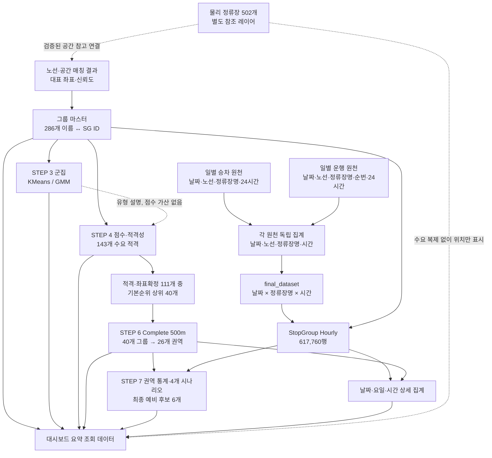

# 미추홀구 I-MOD 후보 권역 프로젝트: 데이터 구조 및 대시보드 설계 분석

작성일: 2026-10-13  
분석 범위: 현재 프로젝트 폴더의 CSV, Jupyter Notebook, Markdown 문서 및 산출물 목록  
작업 범위: 파일 읽기와 데이터 검증, 본 보고서 작성. 웹 개발·모델 재학습·기존 코드 및 데이터 수정은 수행하지 않았다.

## 1. 핵심 결론

이 프로젝트는 **2026년 4~6월 버스 승차·운행 자료를 정류장명 기준으로 집계한 286개 분석 단위**에서 출발하여, 수요 적격성·상대 점수·공간적 인접성·시나리오 반복 선정을 통해 **6개 I-MOD 예비 검토 후보**를 탐색한 연구다.

대시보드의 주 데이터 단위는 **물리 정류장 ID가 아니라 `station_name` 및 이에 대응하는 `stop_group_id`**여야 한다. 물리 정류장 지도는 별도 참조 레이어로 두고, 그룹의 승차량을 각 물리 정류장에 복제해서는 안 된다.

특히 다음 사항을 구현 전제로 삼아야 한다.

1. 286개 정류장명 그룹과 원본의 502개 물리 정류장은 서로 다른 모집단·단위다.
2. 286개 그룹 중 대표 좌표가 있는 것은 249개이며, 37개는 지도 위치가 미확정이다.
3. 최종 권역은 STEP 6의 Complete Linkage 500m 결과인 26개다. STEP 5의 DBSCAN 22개 권역과 섞지 않는다.
4. 최종 6개는 도입 확정 지역이나 효과 검증 지역이 아니라 **추가 검토 후보**다.
5. **Pareto 후보 결과는 현재 자료에 없다.** 기존 가중점수 후보를 Pareto 후보로 표기하면 안 된다.
6. STEP 7의 선정 규칙은 노트북에 명시되어 있다. 문서의 설명보다 실제 노트북과 CSV가 더 구체적이다.
7. 승객 수는 고유 이용자 수가 아니라 승차 건수 성격이며, 운행횟수 합계는 정류장별 운행 관측량이다. 권역 합계를 고유 차량 운행 대수로 해석하면 안 된다.

## 2. 프로젝트 구조와 확인 범위

| 경로 | 현재 역할 | 대시보드 관점 |
|---|---|---|
| `COLAB code/` | STEP 1, 2, 2.5, 3, 4, 5, 6, 7 노트북 8개 | 지표·모델·후보 선정 규칙 확인 |
| `dataset/` | 분석에 바로 사용할 핵심 CSV 5개 | 주 데이터 입력 |
| `dataset_raw/` | 공공데이터 원본 및 API 일별 자료 | 출처·품질·ID 관계 검증 |
| `docs/` | 연구 정리본, 자세한 정리본 및 설명 이미지 | 설명 문구 참고. 계산 정의는 코드와 대조 필요 |
| `STEP별 결과 파일/` | STEP 2~7의 중간·최종 결과 | 군집, 순위, 공간 민감도, 최종 후보 시각화 |

전체 파일은 **CSV 361개, Notebook 8개, Markdown 3개, PNG 86개, HTML 2개, JSON 1개, TXT 1개**였다. 이 수는 본 보고서를 추가하기 전 기준이다. 기존 파일 총용량은 약 203.1 MiB다.

- CSV 361개 모두에 대해 헤더와 데이터 행 수를 확인했다.
- 핵심 분석 파일은 기본키, 결측, 이름 집합, 그룹 ID 연결 및 합계를 추가 검증했다.
- 노트북은 생성 로직을 읽었으며 학습·분석 셀을 실행하지 않았다.
- HTML 지도 2개는 기존 산출물로 존재한다. 웹 애플리케이션 소스나 서비스 API는 현재 폴더에 없다.
- STEP 1 전용 결과 폴더는 없다. 확장 특징 파일은 `dataset/03_features_expanded_286.csv`에 존재한다.
- STEP 0 수집·공간 매칭·Stop Group 생성의 전체 실행 코드는 현재 노트북 목록에 없다. 전처리 결과와 문서 설명은 있으나 모든 초기 처리 규칙을 코드로 재현할 수 있는 상태는 아니다.

## 3. 데이터 단위와 키

### 3.1 세 계층을 구분해야 한다

| 계층 | 대표 키 | 크기 | 의미 |
|---|---|---:|---|
| 물리 정류장 | 원본 `station_id` | 502개 | 실제 위치를 가진 정류장 레코드 |
| 정류장명 분석 그룹 | `station_name`, `stop_group_id` | 286개 | 같은 이름의 승차·운행 통계를 합친 분석 단위 |
| 후보 공간 평가 단위 | STEP 6의 `zone_id` | 26개 | 후보 40개 그룹을 Complete Linkage 500m로 묶은 결과 |

물리 정류장 원본에는 **307개 정류장명**이 있다. 분석 그룹 286개 중 284개 이름이 원본과 일치하며, 2개는 불일치한다. 따라서 원본에만 존재하는 이름도 23개다. “미추홀구 모든 물리 정류장을 빠짐없이 분석했다”는 표현은 피해야 한다.

확인된 관계:

- 특징 파일: `station_name` 286개 고유, `stop_group_id` 286개 고유.
- 특징·군집·시간대 파일의 정류장명 집합은 동일하다.
- 특징과 군집 파일의 `(station_name, stop_group_id)` 286쌍이 모두 일치한다.
- 최종 권역 할당 파일의 40쌍도 특징 파일과 모두 일치한다.
- `station_id`는 특징 파일에서 136개만 값이 있고, 150개는 결측이다. 이를 286개 분석 그룹의 기본키로 사용할 수 없다.

### 3.2 공간 매칭 상태

| 상태 | 그룹 수 | 좌표 사용 | 해석 |
|---|---:|---|---|
| `single_stop` / `high` | 136 | 대표 좌표 사용 가능 | 이름에 물리 정류장 ID 하나가 매칭 |
| `nearby_stop_group` / `medium` | 113 | 대표 좌표 사용 가능 | 같은 이름의 인접 정류장 여러 개를 대표 |
| `spatially_split_ambiguous` / `unresolved` | 35 | 지도 확정 표시 보류 | 같은 이름이 떨어진 복수 물리 그룹에 대응 |
| `unmatched_name` / `unresolved` | 2 | 지도 확정 표시 보류 | 이름 매칭 실패 |
| 합계 | 286 | 249개 위치 확정, 37개 미확정 | 분석 수치 자체는 286개 모두 존재 |

복수 물리 정류장 ID에 대응하는 이름은 148개이며, 그중 113개는 인접 그룹, 35개는 공간 분리 그룹이다.

지도에서 사용할 좌표는 **`representative_latitude`, `representative_longitude`**다. 일반 `latitude`, `longitude`는 단일 ID가 매칭된 136개에만 존재한다. 일반 좌표만 사용하면 지도에 표시 가능한 인접 그룹 113개를 추가로 누락시키게 된다.

대표 좌표는 분석 그룹의 대표점이다. 정확한 탑승 위치, 정류장 시설 위치 또는 서비스 권역 경계를 뜻하지 않는다.

### 3.3 ID 체계는 서로 다르다

| 자료 | 예시 필드·값 | 주의점 |
|---|---|---|
| 물리 정류장 원본 | `station_id=ICB163000019` | 접두어 포함 문자열 ID |
| 노선별 정류장 원본 | `정류소아이디=168000099` | 자체 정류소 ID |
| 노선별 정류장 원본 | `아이에스씨아이디=2800727` | 정류소아이디와 별도 체계 |
| API 노선·정류장 | `sttn_id=2802621` | 위 두 ID와 이름만 보고 동일하다고 가정 금지 |
| API 노선 | `rte_id=28001001` | 원본 `노선아이디`와 별도 체계 |
| 분석 그룹 | `stop_group_id=SG001` | 프로젝트 내부 분석 키 |
| 최종 공간 단위 | `zone_id=Z01` | 특정 분석 실행의 권역 키 |

실제 확인 결과:

- 물리 정류장 ID에서 `ICB`를 제거한 값은 노선 원본의 `정류소아이디`와 502개 중 2개만 일치했다. **접두어 제거만으로 결합하면 안 된다.**
- 5월 1일 API 목록의 고유 `sttn_id` 505개 중 노선 원본 `정류소아이디`와 직접 일치한 것은 0개였다.
- 같은 API ID 중 `아이에스씨아이디`와 일치한 것은 488개였다. 이는 매핑 후보 관계일 뿐이며, 나머지 17개와 중복·시점 차이를 확인해야 한다.
- 물리 정류장의 `station_no`는 502행에 고유 500개다. 옹진군청의 `37019`, `37020`이 각각 두 ID에 대응한다. **정류소번호도 무조건 고유키가 아니다.**

숫자처럼 보이는 ID와 정류소번호, 노선번호는 문자열로 보존하는 편이 안전하다. 확정된 원천 간 매핑표 없이 이름·번호·ID를 상호 대체하지 않는다.

## 4. 핵심 CSV와 주요 컬럼의 의미

전체 361개 CSV의 정확한 행 수·컬럼은 보고서 뒤의 자동 집계 부록에 있다. 여기서는 대시보드 개발에서 우선 이해해야 하는 파일을 설명한다.

### 4.1 `dataset/`의 5개 파일

| 파일 | 행 수 | 1행의 단위 | 주요 역할 |
|---|---:|---|---|
| `01_StopGroup_Features_With_Routes_2026Q2.csv` | 286 | 정류장명 그룹 | 수요·공급·공간·노선 기초 특징 |
| `02_station_assignments_286.csv` | 286 | 정류장명 그룹 | 최종 해석용 K-means·GMM 레이블 |
| `03_features_expanded_286.csv` | 286 | 정류장명 그룹 | 기초 특징 + 평일·주말 특징. 주 마스터로 권장 |
| `04_StopGroup_Hourly_2026Q2.csv` | 617,760 | 날짜 × 정류장명 그룹 × 시간 | 기간·요일·시간대 상세 조회의 원천 |
| `05_complete500_assignments.csv` | 40 | 최종 공간 후보 정류장명 그룹 | 그룹 → STEP 6 권역 연결 |

`dataset/02_station_assignments_286.csv`와 STEP 3의 같은 이름 파일은 SHA-256이 동일하다. `dataset/05_complete500_assignments.csv`와 STEP 6의 같은 이름 파일도 SHA-256이 동일하다. 두 사본을 이어 붙이지 않고 각각 하나만 선택한다.

### 4.2 특징 컬럼 사전

| 컬럼 | 단위·의미 | 해석상 주의 |
|---|---|---|
| `station_name` | 분석에 사용한 정류장명 | 현재 스냅샷의 결합 키. 물리 정류장 하나를 의미하지 않음 |
| `stop_group_id` | `SG...` 내부 그룹 ID | 현재 파일 간 이름과 1:1. 다음 분석 실행에도 유지되는지는 별도 보장 필요 |
| `observed_days` | 관측일 수, 모두 90 | 91일로 나누지 않음 |
| `observed_hours` | 날짜·시간 레코드 수, 모두 2,160 | 실제 운행한 시간 수가 아님 |
| `avg_daily_passengers` | 일평균 승차량 | 고유 이용자 수나 I-MOD 수요가 아님 |
| `avg_daily_operations` | 일평균 정류장 그룹 운행 관측량 | 고유 차량 대수·노선 운행 횟수와 구분 |
| `passengers_per_operation` | 승차량 ÷ 운행횟수 | 차량 재차인원·혼잡률·좌석점유율이 아님 |
| `demand_cv_hour_profile` | 시간대별 평균 수요의 변동계수 | 일별 변동성 및 월별 CV와 구분 |
| `temporal_mismatch` | 24시간 수요·운행 분포 차이 | 수송능력 부족률이 아님 |
| `low_supply_hour_ratio_lt1avg` | 시간대별 일평균 운행이 1회 미만인 시간의 비율 | 야간 미운행도 포함 가능 |
| `positive_demand_zero_supply_record_count` | 승차 양수·운행 0인 시간 레코드 수 | 실제 미충족 수요로 단정하지 않음 |
| `station_id`, `station_no` | 단일 매칭 정류장의 ID·번호 | 복수 ID 그룹에는 결측 |
| `latitude`, `longitude`, `admin_dong` | 단일 매칭 정류장의 위치·행정동 | 그룹 대표 좌표와 구분 |
| `spatial_match_status` | 원래 이름-ID 매칭 상태 | 단일·복수·불일치 구분 |
| `station_name_id_count` | 같은 이름에 매칭된 물리 ID 수 | 수요를 이 수만큼 복제하지 않음 |
| `spatial_group_status` | 단일·인접·공간분리·불일치 | 지도 표시 근거 |
| `physical_cluster_count` | 같은 이름의 물리 공간 그룹 수 | K-means 군집 수와 다름 |
| `representative_latitude`, `representative_longitude` | 분석 그룹 대표점 | 지도 주 좌표 |
| `representative_admin_dong` | 대표 행정동 | 52개 결측. 좌표 결측 37개와 일치하지 않음 |
| `physical_station_count` | 그룹 관련 물리 정류장 수 | 최종 권역의 `n_stops`와 다름 |
| `spatial_confidence` | `high`, `medium`, `unresolved` | 위치 표현에 반영 |
| `unique_route_count` | 매칭된 고유 노선 ID 수 | 2026-06-30 기준. 2개 결측 |
| `matched_route_stop_rows` | 노선 원본 매칭 행 수 | 고유 노선 수가 아님 |
| `matched_physical_stops` | 노선 자료와 매칭된 물리 정류장 수 | 집계 행 수와 구분 |
| `route_names`, `route_ids` | 노선 이름·ID 목록 문자열 | 노선명에 변형된 문자열 존재. 두 목록의 위치별 대응을 가정하지 않음 |
| `route_count_status` | 노선 매칭 상태 | 284개 `matched_20260630`, 2개 `not_matched` |
| `weekday_daily_mean` | 월~금 일평균 승차량 | 법정 공휴일 분류를 별도로 적용한 값이 아님 |
| `weekend_daily_mean` | 토·일 일평균 승차량 | 평일과 일수 차이를 보정한 평균 |
| `weekend_weekday_demand_ratio` | 주말 평균 ÷ 평일 평균 | 전체 군집 입력 특징 중 하나 |

### 4.3 점수·후보·권역 컬럼

| 필드군 | 의미 |
|---|---|
| `KMeans_FULL8`, `GMM_ROUTE6` | STEP 3의 최종 해석용 모델 레이블 |
| `eligible_median`, `eligible_p25` | 전체 286개 수요 분포의 중앙값·25분위 적격성 |
| `percentile_demand/mismatch/low_supply/intensity` | 전체 286개에서 산정한 0~100 백분위 점수 |
| `score_base/demand_priority/time_priority/balanced` | STEP 4 정류장 그룹 가중점수 |
| `rank_base/demand_priority/time_priority/balanced` | STEP 4 전체 286개 기준 순위 |
| `eligible_rank` | 수요 적격 143개 안에서의 기본점수 순위 |
| `scenario_rank` | 해당 수요 기준·가중치 조합 안에서의 순위 |
| `spatial_valid` | 대표 좌표 범위와 공간 신뢰도 조건 통과 여부 |
| `rank_*_top20`, `top20_frequency` | 수요 적격이면서 전체 순위 20위 이내인 시나리오 수 |
| `candidate_tier` | 반복 횟수에 따른 후보 설명 구분 |
| `component` | STEP 5 DBSCAN 내부 레이블 |
| `cluster_number` | STEP 6 공간 군집 내부 레이블. K-means와 무관 |
| `zone_id` | 해당 공간 분석 실행의 권역 키 |
| `zone_type`, `is_multistop`, STEP 7 `type` | 분석 그룹 여러 개를 포함하는지 여부 |
| `n_stop_groups`, STEP 7 `n_stops` | 권역에 포함된 정류장명 분석 그룹 수. 물리 정류장 수가 아님 |
| `top6_frequency` | STEP 7 네 시나리오 중 상위 6위 포함 횟수 |
| `provisional_review_order` | 최종 예비 검토 순서 |

## 5. STEP별 분석 흐름과 후보 선정 규칙

### 5.1 전체 흐름

| 단계 | 입력·작업 | 결과 | 다음 단계에서의 역할 |
|---|---|---|---|
| STEP 0 | API 승차·운행 독립 집계, 이름 기준 결합, 공간·노선 매칭 | 286개 그룹, 617,760 시간 레코드 | 분석 단위와 품질 조건 확정 |
| STEP 1 | EDA, 상관분석, 평일·주말 특징 추가 | 확장 특징 286행 | 모델 입력 |
| STEP 2 | 변수 조합·로그·이상치·K 비교 | K-means 96개 실험 | 초기 분리도와 극소 군집 문제 확인 |
| STEP 2.5 | 변수 4종·스케일러·로그·PCA·알고리즘·K 비교 | 384개 실험, 안정성 비교 | 최종 해석 모델 후보 결정 |
| STEP 3 | K-means/GMM 해석, 월별·시간별 검증 | 군집 할당 286행, 월별 858행 | 유형 설명. 후보 점수 가산에 사용하지 않음 |
| STEP 4 | 수요 적격성 + 백분위 가중점수 | 전체 286개 점수, 기본 적격 143개 | 후보 순위 |
| STEP 5 | 적격·좌표확정 그룹의 기본순위 상위 40개를 공간 묶음 | DBSCAN 500m 기준 22개 단위 | 연쇄 연결 및 거리 민감도 확인 |
| STEP 6 | 동일 40개에서 DBSCAN/Complete Linkage 비교 | Complete 500m의 26개 단위 | 최종 공간 할당 |
| STEP 7 | 26개 단위의 운영 지표·4개 시나리오 평가 | 예비 검토 순서와 최종 6개 | 대시보드 주 결과 |

집합의 크기는 **286개 전체 → 수요 적격 143개 → 그중 좌표확정 111개 → 기본순위 상위 40개 → 공간 평가 단위 26개 → 예비 검토 6개**다. 전체 좌표확정 249개와 적격·좌표확정 111개를 혼동하지 않는다.

### 5.2 K-means 군집

STEP 3의 기준 모델은 8개 특징, 결측 중앙값 대체, StandardScaler, PCA 설명분산 90%, K=3이다. 최종 PCA 차원은 5이며 실루엣은 약 0.3530이다. 비교 GMM은 운행횟수를 노선 수로 대체한 6변수 구성이며 PCA 5차원, 실루엣 약 0.3275다.

| K-means 레이블 | 그룹 수 | 해석 | 일평균 승차량 중앙값(약) |
|---|---:|---|---:|
| 0 | 196 | 일반 수요·공급형 | 309.6 |
| 1 | 65 | 저수요·저공급·시간 불일치형 | 51.0 |
| 2 | 25 | 대규모 수요·공급형 | 2,011.8 |

GMM의 레이블별 수는 0: 56개, 1: 208개, 2: 22개다. 모델이 다르면 같은 숫자 레이블도 같은 집단을 뜻하지 않는다.

- 군집은 정류장 특성 설명용이다. 군집 1을 곧바로 I-MOD 우선 후보로 해석하지 않는다.
- STEP 2의 `cluster`, STEP 2.5의 여러 `labels_*.csv`, STEP 3의 `KMeans_FULL8`은 모델 버전이 다를 수 있다. 최종 화면은 STEP 3 할당으로 통일한다.
- 월별 3변수 군집의 ARI는 보조검증이다. 최종 8변수 모델의 월별 재현성으로 표기하지 않는다.
- STEP 2.5의 PCA 그림 생성 셀은 로그 변환을 적용한 별도 투영을 사용한다. 해당 PNG를 최종 STEP 3 모델의 좌표로 간주하면 안 된다. 최종 모델의 개별 PC1·PC2 좌표 CSV는 없다.

### 5.3 STEP 4: 적격성 및 상대 점수

기본 수요 기준은 일평균 승차량 **266.811111 이상**, 즉 전체 중앙값 이상인 143개다. 25분위 기준은 약 77.3이며 214개가 통과한다.

각 지표는 전체 286개에서 `rank(pct=True, method='average') × 100`으로 백분위화한다.

| 시나리오 | 수요 | 시간 불일치 | 저공급 시간 비율 | 운행당 승차량 |
|---|---:|---:|---:|---:|
| base | 0.25 | 0.35 | 0.20 | 0.20 |
| demand_priority | 0.45 | 0.25 | 0.15 | 0.15 |
| time_priority | 0.15 | 0.50 | 0.25 | 0.10 |
| balanced | 0.25 | 0.25 | 0.25 | 0.25 |

3개 수요 기준 × 4개 가중치 = 12개 시나리오를 비교한다. `06_scenario_rankings.csv`는 2,572행이며, `(286 + 214 + 143) × 4`와 일치한다.

**순위 모집단의 차이:** STEP 4의 기본 적격 상위 20개와 STEP 5의 `rank_base_top20`은 다르다. STEP 5는 **전체 286개 순위 ≤20이고 수요 적격**인지를 검사한다. 실제 이 조건을 충족한 기본 시나리오 그룹은 11개다. 화면에 “적격군 상위 20개”로 잘못 표시하지 않아야 한다.

### 5.4 STEP 5~6: 공간 권역화

STEP 5는 수요 적격·좌표확정 그룹을 기본순위로 정렬하여 상위 20/40/60개, 거리 300/500/800m의 9개 시나리오를 비교한다. DBSCAN은 `min_samples=1`이므로 단독 후보도 남는다.

기본 설정 40개·500m에서는 8개 다중 그룹 권역과 14개 단독 후보, 총 22개 단위가 나온다. 그러나 DBSCAN의 연쇄 연결 때문에 500m 설정에서도 권역 최대 지름이 1,254.2m에 이른다.

STEP 6은 같은 40개를 대상으로 공간 방법을 비교한다.

| 방법 | 거리 기준 | 평가 단위 | 다중 | 단독 | 최대 구성 그룹 수 | 최대 지름(m) |
|---|---:|---:|---:|---:|---:|---:|
| DBSCAN | 300m | 34 | 5 | 29 | 3 | 473.7 |
| DBSCAN | 500m | 22 | 8 | 14 | 7 | 1,254.2 |
| DBSCAN | 800m | 6 | 4 | 2 | 28 | 4,583.4 |
| Complete | 300m | 35 | 5 | 30 | 2 | 286.2 |
| Complete | 500m | 26 | 12 | 14 | 3 | 492.3 |
| Complete | 800m | 18 | 13 | 5 | 5 | 693.2 |

최종 공간 기준은 **Complete Linkage 500m**다. 이는 대표점 사이의 그룹 내 최대 거리 제약이며, 중심점으로부터 반경 500m 서비스 구역이라는 뜻이 아니다. 실제 보행거리나 도로 주행거리도 아니다.

`Z01~Z26`은 권역 대표점의 평균 위도·경도 순서로 부여한 ID다. 숫자가 작다고 우선순위가 높은 것이 아니다. STEP 5 ID는 `R500_N40_C00` 등의 다른 체계이므로, 최종 결과에 STEP 5 프로필을 붙이지 않는다.

300/500/800m Complete 조건에 공통으로 함께 묶인 안정 쌍은 5개다. STEP 6 검토 구분은 `stable_repeat_review` 3개, `additional_spatial_review` 9개, `high_score_singleton_review` 4개, `singleton_monitor` 10개다. 이 구분은 STEP 7의 최종 순서와 별도 지표다.

### 5.5 STEP 7: 최종 선정은 재현 가능한 규칙이 있다

26개 공간 단위에서 다음 지표를 다시 백분위화한다.

- 수요: `daily_demand`
- 시간 분포 차이: `positive_gap_sum`
- 저공급: `median_low_supply`
- 반복 선정: `repeat_count` — STEP 5에서 2회 이상 반복 선정된 구성 그룹 수
- 월별 안정성: `monthly_min_max_ratio`

| 시나리오 | 수요 | 시간 분포 차이 | 저공급 | 반복 선정 | 월별 안정성 |
|---|---:|---:|---:|---:|---:|
| balanced | 0.25 | 0.30 | 0.20 | 0.15 | 0.10 |
| demand_priority | 0.45 | 0.20 | 0.15 | 0.10 | 0.10 |
| time_priority | 0.15 | 0.45 | 0.20 | 0.10 | 0.10 |
| robustness_priority | 0.20 | 0.25 | 0.10 | 0.25 | 0.20 |

`p_service_intensity`도 저장되지만, 위 네 시나리오 가중합에는 사용되지 않는다. STEP 4와 STEP 7의 `score_balanced` 등은 같은 이름이어도 **대상 모집단·입력 지표·가중치가 다르므로 별도 필드로 관리**해야 한다.

최종 정렬 규칙은 다음과 같다.

1. `top6_frequency` 내림차순
2. `median_rank` 오름차순
3. `score_balanced` 내림차순
4. 정렬된 첫 6개 선택

`mean_rank`는 저장되지만 실제 정렬에는 사용하지 않는다. 노트북 주석의 평균순위 언급보다 실제 정렬 코드를 기준으로 설명해야 한다. CSV의 현재 순서가 이 규칙과 일치함을 확인했다.

| 순서 | 권역 ID | 구성 정류장명 그룹 | 유형 | 일평균 승차량 | 상위 6위 반복 | 상대 격차 최대 시간 |
|---:|---|---|---|---:|---:|---:|
| 1 | Z06 | 롯데백화점(인천터미널) | 단독 | 10,306.5 | 4/4 | 18시 |
| 2 | Z23 | 남중학교, 인화여고 | 다중 | 1,042.7 | 4/4 | 16시 |
| 3 | Z10 | 주안7동행정복지센터, 신기.남부종합시장(진흥사거리) | 다중 | 3,791.1 | 3/4 | 15시 |
| 4 | Z22 | 주안역, 주안역환승정류장 | 다중 | 11,853.1 | 2/4 | 18시 |
| 5 | Z01 | 문학경기장(야구장) | 단독 | 309.5 | 2/4 | 21시 |
| 6 | Z02 | 문학초등학교 | 단독 | 925.8 | 2/4 | 07시 |

여기서 단독은 **정류장명 분석 그룹 하나**라는 뜻이다. 물리 정류장 하나라는 의미는 아니다. `peak_hour`는 승차량 자체의 최대 시간이 아니라 **수요 비중−운행 비중이 가장 큰 시간**이다.

### 5.6 Pareto 후보와의 관계

현재 CSV 컬럼, 노트북 소스, Markdown에서 Pareto/파레토 후보 계산이나 결과를 확인하지 못했다. 따라서 현재 관계는 다음과 같다.

> 정류장명 특징 → 군집 유형 설명 + 별도 가중점수 → 공간 후보 40개 → 26개 공간 단위 → 시나리오 기반 6개 예비 후보

Pareto 전선, 지배 관계, Pareto rank 또는 membership은 이 흐름에 포함되어 있지 않다. 이를 구현하려면 목적함수, 최대화·최소화 방향, 적격 모집단, 결측 처리, 지배 판정 및 동점 규칙을 정한 별도 분석이 필요하다. 기존 원자료로 산출할 수는 있지만 기존 연구 결과인 것처럼 제공해서는 안 된다.

## 6. 시간대별 승차·운행 데이터 구조와 지표

### 6.1 원천과 가공본

| 자료 | 구조 | 주의점 |
|---|---|---|
| `passenger_daily/` | 날짜·노선번호·정류장명 및 24개 시간별 승차 컬럼 | `busStopSeq` 전부 결측. 같은 날짜·노선·이름에 여러 행 존재 |
| `operation_daily/` | 날짜·노선번호·정류장명·순번 및 24개 시간별 운행 컬럼 | 순번은 있지만 승차 자료와 순번으로 1:1 결합할 수 없음 |
| `final_dataset.csv` | 날짜 × 정류장명 × 시간의 long format | 617,760행, 공간·그룹 ID 없음 |
| `04_StopGroup_Hourly_2026Q2.csv` | 위 구조 + 공간·그룹·품질 정보 | 617,760행, 대시보드 상세 조회의 주 원천 |

`date`는 `YYYYMMDD`, `hour`는 0~23이다. 시간 자료는 2026-04-01~2026-06-30 중 6월 11일을 제외한 90일로 구성된다.

검증 결과:

- 286 × 90 × 24 = **617,760행**.
- `(date, station_name, hour)` 중복 0건.
- 각 그룹은 정확히 2,160행.
- 승차·운행 값 결측 없음.
- 총승차량 **13,516,847**, 총 정류장 운행 관측량 **12,262,533**.
- 원본 `final_dataset.csv`와 가공 시간대 파일의 승차·운행 값이 키별로 정확히 일치한다.
- 운행당 승차 비율 차이는 최대 약 4.97×10⁻⁹로 저장 정밀도 수준이다.
- 운행당 승차 비율 결측 **117,224행**. 운행 0의 비율은 정의되지 않는다.
- 승차 양수·운행 0은 **3,143행**. 품질 플래그로 표시한다.

월별 유효 일수는 4월 30일, 5월 31일, 6월 29일이다. 월 비교에는 총량과 일평균을 구분한다.

### 6.2 시각화 가능한 지표

| 지표 | 계산 또는 사용법 | 적합한 시각화 |
|---|---|---|
| 일별 승차량·운행량 | 해당 날짜의 시간값 합 | 시계열, 달력 히트맵 |
| 시간별 평균 승차량·운행량 | 선택 기간의 시간별 합 ÷ 유효 날짜 수 | 24시간 선그래프·막대 |
| 시간대 수요 비중 | 해당 시간 승차 합 ÷ 선택 기간 전체 승차 합 | 수요·공급 패턴 비교 |
| 시간대 운행 비중 | 해당 시간 운행 합 ÷ 선택 기간 전체 운행 합 | 수요 비중과 같은 축 비교 |
| 상대 격차 | 수요 비중−운행 비중 | 0 중심 양·음 막대, 히트맵 |
| 운행당 승차량 | 승차 합 ÷ 운행 합 | 이용 강도 비교 |
| 평일·주말 차이 | 날짜를 월~금/토·일로 나누고 각각 평균 | 요일·시간대 히트맵 |
| 월별 일평균 | 월 총량 ÷ 월 유효 관측일 | 월별 추세 |
| 품질 기록 수 | 승차>0 및 운행=0 레코드 개수 | 품질 배지·상세 표 |

집계 비율은 **비율의 단순 평균이 아니라 합계의 비율**로 계산한다. 기간 선택 시 분모는 선택 기간의 실제 관측일이다. 누락된 6월 11일을 0승차·0운행일로 채우지 않는다.

STEP 3·4·5·7의 시간별 프로필에 저장된 `passenger_count`, `boardings`, `operation_count`, `operations`는 대체로 **90일 누적 합계**다. 일평균으로 보여주려면 90으로 나누고 화면 단위를 명시해야 한다. 반면 `demand_share`, `supply_share`, `operation_share`는 0~1 비중이다. 비중 차이를 100배하면 단위는 퍼센트포인트(%p)다.

### 6.3 불일치와 CV 정의

현재 그룹별 `temporal_mismatch`는 시간별 수요 비중과 운행 비중의 절대차 합의 절반으로 재계산한 값과 최대 약 4.99×10⁻⁷ 차이로 일치했다. 이는 **데이터 값으로 확인한 수치적 일치**이며 초기 특징 생성 코드가 보존되어 있다는 뜻은 아니다.

STEP 7의 `positive_gap_sum`은 권역으로 먼저 합산한 시간대 비중의 양의 차이를 합한다. 구성 그룹별 `temporal_mismatch`의 평균·중앙값과는 계산 순서가 다르다. `median_mismatch`와 `positive_gap_sum`을 동일 지표로 덮어쓰지 않는다.

월별 CV에도 구현 차이가 있다.

- STEP 4와 STEP 5: 표준편차 `ddof=0`.
- STEP 7: pandas 기본 표본 표준편차 `ddof=1`.
- STEP 7 시나리오의 월별 안정성 입력은 CV가 아니라 `monthly_min_max_ratio`다.

따라서 STEP 간 CV를 비교하거나 화면에서 재계산할 때 산식을 명시해야 한다.

## 7. 대시보드용 핵심 파일 목록

| 우선도 | 파일 | 활용 |
|---|---|---|
| 필수 | `dataset/03_features_expanded_286.csv` | 그룹 마스터, 지표, 대표 좌표, 공간 신뢰도 |
| 필수 | `dataset/02_station_assignments_286.csv` | K-means·GMM 설명 레이블 |
| 필수 | `STEP별 결과 파일/Michuhol_IMOD_STEP4_Candidate_Screening_Results/02_all_286_with_scores.csv` | 전체 그룹 후보 점수·적격성 |
| 필수 | `STEP별 결과 파일/Michuhol_IMOD_STEP5_Spatial_Zones_Results/01_all_286_candidate_flags.csv` | 전체 그룹의 공간 유효성·반복 선정 |
| 필수 | `dataset/05_complete500_assignments.csv` | 최종 그룹→권역 연결 |
| 필수 | `STEP별 결과 파일/Michuhol_IMOD_STEP6_Spatial_Stability_Results/06_complete500_zone_profiles.csv` | 26개 권역 중심점·지름·구성 이름 |
| 필수 | `STEP별 결과 파일/Michuhol_IMOD_STEP7_Operational_Screening_Results/04_all_26_zones_scenario_scores.csv` | 26개 권역 평가·최종 검토 순서 |
| 필수 | `STEP별 결과 파일/Michuhol_IMOD_STEP7_Operational_Screening_Results/05_provisional_top6_review.csv` | 최종 6개 강조 |
| 필수 | `STEP별 결과 파일/Michuhol_IMOD_STEP7_Operational_Screening_Results/02_monthly_zone_profiles.csv` | 최종 권역 월별 비교 |
| 필수 | `STEP별 결과 파일/Michuhol_IMOD_STEP7_Operational_Screening_Results/03_hourly_zone_shares.csv` | 최종 권역 시간대 패턴 |
| 상세 탐색 | `dataset/04_StopGroup_Hourly_2026Q2.csv` | 날짜·요일·임의 기간별 조회 |
| 군집 설명 | STEP 3의 `03_cluster_profiles_*.csv`, `06_monthly_stop_features_286x3.csv`, `13_hourly_cluster_patterns_*.csv` | 군집 특성·월별·시간대 비교 |
| 민감도 설명 | STEP 4의 `06_scenario_rankings.csv`, STEP 6의 `01_algorithm_radius_comparison.csv`, `04_stable_core_pairs.csv` | 순위 변화·거리 민감도·안정 쌍 |
| 참조 레이어 | `dataset_raw/3. 미추홀구 버스 정류장.csv` | 물리 정류장 지도. 그룹 수요를 이 레이어에 배분하지 않음 |

확장 특징·군집·점수 파일은 중복 지표를 여러 개 포함한다. 구현 시 모든 파일을 무차별 병합하여 `_x`, `_y` 컬럼을 만들기보다, 각 파일에서 필요한 키와 필드만 선택하고 중복 지표의 기준 파일을 정한다.

권장 기준은 그룹 특징=`03_features_expanded_286`, 군집=`02_station_assignments_286`, 그룹 점수=STEP 4, 최종 공간 할당=STEP 6, 권역 점수=STEP 7이다.

시간대 CSV는 약 **100.92 MiB**다. 첫 화면에서 브라우저가 전체 파일을 내려받고 파싱하는 구조는 피하는 편이 좋다. 실제 구현 단계에서는 요약 데이터로 초기 화면을 구성하고 시간대 자료를 그룹·권역·월 단위로 나누어 조회하도록 준비할 수 있다. 본 작업에서는 변환 파일이나 API를 만들지 않았다.

## 8. 데이터 결합 규칙

### 8.1 권장 관계

| 왼쪽 | 오른쪽 | 키 | 관계 | 확인 사항 |
|---|---|---|---|---|
| 그룹 특징 286행 | 군집 286행 | `station_name` 또는 검증된 `stop_group_id` | 1:1 | 두 키의 대응 일치 확인 |
| 그룹 특징 | STEP 4 점수 | `station_name` | 1:1 | 컬럼 중복 선택 제거 |
| 시간대 617,760행 | 그룹 마스터 | `station_name` | N:1 | 결합 후 행 수·총량 유지 |
| 최종 할당 40행 | 그룹 마스터 | `station_name` | 1:1 부분집합 | 40개 모두 매칭 |
| 후보 시간대 자료 | 최종 할당 40행 | `station_name` | N:1 | 후보 40개만 필터링 시 86,400행 |
| 최종 할당 40행 | STEP 6·7 권역 표 | `zone_id` | N:1 | 동일한 Complete 500m 버전 사용 |
| STEP 7 월별 표 | 권역 마스터 | `zone_id` | N:1 | `(zone_id, month)` 고유 |
| STEP 7 시간별 표 | 권역 마스터 | `zone_id` | N:1 | `(zone_id, hour)` 고유 |
| 물리 정류장 원본 | 그룹 마스터 | 이름 기반 참고 연결 | N:1 또는 검증 필요 | 수요 복제 금지, 미확정 그룹 분리 |

전체 286개 그룹에 최종 할당을 붙일 때는 왼쪽 결합으로 286개를 유지한다. `zone_id`가 없는 246개는 “최종 공간 후보 40개에 포함되지 않음”이며, 반드시 데이터 오류인 것은 아니다.

### 8.2 금지하거나 검증해야 하는 결합

- 정류장명별 승차량을 같은 이름의 모든 물리 ID 행에 붙인 후 다시 합산하지 않는다.
- 승차 원천과 운행 원천을 날짜·노선번호·정류장명만으로 곧바로 결합하지 않는다. 일별 전체 자료 각각에서 이 키의 중복 초과 행이 60,120개다. 먼저 각 자료를 동일 단위로 독립 집계해야 한다.
- 승차 원천의 `busStopSeq`는 182,812행 전부 결측이다. 운행 자료의 순번으로 방향별 승차량을 복원할 수 없다.
- `station_no`나 `정류소번호`를 검증 없이 고유키로 취급하지 않는다.
- 이름의 괄호, 점, 출구번호, 행정복지센터 명칭을 임의 삭제하지 않는다. 서로 다른 분석 단위가 합쳐질 수 있다.
- STEP 5의 권역 통계와 STEP 6의 `Z..` 할당을 섞지 않는다.
- 시나리오 전체 membership 360행을 하나의 확정 할당표처럼 시간대 자료에 결합하지 않는다. `pool`, `radius_m` 조건 하나를 먼저 선택해야 한다.
- 권역의 노선 수는 구성 그룹의 노선 수 합이 아니다. 고유 노선 ID의 합집합으로 별도 계산해야 한다.
- `max_routes_at_stop`, `median_routes_at_stop`는 권역 고유 노선 수가 아니다.
- `names`, `station_names`는 표시용 목록이다. 구분자로 문자열을 쪼개 권역 연결을 만들기보다 정식 할당 CSV를 사용한다.
- 행정동 코드도 자료별 체계가 다르다. API의 법정동 성격 필드와 원본 행정동을 같은 코드로 간주하지 않는다.

## 9. 누락·품질 문제 및 문서와 코드의 차이

### 9.1 수집 범위와 날짜 누락

| 항목 | 확인 결과 | 처리 방향 |
|---|---|---|
| 2026-06-11 승차 파일 | 없음 | 무관측일로 유지 |
| 2026-06-11 운행 파일 | 헤더만 있고 데이터 0행 | 0운행일과 구분 |
| 2026-04-29~30 노선 목록 | 파일 없음 | 그날의 노선 구성을 확정하지 않음 |
| 4/10, 4/25, 5/7, 6/5 승차·운행 | 각 2,015행. 일반 날짜는 2,032행 | 17행 차이의 의미는 원천 추가 검증 필요 |
| 승차·운행 지역 필터 | 5월 1일 노선·정류장 목록 기준 | 분기 중 신규·변경 노선·정류장 반영 범위 제한 |
| 공통 노선·정류장 목록 | 3시점 공통 2,074행, 89일 공통 2,072행 | README상 최종 통합본에 해당 필터 미적용 |

문서는 6월 11일을 의도적으로 제외했다고 설명한다. 현재 파일 상태에서는 승차 파일 부재와 운행 파일 무내용을 확인할 수 있다. 제외 이유와 원천 API의 사실 정확성까지 파일만으로 입증한 것은 아니다.

### 9.2 공간·노선 결측과 변형

- 위치 미확정 37개 중 이름 불일치 2개는 **숭의역(2번출구)**, **시민공원.문화창작지대**다. 이 둘은 노선 수·노선 목록도 결측이다.
- `representative_admin_dong`은 52개 결측이다. 대표 좌표가 있어도 행정동 필터에 들어가지 못하는 그룹이 있으므로 “미확정” 범주가 필요하다.
- 노선 원본과 가공 `route_names`에 `01월 28일`, `05월 01일`, `Jan-65`, `03-02` 등 변형이 의심되는 노선명이 존재한다.
- `월` 또는 `Jan-` 문자열이 포함된 그룹만 79개다. 이 수는 모든 변형을 확정 검출한 수가 아니라 해당 패턴 탐지 수다.
- 날짜형 변형의 원인과 원래 노선명은 이 자료만으로 확정하지 않았다. 노선 ID 기반 공식 이름 매핑을 확인한 뒤 표시명을 정리해야 한다. `01월 28일`을 임의로 `28-1`로 바꾸는 식의 복원은 하지 않는다.
- 노선 수는 ID 기반이므로 이름 문자열 변형과 구분해서 평가한다. 이름 변형만으로 기존 고유 노선 수 전체가 틀렸다고 결론 내릴 수는 없다.
- 노드현황의 `X좌표`, `Y좌표`는 대표 위·경도와 같은 수치 체계가 아니다. 현재 자료에 명확한 좌표계 정의가 없어 그대로 지도 위·경도로 사용할 수 없다.
- 원본 2번·4번 CSV는 CP949, 확인한 나머지 주요 CSV는 UTF-8 계열로 읽힌다. 일괄 UTF-8만 강제하면 일부 원본 읽기에 실패한다.

### 9.3 재현성에 필요한 누락 자료

| 현재 없는 자료 또는 정의 | 영향 |
|---|---|
| STEP 0의 전체 수집·전처리·그룹 생성 코드 | 초기 공간 그룹 생성 거리 기준·ID 연결 절차의 완전 재현 어려움 |
| 물리 ID ↔ 그룹 ID ↔ 원천별 ID의 검증된 명시적 bridge | 방향별·물리 정류장별 수요 분배 불가 |
| Pareto 결과 및 정의 | Pareto 후보 화면은 신규 분석 필요 |
| 최종 모델의 개별 PCA 좌표·저장된 변환기·모델 파일 | 최종 모델과 일치하는 대화형 PCA 화면은 추가 산출 필요 |
| 행정경계 GeoJSON·도로망·보행망·노선 경로 geometry | 행정동 면 지도·실제 이동권역·정확한 노선선형 표시 제한 |
| OD, 실제 대기시간, 차량 재차인원·잔여 좌석 | 미충족 수요·혼잡·서비스 효과 검증 불가 |
| 호출·예약 기록, 차량·비용·운영 제약 | I-MOD 배차·운영 시뮬레이션 및 경제성 검증 불가 |
| 경기·행사 일정, 공휴일 별도 분류 | 이벤트 원인 분석 및 휴일 효과 분리 미완료 |

### 9.4 문서보다 실제 산출 로직을 우선할 부분

1. 자세한 정리본은 STEP 7의 정확한 가중치·최종 정렬 규칙이 보고서에 없다고 설명하지만, 노트북에는 명시되어 있다. 본 보고서 5.5절의 실제 규칙으로 설명할 수 있다.
2. STEP 7은 단순히 STEP 4 점수를 요약하는 데서 끝나지 않고, 26개 권역 단위 지표를 다시 백분위화해 네 가중점수를 계산한다.
3. 월별 CV의 표준편차 설정은 문서보다 코드가 구체적이며 STEP 간 차이가 있다.
4. STEP 5의 상위 20 반복 선정은 적격군 내 순위가 아닌 전체 순위 조건이다.
5. 모델 설명용 PNG의 전처리 조건이 최종 모델과 같은지 확인해야 한다. 특히 STEP 2.5 PCA 그림을 그대로 최종 모델 그림으로 사용할 수 없다.

## 10. 현재 자료로 가능한 기능과 추가 작업이 필요한 기능

### 10.1 기존 산출물로 바로 표현 가능한 기능

| 기능 | 근거 자료 | 표시 조건 |
|---|---|---|
| 최종 6개 후보 카드·비교표 | STEP 7 최종 6개 | 예비 검토 대상으로 표기 |
| 26개 평가 단위의 순위·시나리오 비교 | STEP 7 전체 점수 | 정렬 규칙과 시나리오를 설명 |
| 249개 그룹 대표점 지도 | 확장 특징 | 신뢰도 구분, 미확정 37개는 표에 유지 |
| 최종 40개 그룹과 26개 공간 단위 지도 | STEP 6 할당·프로필 | 점·연결선 중심. 실제 서비스 경계로 표현하지 않음 |
| K-means/GMM 군집 분포·특징 비교 | STEP 3 | 모델별 레이블 분리 |
| 수요×시간 불일치 등 지표 산점도 | 특징·군집·점수 | Pareto 전선으로 부르지 않음 |
| 권역별 월별·시간별 패턴 | STEP 7 월별·시간별 CSV | 누적량·평균·비중 단위 명시 |
| 그룹별 점수·적격성·시나리오 순위 | STEP 4 | 전체 순위와 적격군 순위 구분 |
| 거리·공간 방법 민감도 요약 | STEP 5·6 비교표 | 탐색 결과로 표시 |
| 데이터 품질 화면 | 결측·품질 플래그·audit CSV | 미확정·누락·운행 0 비율 분리 |

### 10.2 현재 자료의 재집계로 가능한 기능

외부 데이터나 새 모델은 필요 없지만, 현재 저장된 요약 CSV만으로 즉시 제공되는 기능은 아니다.

- 임의 날짜 범위, 평일·주말, 요일별 필터와 시간대 히트맵.
- 286개 전체 그룹의 일별·시간별 상세 프로필.
- 최종 권역의 날짜별 추세와 기간별 합계의 비율.
- 동일 권역 내 노선 ID 합집합 수. 단, 원천별 노선 ID 체계는 먼저 통일해야 한다.
- 권역 구성 그룹 연결선·최대 거리 표시. 표시용 geometry라는 설명 필요.
- 행정동별 그룹 통계. 미확정·복수 위치의 귀속 기준을 먼저 정해야 한다.

기간 필터로 수요·운행 차트를 바꾸더라도 기존 군집·점수·후보 선정은 **2026Q2 고정 분석 결과**다. 선택 기간의 새 군집·새 순위처럼 보이게 해서는 안 된다.

### 10.3 추가 분석 또는 외부 자료가 필요한 기능

| 기능 | 필요한 작업·자료 |
|---|---|
| Pareto 후보·전선 | 목적함수와 지배 규칙 설계, 신규 계산 |
| 선택 기간별 군집·후보 순위 자동 재산정 | 초기 특징 정의 확정, 모델·점수 파이프라인 재실행·버전 관리 |
| 최종 모델의 대화형 PCA | 동일 전처리·모델 조건에서 좌표 추가 산출 |
| 모든 거리 설정의 Complete 군집 지도 | 현재 CSV에는 Complete 500m 확정 할당만 있음. 다른 설정의 할당 추가 산출 필요 |
| 물리 정류장·상하행별 승차량 | 방향·정류장 ID가 포함된 수요 원천 또는 검증된 배분 근거 |
| 실제 도보 5분·10분 생활권 | 보행망·횡단보도·접근 제한 및 경로 계산 |
| 정확한 버스 노선 경로 지도 | 노선 geometry 또는 검증된 정류장 순서·좌표 매핑 |
| 실제 대기시간·차량 혼잡도 | 도착 로그·재차인원·차량 용량 |
| I-MOD 예상 대기시간 개선·차량 수·운영비 | OD·호출 수요·차량 조건·운행 시뮬레이션 |
| 문학경기장 행사 영향 검증 | 행사·경기 일정과 일별 수요 결합 |

## 11. 권장 웹 대시보드 페이지 구성

### 페이지 1. 분석 개요와 최종 후보

- 목적: 첫 화면에서 연구 질문과 현재 결론을 이해하게 한다.
- 핵심 수치: 286개 그룹, 90일, 좌표확정 249개, 공간 후보 40개, 평가 단위 26개, 예비 후보 6개.
- 최종 후보 6개 카드와 지도, 일평균 승차량·반복 선정·최대 상대 격차 시간.
- 후보를 누르면 권역 상세로 이동.
- 상단에 “2026년 2분기 관측자료 기반 I-MOD 예비 검토”라는 분석 범위를 명시.

### 페이지 2. 정류장 그룹 탐색

- 지도와 286개 그룹 표를 연동한다.
- 검색: 정류장명, 그룹 ID.
- 필터: 군집, 수요 적격성, 공간 신뢰도, 후보 포함 여부, 행정동 미확정 포함.
- 지도는 대표점 249개, 표는 286개를 유지한다.
- 상세 패널: 주요 특징, 시간 패턴, 연결 물리 정류장 수, 군집, 점수, 최종 권역 포함 여부.
- 물리 정류장은 선택 가능한 보조 레이어로 표시하며 그룹 승차량을 각 점의 수요로 복제하지 않는다.

### 페이지 3. 군집과 후보 선정 근거

- K-means 3개 유형의 구성 수·중앙값 비교.
- 수요×시간 불일치 산점도와 그룹 점수 순위.
- 수요 적격 기준, 네 가중치, 12개 시나리오의 순위 변화.
- 필요하면 GMM과의 교차표, 모델 실험·안정성 설명을 펼쳐보기로 제공.
- Pareto라는 명칭은 현재 사용하지 않는다.

### 페이지 4. 후보 권역 비교와 상세

- 26개 평가 단위 목록, 최종 6개 강조, 단독·다중 구분.
- 그룹 구성, 대표점·지름, 안정 쌍, 일평균 승차량·운행량.
- 시나리오별 순위와 상위 6위 반복 횟수.
- 월별 일평균, 24시간 수요·운행 비중, 상대 격차 막대.
- “균형 시나리오 순위”와 “최종 검토 순서”를 구분해서 제공.

### 페이지 5. 시간대·요일 탐색

- 그룹 또는 권역, 날짜 범위, 평일·주말·요일 선택.
- 일별 추세, 요일×시간 히트맵, 승차·운행 비중 비교.
- 관측일 수와 품질 레코드 수를 함께 표시.
- 기간 필터는 관측 통계를 바꾸며, 기존 후보 선정 결과는 2026Q2 기준임을 명시.

### 페이지 6. 분석 방법과 데이터 품질

- 분석 흐름, 출처와 기준일, 원천별 단위.
- 공간 미확정 37개, 노선 미매칭 2개, 날짜 누락, 승차 양수·운행 0 기록.
- 공간 방법·거리 민감도, 지표 정의, 문서·코드 차이.
- 실제 도입 효과를 검증하지 않았다는 해석 범위.

초기 구현을 작게 시작한다면 페이지 5를 그룹·권역 상세 탭으로 합치고, 페이지 3과 6을 “분석 근거”로 묶어 4개 주요 메뉴로 줄일 수 있다.

## 12. 권장 데이터 흐름도



### 권장 논리 테이블

| 논리 테이블 | 기본키 | 역할 |
|---|---|---|
| `stop_groups` | 분석 버전 + `stop_group_id` | 이름·특징·대표점·공간 신뢰도 |
| `group_clusters` | 분석 버전 + 그룹 ID + 모델 ID | 모델별 군집 |
| `group_scores` | 분석 버전 + 그룹 ID + 시나리오 | 적격성·그룹 점수·순위 |
| `group_hourly` | 분석 버전 + 그룹 ID + 날짜 + 시간 | 상세 관측 사실 |
| `zone_memberships` | 공간 버전 + 그룹 ID | 최종 권역 ID 연결 |
| `zones` | 공간 버전 + 권역 ID | 대표점·지름·구성 수 |
| `zone_scores` | 평가 버전 + 권역 ID + 시나리오 | 권역 점수·순위 |
| `zone_monthly` | 평가 버전 + 권역 ID + 월 | 월별 운영 통계 |
| `zone_hourly_profile` | 평가 버전 + 권역 ID + 시간 | 90일 누적 시간 프로필 |
| `physical_stops` | 출처 버전 + 물리 ID | 실제 위치 참조 |
| `group_physical_bridge` | 그룹 ID + 물리 ID + 매핑 버전 | 추가 검증 후 사용하는 위치 연결. 수요 배분표가 아님 |

이 테이블들은 설계 제안이며 실제 파일이나 데이터베이스로 구현하지 않았다. 현재 분석 그룹 ID와 권역 ID는 실행별로 달라질 수 있으므로 분석 버전·공간 설정을 함께 보존하는 구조가 적절하다.

## 13. 구현 전 확인할 데이터 계약

1. 그룹 마스터는 286행, 그룹 ID와 이름은 각각 고유해야 한다.
2. 시간대 원천은 키 중복이 없어야 하며 마스터 연결 후 행 수·승차 합·운행 합이 보존되어야 한다.
3. 최종 membership은 40행·40개 그룹·26개 권역이어야 한다.
4. 권역별 구성 수 합은 40이어야 하고 다중 12개·단독 14개여야 한다.
5. 월별 권역 표는 26×3=78행, 시간별 권역 표는 26×24=624행이어야 한다.
6. 최종 6개 순서와 시나리오 반복 횟수는 저장된 STEP 7 CSV와 일치해야 한다.
7. 위치 미확정 37개와 노선 결측 2개를 삭제하거나 0으로 채우지 않아야 한다.
8. 지도 대표점, 물리 정류장 점, 권역 표시를 구분해야 한다.
9. 날짜형으로 변형된 노선명은 검증 전 확정 명칭으로 제공하지 않아야 한다.
10. 현재 지표로 대기시간·혼잡률·미충족 수요·I-MOD 효과를 산출했다고 표현하지 않아야 한다.

## 14. 참조한 주요 로컬 자료

- [API 자료 안내](dataset_raw/OpenApiData/README.md)
- [연구 정리본](<docs/연구 정리본/연구 정리본 565b43a48dc58234a95f01b21f9dd2ba.md>)
- [자세한 정리본](<docs/자세한 정리본/자세한 정리본 3f7710ecf6c480db8ba7c7c28c747cf3.md>)
- [STEP 3 노트북](<COLAB code/Michuhol_IMOD_STEP3_Cluster_Interpretation_Colab (1).ipynb>)
- [STEP 4 노트북](<COLAB code/Michuhol_IMOD_STEP4_Candidate_Prioritization_Colab (1).ipynb>)
- [STEP 5 노트북](<COLAB code/Michuhol_IMOD_STEP5_Spatial_Zones_Colab (1).ipynb>)
- [STEP 6 노트북](<COLAB code/Michuhol_IMOD_STEP6_Spatial_Stability_Colab (1).ipynb>)
- [STEP 7 노트북](<COLAB code/Michuhol_IMOD_STEP7_Operational_Screening_Colab (1).ipynb>)

---

## 부록 A. 전체 CSV 파일별 행 수·단위·역할

아래 목록은 실제 CSV를 읽어 작성했다. 행 수는 헤더를 제외한 데이터 레코드 수이며, 동일한 스키마에는 같은 스키마 ID를 부여했다. 각 스키마 ID의 **전체 컬럼 목록**은 부록 B에 원래 순서대로 제시한다. 따라서 같은 구조의 일별 파일도 누락 없이 개별 행 수를 확인할 수 있다.


### STEP별 결과 파일/Michuhol_IMOD_STEP2_5_Results

파일 11개, 데이터 행 수 합계 2,246행. 파일 간 중복과 집계 단위 차이가 있으므로 이 합계를 전체 승객 수나 고유 표본 수로 해석하지 않는다.

| 파일 | 행 수 | 컬럼 수 | 스키마 | 인코딩 | 데이터 단위 | 주요 역할 |
|---|---:|---:|---|---|---|---|
| `01_all_experiments.csv` | 384 | 15 | S01 | utf-8-sig | 실험 조건 | 384개 모델 실험 성능 |
| `02_ranked_experiments.csv` | 384 | 17 | S02 | utf-8-sig | 실험 조건 | 최소 군집 크기 기준 및 실험 순위 |
| `05_PCA_variance.csv` | 16 | 5 | S03 | utf-8-sig | 변수·스케일러·로그 조건 | PCA 차원·설명분산 |
| `06_stability_ARI.csv` | 5 | 7 | S04 | utf-8-sig | 비교 모델 | 초기값·재표본 ARI 안정성 |
| `07_candidate_cluster_profiles_median.csv` | 15 | 10 | S05 | utf-8-sig | 모델 × 군집 | 후보 모델의 군집 중앙값·크기 |
| `09_factor_comparison.csv` | 12 | 6 | S06 | utf-8-sig | 실험 요인 × 조건 | 요인별 성능 요약 |
| `labels_FULL_8__Standard__log0__Original__KMeans__K3.csv` | 286 | 3 | S07 | utf-8-sig | 정류장명 그룹 × 해당 모델 | 파일명에 명시된 모델의 군집 할당 |
| `labels_FULL_8__Standard__log0__PCA90__GMM__K3.csv` | 286 | 3 | S07 | utf-8-sig | 정류장명 그룹 × 해당 모델 | 파일명에 명시된 모델의 군집 할당 |
| `labels_FULL_8__Standard__log0__PCA90__KMeans__K3.csv` | 286 | 3 | S07 | utf-8-sig | 정류장명 그룹 × 해당 모델 | 파일명에 명시된 모델의 군집 할당 |
| `labels_REDUNDANCY_6__Standard__log0__Original__KMeans__K3.csv` | 286 | 3 | S07 | utf-8-sig | 정류장명 그룹 × 해당 모델 | 파일명에 명시된 모델의 군집 할당 |
| `labels_ROUTE_INSTEAD_OPS_6__Standard__log0__PCA90__GMM__K3.csv` | 286 | 3 | S07 | utf-8-sig | 정류장명 그룹 × 해당 모델 | 파일명에 명시된 모델의 군집 할당 |

### STEP별 결과 파일/Michuhol_IMOD_STEP2_KMeans_2026Q2_Results

파일 14개, 데이터 행 수 합계 1,051행. 파일 간 중복과 집계 단위 차이가 있으므로 이 합계를 전체 승객 수나 고유 표본 수로 해석하지 않는다.

| 파일 | 행 수 | 컬럼 수 | 스키마 | 인코딩 | 데이터 단위 | 주요 역할 |
|---|---:|---:|---|---|---|---|
| `01_variable_quality.csv` | 8 | 6 | S08 | utf-8-sig | 변수 | 군집 입력 변수별 사분위·이상치·결측 진단 |
| `02_extreme_outlier_audit.csv` | 1 | 3 | S09 | utf-8-sig | 극단값 정류장명 그룹 | 이상치 제외 민감도 대상 기록 |
| `03_all_experiments.csv` | 96 | 13 | S10 | utf-8-sig | 실험 조건 | 96개 K-means 실험 성능·군집 크기 |
| `04_imputation_audit.csv` | 16 | 12 | S11 | utf-8-sig | 전처리 조건 | 변수 조합별 결측 대체 감사 |
| `06_baseline_A_raw_K3_assignments.csv` | 286 | 10 | S12 | utf-8-sig | 정류장명 그룹 | 초기 기준 모델의 군집 할당 |
| `06_baseline_A_raw_K3_mean_profile.csv` | 3 | 9 | S13 | utf-8-sig | 초기 모델 군집 | 특징 평균 프로필 |
| `06_baseline_A_raw_K3_median_profile.csv` | 3 | 10 | S14 | utf-8-sig | 초기 모델 군집 | 특징 중앙값·군집 크기 |
| `07_best_candidate_assignments.csv` | 286 | 10 | S12 | utf-8-sig | 정류장명 그룹 | STEP 2 후보 모델 할당. 최종 STEP 3 모델과 구분 |
| `07_best_candidate_mean_profile.csv` | 3 | 9 | S13 | utf-8-sig | 후보 모델 군집 | 특징 평균 프로필 |
| `07_best_candidate_median_profile.csv` | 3 | 10 | S14 | utf-8-sig | 후보 모델 군집 | 특징 중앙값·군집 크기 |
| `09_sensitivity_ARI.csv` | 48 | 5 | S15 | utf-8-sig | 조건 비교 | 전처리 변화에 따른 ARI |
| `10_route_missing_sensitivity.csv` | 12 | 5 | S16 | utf-8-sig | 변수 조합 × K | 노선 결측 대체와 완전 관측 사례의 ARI 비교 |
| `11_baseline_high_mismatch_demand_screen.csv` | 143 | 10 | S12 | utf-8-sig | 선별된 정류장명 그룹 | 초기 모델별 수요 적격·불일치 검토 목록 |
| `11_best_high_mismatch_demand_screen.csv` | 143 | 10 | S12 | utf-8-sig | 선별된 정류장명 그룹 | 초기 모델별 수요 적격·불일치 검토 목록 |

### STEP별 결과 파일/Michuhol_IMOD_STEP3_Interpretation_Results

파일 14개, 데이터 행 수 합계 1,904행. 파일 간 중복과 집계 단위 차이가 있으므로 이 합계를 전체 승객 수나 고유 표본 수로 해석하지 않는다.

| 파일 | 행 수 | 컬럼 수 | 스키마 | 인코딩 | 데이터 단위 | 주요 역할 |
|---|---:|---:|---|---|---|---|
| `01_candidate_model_metrics.csv` | 2 | 5 | S17 | utf-8-sig | 최종 해석 모델 | K-means/GMM 성능·PCA 차원 |
| `02_station_assignments_286.csv` | 286 | 12 | S18 | utf-8-sig | 정류장명 그룹 | 최종 해석용 군집 할당 |
| `03_cluster_profiles_GMM_ROUTE6.csv` | 3 | 10 | S19 | utf-8-sig | 해당 모델 군집 | 특징 중앙값·그룹 수 |
| `03_cluster_profiles_KMeans_FULL8.csv` | 3 | 10 | S20 | utf-8-sig | 해당 모델 군집 | 특징 중앙값·그룹 수 |
| `04_model_overlap_counts.csv` | 3 | 4 | S21 | utf-8-sig | K-means 군집 | 열 0·1·2는 GMM 군집별 교차 개수 |
| `06_monthly_stop_features_286x3.csv` | 858 | 8 | S22 | utf-8-sig | 정류장명 그룹 × 월 | 286개 그룹의 3개월 운영 특징 |
| `07_monthly_cluster_profile_GMM_ROUTE6.csv` | 9 | 6 | S23 | utf-8-sig | 해당 모델 군집 × 월 | 월별 군집 중앙값 프로필 |
| `07_monthly_cluster_profile_KMeans_FULL8.csv` | 9 | 6 | S24 | utf-8-sig | 해당 모델 군집 × 월 | 월별 군집 중앙값 프로필 |
| `09_month_pair_correlations.csv` | 9 | 5 | S25 | utf-8-sig | 지표 × 월 쌍 | 월간 Pearson·Spearman 상관 |
| `10_monthly_demand_instability.csv` | 286 | 5 | S26 | utf-8-sig | 정류장명 그룹 | 월별 수요 범위·평균 대비 변동 |
| `11_monthly_3feature_clustering.csv` | 286 | 5 | S27 | utf-8-sig | 정류장명 그룹 | 전체 기간 및 월별 3변수 보조 군집 레이블 |
| `12_monthly_3feature_ARI.csv` | 6 | 3 | S28 | utf-8-sig | 3변수 모델 쌍 | 월별 보조 군집 ARI |
| `13_hourly_cluster_patterns_GMM_ROUTE6.csv` | 72 | 6 | S29 | utf-8-sig | 해당 모델 군집 × 시간 | 90일 누적 승차·운행 및 시간 비중 |
| `13_hourly_cluster_patterns_KMeans_FULL8.csv` | 72 | 6 | S30 | utf-8-sig | 해당 모델 군집 × 시간 | 90일 누적 승차·운행 및 시간 비중 |

### STEP별 결과 파일/Michuhol_IMOD_STEP4_Candidate_Screening_Results

파일 10개, 데이터 행 수 합계 3,349행. 파일 간 중복과 집계 단위 차이가 있으므로 이 합계를 전체 승객 수나 고유 표본 수로 해석하지 않는다.

| 파일 | 행 수 | 컬럼 수 | 스키마 | 인코딩 | 데이터 단위 | 주요 역할 |
|---|---:|---:|---|---|---|---|
| `01_eligibility_summary.csv` | 3 | 3 | S31 | utf-8-sig | 수요 적격 기준 | 전체·25분위·중앙값 기준 대상 수 |
| `02_all_286_with_scores.csv` | 286 | 50 | S32 | utf-8-sig | 정류장명 그룹 | 전체 286개 특징·군집·백분위·4종 점수·전체 순위 |
| `03_base_eligible_ranking.csv` | 143 | 13 | S33 | utf-8-sig | 기본 수요 적격 그룹 | 143개 내 기본점수 순위 |
| `05_cluster_eligibility_counts.csv` | 3 | 3 | S34 | utf-8-sig | K-means 군집 | 수요 적격 False·True 개수 |
| `06_scenario_rankings.csv` | 2,572 | 4 | S35 | utf-8-sig | 시나리오 × 적격 그룹 | 12개 조건에서 순위·점수 |
| `07_top20_sensitivity.csv` | 12 | 3 | S36 | utf-8-sig | 시나리오 | 기본 적격 상위 20과의 중복·Jaccard |
| `09_top10_hourly_profiles.csv` | 240 | 7 | S37 | utf-8-sig | 기본 적격 상위 10 그룹 × 시간 | 시간별 90일 누적량·비중·상대 격차 |
| `11_largest_relative_gap_hours.csv` | 10 | 3 | S38 | utf-8-sig | 기본 적격 상위 10 그룹 | 상대 격차 최대 시간 |
| `12_top20_monthly_cv.csv` | 20 | 2 | S39 | utf-8-sig | 기본 적격 상위 20 그룹 | 월별 일평균 승차량 CV, ddof=0 |
| `13_top20_monthly_summary.csv` | 60 | 7 | S40 | utf-8-sig | 기본 적격 상위 20 그룹 × 월 | 월 총량·관측일·일평균 |

### STEP별 결과 파일/Michuhol_IMOD_STEP5_Spatial_Zones_Results

파일 11개, 데이터 행 수 합계 1,372행. 파일 간 중복과 집계 단위 차이가 있으므로 이 합계를 전체 승객 수나 고유 표본 수로 해석하지 않는다.

| 파일 | 행 수 | 컬럼 수 | 스키마 | 인코딩 | 데이터 단위 | 주요 역할 |
|---|---:|---:|---|---|---|---|
| `01_all_286_candidate_flags.csv` | 286 | 57 | S41 | utf-8-sig | 정류장명 그룹 | 전체 286개의 공간 유효성·반복 선정 플래그 |
| `02_spatial_scenario_summary.csv` | 9 | 7 | S42 | utf-8-sig | 후보 풀 크기 × 거리 기준 | 9개 DBSCAN 공간 조건 요약 |
| `03_all_spatial_scenario_memberships.csv` | 360 | 8 | S43 | utf-8-sig | 공간 시나리오 × 후보 그룹 | 20/40/60개 풀 및 300/500/800m의 전체 membership |
| `04_base_zone_memberships.csv` | 40 | 62 | S44 | utf-8-sig | 기본 후보 그룹 | 40개·500m DBSCAN의 그룹→권역 할당 |
| `05_base_zone_profiles.csv` | 22 | 13 | S45 | utf-8-sig | STEP 5 권역 | 22개 DBSCAN 단위의 수요·점수·대표점 |
| `06_monthly_zone_profiles.csv` | 66 | 7 | S46 | utf-8-sig | STEP 5 권역 × 월 | 월별 총량·관측일·일평균 |
| `07_monthly_zone_cv.csv` | 22 | 3 | S47 | utf-8-sig | STEP 5 권역 | 승차·운행 월별 CV, ddof=0 |
| `08_hourly_zone_patterns.csv` | 528 | 8 | S48 | utf-8-sig | STEP 5 권역 × 시간 | 90일 누적량·품질 건수·비중·상대 격차 |
| `09_largest_relative_gap_hours.csv` | 22 | 5 | S49 | utf-8-sig | STEP 5 권역 | 상대 격차 최대 시간 |
| `11_radius_sensitivity.csv` | 9 | 6 | S50 | utf-8-sig | 후보 풀 × 거리 기준 쌍 | 공동 소속 정류장 쌍의 Jaccard 민감도 |
| `13_audit_summary.csv` | 8 | 2 | S51 | utf-8-sig | 검사 항목 | 대상 수·공간 상태·월별 일수 감사 |

### STEP별 결과 파일/Michuhol_IMOD_STEP6_Spatial_Stability_Results

파일 7개, 데이터 행 수 합계 127행. 파일 간 중복과 집계 단위 차이가 있으므로 이 합계를 전체 승객 수나 고유 표본 수로 해석하지 않는다.

| 파일 | 행 수 | 컬럼 수 | 스키마 | 인코딩 | 데이터 단위 | 주요 역할 |
|---|---:|---:|---|---|---|---|
| `01_algorithm_radius_comparison.csv` | 6 | 7 | S52 | utf-8-sig | 공간 방법 × 거리 기준 | DBSCAN/Complete 6개 설정의 크기·지름 비교 |
| `03_pair_stability_comparison.csv` | 15 | 6 | S53 | utf-8-sig | 공간 설정 쌍 | 15개 설정 쌍의 Jaccard·ARI |
| `04_stable_core_pairs.csv` | 5 | 4 | S54 | utf-8-sig | 정류장명 그룹 쌍 | 세 거리 기준에서 공통으로 함께 묶인 안정 쌍·거리 |
| `05_complete500_assignments.csv` | 40 | 60 | S55 | utf-8-sig | 최종 후보 그룹 | 40개 그룹→26개 Complete 500m 권역 할당 |
| `06_complete500_zone_profiles.csv` | 26 | 11 | S56 | utf-8-sig | 최종 공간 권역 | 26개 권역의 중심점·지름·수요·점수 요약 |
| `07_review_priority_zone_list.csv` | 26 | 13 | S57 | utf-8-sig | 최종 공간 권역 | 안정 핵심·반복 선정에 따른 STEP 6 검토 구분 |
| `10_analysis_audit.csv` | 9 | 2 | S58 | utf-8-sig | 검사 항목 | 공간 대상 수·최대 지름·해석 범위 감사 |

### STEP별 결과 파일/Michuhol_IMOD_STEP7_Operational_Screening_Results

파일 6개, 데이터 행 수 합계 761행. 파일 간 중복과 집계 단위 차이가 있으므로 이 합계를 전체 승객 수나 고유 표본 수로 해석하지 않는다.

| 파일 | 행 수 | 컬럼 수 | 스키마 | 인코딩 | 데이터 단위 | 주요 역할 |
|---|---:|---:|---|---|---|---|
| `01_zone_base_profiles.csv` | 26 | 17 | S59 | utf-8-sig | 최종 공간 권역 | 26개 권역의 기초 수요·운행·구성·노선 통계 |
| `02_monthly_zone_profiles.csv` | 78 | 7 | S60 | utf-8-sig | 최종 공간 권역 × 월 | 월별 총량·관측일·일평균 |
| `03_hourly_zone_shares.csv` | 624 | 7 | S61 | utf-8-sig | 최종 공간 권역 × 시간 | 90일 누적 승차·운행·시간 비중·상대 격차 |
| `04_all_26_zones_scenario_scores.csv` | 26 | 48 | S62 | utf-8-sig | 최종 공간 권역 | 26개 권역의 4종 시나리오 점수·순위·반복 횟수·검토 순서 |
| `05_provisional_top6_review.csv` | 6 | 48 | S62 | utf-8-sig | 최종 예비 후보 권역 | 최종 검토 순서의 상위 6개 |
| `09_audit_summary.csv` | 1 | 8 | S63 | utf-8-sig | 전체 실행 요약 | 286개 그룹·40개 후보·26개 단위·관측일·최종 수 감사 |

### dataset

파일 5개, 데이터 행 수 합계 618,658행. 파일 간 중복과 집계 단위 차이가 있으므로 이 합계를 전체 승객 수나 고유 표본 수로 해석하지 않는다.

| 파일 | 행 수 | 컬럼 수 | 스키마 | 인코딩 | 데이터 단위 | 주요 역할 |
|---|---:|---:|---|---|---|---|
| `01_StopGroup_Features_With_Routes_2026Q2.csv` | 286 | 31 | S64 | utf-8-sig | 정류장명 그룹 | 수요·공급·공간·노선 기초 특징 |
| `02_station_assignments_286.csv` | 286 | 12 | S18 | utf-8-sig | 정류장명 그룹 | 최종 K-means·GMM 할당. STEP 3 사본 |
| `03_features_expanded_286.csv` | 286 | 34 | S65 | utf-8-sig | 정류장명 그룹 | 기초 특징 + 평일·주말 특징. 권장 그룹 마스터 |
| `04_StopGroup_Hourly_2026Q2.csv` | 617,760 | 25 | S66 | utf-8-sig | 날짜 × 정류장명 그룹 × 시간 | 승차·운행·비율·공간·품질 상세 관측 |
| `05_complete500_assignments.csv` | 40 | 60 | S55 | utf-8-sig | 최종 후보 정류장명 그룹 | Complete 500m 권역 할당. STEP 6 사본 |

### dataset_raw

파일 4개, 데이터 행 수 합계 66,010행. 파일 간 중복과 집계 단위 차이가 있으므로 이 합계를 전체 승객 수나 고유 표본 수로 해석하지 않는다.

| 파일 | 행 수 | 컬럼 수 | 스키마 | 인코딩 | 데이터 단위 | 주요 역할 |
|---|---:|---:|---|---|---|---|
| `1. 인천광역시_정류장별 이용승객 현황_20260731.csv` | 7,373 | 8 | S67 | utf-8-sig | 정류소별 원천 통계 레코드 | 승하차·카드·현금·일평균 승하차 참고. 분기 시간대 자료와 기간 구분 |
| `2. 인천광역시_버스노선별 정류장 현황_20260630.csv` | 26,308 | 14 | S68 | cp949 | 기준일 × 노선 × 정류소 순번 | 노선·정류소 ID·순번·상하행·거리. CP949 |
| `3. 미추홀구 버스 정류장.csv` | 502 | 9 | S69 | utf-8-sig | 물리 정류장 ID | 미추홀구 물리 정류장 502개 좌표·행정동 |
| `4. 인천광역시_버스정보관리시스템 노드현황_20260909.csv` | 31,827 | 15 | S70 | cp949 | 노드 원천 레코드 | 노드 유형·위치·상태 참고. 좌표계 확인 필요, CP949 |

### dataset_raw/OpenApiData

파일 9개, 데이터 행 수 합계 644,860행. 파일 간 중복과 집계 단위 차이가 있으므로 이 합계를 전체 승객 수나 고유 표본 수로 해석하지 않는다.

| 파일 | 행 수 | 컬럼 수 | 스키마 | 인코딩 | 데이터 단위 | 주요 역할 |
|---|---:|---:|---|---|---|---|
| `common_route_stops.csv` | 2,074 | 14 | S71 | utf-8-sig | 공통 노선·정류장 목록 레코드 | 4/1·5/1·6/30 공통 노선번호+정류장 ID 목록 |
| `common_route_stops_period.csv` | 2,072 | 14 | S71 | utf-8-sig | 공통 노선·정류장 목록 레코드 | 수집된 89일 모두의 공통 노선번호+정류장 ID 목록 |
| `final_dataset.csv` | 617,760 | 6 | S72 | utf-8-sig | 날짜 × 정류장명 × 시간 | 승차·운행 독립 집계 후 통합한 long format 원천 |
| `michuhol_passenger_20260501.csv` | 8,571 | 29 | S73 | utf-8-sig | 날짜·노선·정류장명 원천 레코드 | 5/1 지역 필터 전 승차 수집본. 구 밖 포함 가능 |
| `michuhol_passenger_20260501_20260503.csv` | 6,096 | 29 | S73 | utf-8-sig | 날짜·노선·정류장명 원천 레코드 | 5/1~5/3 승차 자료. 일별 폴더와 중복 입력 주의 |
| `michuhol_passenger_filtered_20260501.csv` | 2,032 | 29 | S73 | utf-8-sig | 날짜·노선·정류장명 원천 레코드 | 5/1 지역 필터 결과. 일별 폴더와 중복 입력 주의 |
| `michuhol_routes_20260401.csv` | 2,088 | 14 | S71 | utf-8-sig | 해당 날짜의 노선·정류장·순번 레코드 | 시점별 노선 목록. 5/1 목록은 지역 필터 기준 |
| `michuhol_routes_20260501.csv` | 2,074 | 14 | S71 | utf-8-sig | 해당 날짜의 노선·정류장·순번 레코드 | 시점별 노선 목록. 5/1 목록은 지역 필터 기준 |
| `michuhol_routes_20260630.csv` | 2,093 | 14 | S71 | utf-8-sig | 해당 날짜의 노선·정류장·순번 레코드 | 시점별 노선 목록. 5/1 목록은 지역 필터 기준 |

### dataset_raw/OpenApiData/operation_daily

파일 91개, 데이터 행 수 합계 182,812행. 파일 간 중복과 집계 단위 차이가 있으므로 이 합계를 전체 승객 수나 고유 표본 수로 해석하지 않는다.

| 파일 | 행 수 | 컬럼 수 | 스키마 | 인코딩 | 데이터 단위 | 주요 역할 |
|---|---:|---:|---|---|---|---|
| `michuhol_operation_20260401.csv` | 2,032 | 29 | S74 | utf-8-sig | 해당 날짜의 노선·정류장명·순번 원천 레코드 | 일·24시간 운행량. 6/11은 헤더만 존재 |
| `michuhol_operation_20260402.csv` | 2,032 | 29 | S74 | utf-8-sig | 해당 날짜의 노선·정류장명·순번 원천 레코드 | 일·24시간 운행량. 6/11은 헤더만 존재 |
| `michuhol_operation_20260403.csv` | 2,032 | 29 | S74 | utf-8-sig | 해당 날짜의 노선·정류장명·순번 원천 레코드 | 일·24시간 운행량. 6/11은 헤더만 존재 |
| `michuhol_operation_20260404.csv` | 2,032 | 29 | S74 | utf-8-sig | 해당 날짜의 노선·정류장명·순번 원천 레코드 | 일·24시간 운행량. 6/11은 헤더만 존재 |
| `michuhol_operation_20260405.csv` | 2,032 | 29 | S74 | utf-8-sig | 해당 날짜의 노선·정류장명·순번 원천 레코드 | 일·24시간 운행량. 6/11은 헤더만 존재 |
| `michuhol_operation_20260406.csv` | 2,032 | 29 | S74 | utf-8-sig | 해당 날짜의 노선·정류장명·순번 원천 레코드 | 일·24시간 운행량. 6/11은 헤더만 존재 |
| `michuhol_operation_20260407.csv` | 2,032 | 29 | S74 | utf-8-sig | 해당 날짜의 노선·정류장명·순번 원천 레코드 | 일·24시간 운행량. 6/11은 헤더만 존재 |
| `michuhol_operation_20260408.csv` | 2,032 | 29 | S74 | utf-8-sig | 해당 날짜의 노선·정류장명·순번 원천 레코드 | 일·24시간 운행량. 6/11은 헤더만 존재 |
| `michuhol_operation_20260409.csv` | 2,032 | 29 | S74 | utf-8-sig | 해당 날짜의 노선·정류장명·순번 원천 레코드 | 일·24시간 운행량. 6/11은 헤더만 존재 |
| `michuhol_operation_20260410.csv` | 2,015 | 29 | S74 | utf-8-sig | 해당 날짜의 노선·정류장명·순번 원천 레코드 | 일·24시간 운행량. 6/11은 헤더만 존재 |
| `michuhol_operation_20260411.csv` | 2,032 | 29 | S74 | utf-8-sig | 해당 날짜의 노선·정류장명·순번 원천 레코드 | 일·24시간 운행량. 6/11은 헤더만 존재 |
| `michuhol_operation_20260412.csv` | 2,032 | 29 | S74 | utf-8-sig | 해당 날짜의 노선·정류장명·순번 원천 레코드 | 일·24시간 운행량. 6/11은 헤더만 존재 |
| `michuhol_operation_20260413.csv` | 2,032 | 29 | S74 | utf-8-sig | 해당 날짜의 노선·정류장명·순번 원천 레코드 | 일·24시간 운행량. 6/11은 헤더만 존재 |
| `michuhol_operation_20260414.csv` | 2,032 | 29 | S74 | utf-8-sig | 해당 날짜의 노선·정류장명·순번 원천 레코드 | 일·24시간 운행량. 6/11은 헤더만 존재 |
| `michuhol_operation_20260415.csv` | 2,032 | 29 | S74 | utf-8-sig | 해당 날짜의 노선·정류장명·순번 원천 레코드 | 일·24시간 운행량. 6/11은 헤더만 존재 |
| `michuhol_operation_20260416.csv` | 2,032 | 29 | S74 | utf-8-sig | 해당 날짜의 노선·정류장명·순번 원천 레코드 | 일·24시간 운행량. 6/11은 헤더만 존재 |
| `michuhol_operation_20260417.csv` | 2,032 | 29 | S74 | utf-8-sig | 해당 날짜의 노선·정류장명·순번 원천 레코드 | 일·24시간 운행량. 6/11은 헤더만 존재 |
| `michuhol_operation_20260418.csv` | 2,032 | 29 | S74 | utf-8-sig | 해당 날짜의 노선·정류장명·순번 원천 레코드 | 일·24시간 운행량. 6/11은 헤더만 존재 |
| `michuhol_operation_20260419.csv` | 2,032 | 29 | S74 | utf-8-sig | 해당 날짜의 노선·정류장명·순번 원천 레코드 | 일·24시간 운행량. 6/11은 헤더만 존재 |
| `michuhol_operation_20260420.csv` | 2,032 | 29 | S74 | utf-8-sig | 해당 날짜의 노선·정류장명·순번 원천 레코드 | 일·24시간 운행량. 6/11은 헤더만 존재 |
| `michuhol_operation_20260421.csv` | 2,032 | 29 | S74 | utf-8-sig | 해당 날짜의 노선·정류장명·순번 원천 레코드 | 일·24시간 운행량. 6/11은 헤더만 존재 |
| `michuhol_operation_20260422.csv` | 2,032 | 29 | S74 | utf-8-sig | 해당 날짜의 노선·정류장명·순번 원천 레코드 | 일·24시간 운행량. 6/11은 헤더만 존재 |
| `michuhol_operation_20260423.csv` | 2,032 | 29 | S74 | utf-8-sig | 해당 날짜의 노선·정류장명·순번 원천 레코드 | 일·24시간 운행량. 6/11은 헤더만 존재 |
| `michuhol_operation_20260424.csv` | 2,032 | 29 | S74 | utf-8-sig | 해당 날짜의 노선·정류장명·순번 원천 레코드 | 일·24시간 운행량. 6/11은 헤더만 존재 |
| `michuhol_operation_20260425.csv` | 2,015 | 29 | S74 | utf-8-sig | 해당 날짜의 노선·정류장명·순번 원천 레코드 | 일·24시간 운행량. 6/11은 헤더만 존재 |
| `michuhol_operation_20260426.csv` | 2,032 | 29 | S74 | utf-8-sig | 해당 날짜의 노선·정류장명·순번 원천 레코드 | 일·24시간 운행량. 6/11은 헤더만 존재 |
| `michuhol_operation_20260427.csv` | 2,032 | 29 | S74 | utf-8-sig | 해당 날짜의 노선·정류장명·순번 원천 레코드 | 일·24시간 운행량. 6/11은 헤더만 존재 |
| `michuhol_operation_20260428.csv` | 2,032 | 29 | S74 | utf-8-sig | 해당 날짜의 노선·정류장명·순번 원천 레코드 | 일·24시간 운행량. 6/11은 헤더만 존재 |
| `michuhol_operation_20260429.csv` | 2,032 | 29 | S74 | utf-8-sig | 해당 날짜의 노선·정류장명·순번 원천 레코드 | 일·24시간 운행량. 6/11은 헤더만 존재 |
| `michuhol_operation_20260430.csv` | 2,032 | 29 | S74 | utf-8-sig | 해당 날짜의 노선·정류장명·순번 원천 레코드 | 일·24시간 운행량. 6/11은 헤더만 존재 |
| `michuhol_operation_20260501.csv` | 2,032 | 29 | S74 | utf-8-sig | 해당 날짜의 노선·정류장명·순번 원천 레코드 | 일·24시간 운행량. 6/11은 헤더만 존재 |
| `michuhol_operation_20260502.csv` | 2,032 | 29 | S74 | utf-8-sig | 해당 날짜의 노선·정류장명·순번 원천 레코드 | 일·24시간 운행량. 6/11은 헤더만 존재 |
| `michuhol_operation_20260503.csv` | 2,032 | 29 | S74 | utf-8-sig | 해당 날짜의 노선·정류장명·순번 원천 레코드 | 일·24시간 운행량. 6/11은 헤더만 존재 |
| `michuhol_operation_20260504.csv` | 2,032 | 29 | S74 | utf-8-sig | 해당 날짜의 노선·정류장명·순번 원천 레코드 | 일·24시간 운행량. 6/11은 헤더만 존재 |
| `michuhol_operation_20260505.csv` | 2,032 | 29 | S74 | utf-8-sig | 해당 날짜의 노선·정류장명·순번 원천 레코드 | 일·24시간 운행량. 6/11은 헤더만 존재 |
| `michuhol_operation_20260506.csv` | 2,032 | 29 | S74 | utf-8-sig | 해당 날짜의 노선·정류장명·순번 원천 레코드 | 일·24시간 운행량. 6/11은 헤더만 존재 |
| `michuhol_operation_20260507.csv` | 2,015 | 29 | S74 | utf-8-sig | 해당 날짜의 노선·정류장명·순번 원천 레코드 | 일·24시간 운행량. 6/11은 헤더만 존재 |
| `michuhol_operation_20260508.csv` | 2,032 | 29 | S74 | utf-8-sig | 해당 날짜의 노선·정류장명·순번 원천 레코드 | 일·24시간 운행량. 6/11은 헤더만 존재 |
| `michuhol_operation_20260509.csv` | 2,032 | 29 | S74 | utf-8-sig | 해당 날짜의 노선·정류장명·순번 원천 레코드 | 일·24시간 운행량. 6/11은 헤더만 존재 |
| `michuhol_operation_20260510.csv` | 2,032 | 29 | S74 | utf-8-sig | 해당 날짜의 노선·정류장명·순번 원천 레코드 | 일·24시간 운행량. 6/11은 헤더만 존재 |
| `michuhol_operation_20260511.csv` | 2,032 | 29 | S74 | utf-8-sig | 해당 날짜의 노선·정류장명·순번 원천 레코드 | 일·24시간 운행량. 6/11은 헤더만 존재 |
| `michuhol_operation_20260512.csv` | 2,032 | 29 | S74 | utf-8-sig | 해당 날짜의 노선·정류장명·순번 원천 레코드 | 일·24시간 운행량. 6/11은 헤더만 존재 |
| `michuhol_operation_20260513.csv` | 2,032 | 29 | S74 | utf-8-sig | 해당 날짜의 노선·정류장명·순번 원천 레코드 | 일·24시간 운행량. 6/11은 헤더만 존재 |
| `michuhol_operation_20260514.csv` | 2,032 | 29 | S74 | utf-8-sig | 해당 날짜의 노선·정류장명·순번 원천 레코드 | 일·24시간 운행량. 6/11은 헤더만 존재 |
| `michuhol_operation_20260515.csv` | 2,032 | 29 | S74 | utf-8-sig | 해당 날짜의 노선·정류장명·순번 원천 레코드 | 일·24시간 운행량. 6/11은 헤더만 존재 |
| `michuhol_operation_20260516.csv` | 2,032 | 29 | S74 | utf-8-sig | 해당 날짜의 노선·정류장명·순번 원천 레코드 | 일·24시간 운행량. 6/11은 헤더만 존재 |
| `michuhol_operation_20260517.csv` | 2,032 | 29 | S74 | utf-8-sig | 해당 날짜의 노선·정류장명·순번 원천 레코드 | 일·24시간 운행량. 6/11은 헤더만 존재 |
| `michuhol_operation_20260518.csv` | 2,032 | 29 | S74 | utf-8-sig | 해당 날짜의 노선·정류장명·순번 원천 레코드 | 일·24시간 운행량. 6/11은 헤더만 존재 |
| `michuhol_operation_20260519.csv` | 2,032 | 29 | S74 | utf-8-sig | 해당 날짜의 노선·정류장명·순번 원천 레코드 | 일·24시간 운행량. 6/11은 헤더만 존재 |
| `michuhol_operation_20260520.csv` | 2,032 | 29 | S74 | utf-8-sig | 해당 날짜의 노선·정류장명·순번 원천 레코드 | 일·24시간 운행량. 6/11은 헤더만 존재 |
| `michuhol_operation_20260521.csv` | 2,032 | 29 | S74 | utf-8-sig | 해당 날짜의 노선·정류장명·순번 원천 레코드 | 일·24시간 운행량. 6/11은 헤더만 존재 |
| `michuhol_operation_20260522.csv` | 2,032 | 29 | S74 | utf-8-sig | 해당 날짜의 노선·정류장명·순번 원천 레코드 | 일·24시간 운행량. 6/11은 헤더만 존재 |
| `michuhol_operation_20260523.csv` | 2,032 | 29 | S74 | utf-8-sig | 해당 날짜의 노선·정류장명·순번 원천 레코드 | 일·24시간 운행량. 6/11은 헤더만 존재 |
| `michuhol_operation_20260524.csv` | 2,032 | 29 | S74 | utf-8-sig | 해당 날짜의 노선·정류장명·순번 원천 레코드 | 일·24시간 운행량. 6/11은 헤더만 존재 |
| `michuhol_operation_20260525.csv` | 2,032 | 29 | S74 | utf-8-sig | 해당 날짜의 노선·정류장명·순번 원천 레코드 | 일·24시간 운행량. 6/11은 헤더만 존재 |
| `michuhol_operation_20260526.csv` | 2,032 | 29 | S74 | utf-8-sig | 해당 날짜의 노선·정류장명·순번 원천 레코드 | 일·24시간 운행량. 6/11은 헤더만 존재 |
| `michuhol_operation_20260527.csv` | 2,032 | 29 | S74 | utf-8-sig | 해당 날짜의 노선·정류장명·순번 원천 레코드 | 일·24시간 운행량. 6/11은 헤더만 존재 |
| `michuhol_operation_20260528.csv` | 2,032 | 29 | S74 | utf-8-sig | 해당 날짜의 노선·정류장명·순번 원천 레코드 | 일·24시간 운행량. 6/11은 헤더만 존재 |
| `michuhol_operation_20260529.csv` | 2,032 | 29 | S74 | utf-8-sig | 해당 날짜의 노선·정류장명·순번 원천 레코드 | 일·24시간 운행량. 6/11은 헤더만 존재 |
| `michuhol_operation_20260530.csv` | 2,032 | 29 | S74 | utf-8-sig | 해당 날짜의 노선·정류장명·순번 원천 레코드 | 일·24시간 운행량. 6/11은 헤더만 존재 |
| `michuhol_operation_20260531.csv` | 2,032 | 29 | S74 | utf-8-sig | 해당 날짜의 노선·정류장명·순번 원천 레코드 | 일·24시간 운행량. 6/11은 헤더만 존재 |
| `michuhol_operation_20260601.csv` | 2,032 | 29 | S74 | utf-8-sig | 해당 날짜의 노선·정류장명·순번 원천 레코드 | 일·24시간 운행량. 6/11은 헤더만 존재 |
| `michuhol_operation_20260602.csv` | 2,032 | 29 | S74 | utf-8-sig | 해당 날짜의 노선·정류장명·순번 원천 레코드 | 일·24시간 운행량. 6/11은 헤더만 존재 |
| `michuhol_operation_20260603.csv` | 2,032 | 29 | S74 | utf-8-sig | 해당 날짜의 노선·정류장명·순번 원천 레코드 | 일·24시간 운행량. 6/11은 헤더만 존재 |
| `michuhol_operation_20260604.csv` | 2,032 | 29 | S74 | utf-8-sig | 해당 날짜의 노선·정류장명·순번 원천 레코드 | 일·24시간 운행량. 6/11은 헤더만 존재 |
| `michuhol_operation_20260605.csv` | 2,015 | 29 | S74 | utf-8-sig | 해당 날짜의 노선·정류장명·순번 원천 레코드 | 일·24시간 운행량. 6/11은 헤더만 존재 |
| `michuhol_operation_20260606.csv` | 2,032 | 29 | S74 | utf-8-sig | 해당 날짜의 노선·정류장명·순번 원천 레코드 | 일·24시간 운행량. 6/11은 헤더만 존재 |
| `michuhol_operation_20260607.csv` | 2,032 | 29 | S74 | utf-8-sig | 해당 날짜의 노선·정류장명·순번 원천 레코드 | 일·24시간 운행량. 6/11은 헤더만 존재 |
| `michuhol_operation_20260608.csv` | 2,032 | 29 | S74 | utf-8-sig | 해당 날짜의 노선·정류장명·순번 원천 레코드 | 일·24시간 운행량. 6/11은 헤더만 존재 |
| `michuhol_operation_20260609.csv` | 2,032 | 29 | S74 | utf-8-sig | 해당 날짜의 노선·정류장명·순번 원천 레코드 | 일·24시간 운행량. 6/11은 헤더만 존재 |
| `michuhol_operation_20260610.csv` | 2,032 | 29 | S74 | utf-8-sig | 해당 날짜의 노선·정류장명·순번 원천 레코드 | 일·24시간 운행량. 6/11은 헤더만 존재 |
| `michuhol_operation_20260611.csv` | 0 | 29 | S74 | utf-8-sig | 해당 날짜의 노선·정류장명·순번 원천 레코드 | 일·24시간 운행량. 6/11은 헤더만 존재 |
| `michuhol_operation_20260612.csv` | 2,032 | 29 | S74 | utf-8-sig | 해당 날짜의 노선·정류장명·순번 원천 레코드 | 일·24시간 운행량. 6/11은 헤더만 존재 |
| `michuhol_operation_20260613.csv` | 2,032 | 29 | S74 | utf-8-sig | 해당 날짜의 노선·정류장명·순번 원천 레코드 | 일·24시간 운행량. 6/11은 헤더만 존재 |
| `michuhol_operation_20260614.csv` | 2,032 | 29 | S74 | utf-8-sig | 해당 날짜의 노선·정류장명·순번 원천 레코드 | 일·24시간 운행량. 6/11은 헤더만 존재 |
| `michuhol_operation_20260615.csv` | 2,032 | 29 | S74 | utf-8-sig | 해당 날짜의 노선·정류장명·순번 원천 레코드 | 일·24시간 운행량. 6/11은 헤더만 존재 |
| `michuhol_operation_20260616.csv` | 2,032 | 29 | S74 | utf-8-sig | 해당 날짜의 노선·정류장명·순번 원천 레코드 | 일·24시간 운행량. 6/11은 헤더만 존재 |
| `michuhol_operation_20260617.csv` | 2,032 | 29 | S74 | utf-8-sig | 해당 날짜의 노선·정류장명·순번 원천 레코드 | 일·24시간 운행량. 6/11은 헤더만 존재 |
| `michuhol_operation_20260618.csv` | 2,032 | 29 | S74 | utf-8-sig | 해당 날짜의 노선·정류장명·순번 원천 레코드 | 일·24시간 운행량. 6/11은 헤더만 존재 |
| `michuhol_operation_20260619.csv` | 2,032 | 29 | S74 | utf-8-sig | 해당 날짜의 노선·정류장명·순번 원천 레코드 | 일·24시간 운행량. 6/11은 헤더만 존재 |
| `michuhol_operation_20260620.csv` | 2,032 | 29 | S74 | utf-8-sig | 해당 날짜의 노선·정류장명·순번 원천 레코드 | 일·24시간 운행량. 6/11은 헤더만 존재 |
| `michuhol_operation_20260621.csv` | 2,032 | 29 | S74 | utf-8-sig | 해당 날짜의 노선·정류장명·순번 원천 레코드 | 일·24시간 운행량. 6/11은 헤더만 존재 |
| `michuhol_operation_20260622.csv` | 2,032 | 29 | S74 | utf-8-sig | 해당 날짜의 노선·정류장명·순번 원천 레코드 | 일·24시간 운행량. 6/11은 헤더만 존재 |
| `michuhol_operation_20260623.csv` | 2,032 | 29 | S74 | utf-8-sig | 해당 날짜의 노선·정류장명·순번 원천 레코드 | 일·24시간 운행량. 6/11은 헤더만 존재 |
| `michuhol_operation_20260624.csv` | 2,032 | 29 | S74 | utf-8-sig | 해당 날짜의 노선·정류장명·순번 원천 레코드 | 일·24시간 운행량. 6/11은 헤더만 존재 |
| `michuhol_operation_20260625.csv` | 2,032 | 29 | S74 | utf-8-sig | 해당 날짜의 노선·정류장명·순번 원천 레코드 | 일·24시간 운행량. 6/11은 헤더만 존재 |
| `michuhol_operation_20260626.csv` | 2,032 | 29 | S74 | utf-8-sig | 해당 날짜의 노선·정류장명·순번 원천 레코드 | 일·24시간 운행량. 6/11은 헤더만 존재 |
| `michuhol_operation_20260627.csv` | 2,032 | 29 | S74 | utf-8-sig | 해당 날짜의 노선·정류장명·순번 원천 레코드 | 일·24시간 운행량. 6/11은 헤더만 존재 |
| `michuhol_operation_20260628.csv` | 2,032 | 29 | S74 | utf-8-sig | 해당 날짜의 노선·정류장명·순번 원천 레코드 | 일·24시간 운행량. 6/11은 헤더만 존재 |
| `michuhol_operation_20260629.csv` | 2,032 | 29 | S74 | utf-8-sig | 해당 날짜의 노선·정류장명·순번 원천 레코드 | 일·24시간 운행량. 6/11은 헤더만 존재 |
| `michuhol_operation_20260630.csv` | 2,032 | 29 | S74 | utf-8-sig | 해당 날짜의 노선·정류장명·순번 원천 레코드 | 일·24시간 운행량. 6/11은 헤더만 존재 |

### dataset_raw/OpenApiData/passenger_daily

파일 90개, 데이터 행 수 합계 182,812행. 파일 간 중복과 집계 단위 차이가 있으므로 이 합계를 전체 승객 수나 고유 표본 수로 해석하지 않는다.

| 파일 | 행 수 | 컬럼 수 | 스키마 | 인코딩 | 데이터 단위 | 주요 역할 |
|---|---:|---:|---|---|---|---|
| `michuhol_passenger_20260401.csv` | 2,032 | 29 | S73 | utf-8-sig | 해당 날짜의 노선·정류장명 원천 레코드 | 일·24시간 승차량. 이름 키 중복, 순번 전부 결측 |
| `michuhol_passenger_20260402.csv` | 2,032 | 29 | S73 | utf-8-sig | 해당 날짜의 노선·정류장명 원천 레코드 | 일·24시간 승차량. 이름 키 중복, 순번 전부 결측 |
| `michuhol_passenger_20260403.csv` | 2,032 | 29 | S73 | utf-8-sig | 해당 날짜의 노선·정류장명 원천 레코드 | 일·24시간 승차량. 이름 키 중복, 순번 전부 결측 |
| `michuhol_passenger_20260404.csv` | 2,032 | 29 | S73 | utf-8-sig | 해당 날짜의 노선·정류장명 원천 레코드 | 일·24시간 승차량. 이름 키 중복, 순번 전부 결측 |
| `michuhol_passenger_20260405.csv` | 2,032 | 29 | S73 | utf-8-sig | 해당 날짜의 노선·정류장명 원천 레코드 | 일·24시간 승차량. 이름 키 중복, 순번 전부 결측 |
| `michuhol_passenger_20260406.csv` | 2,032 | 29 | S73 | utf-8-sig | 해당 날짜의 노선·정류장명 원천 레코드 | 일·24시간 승차량. 이름 키 중복, 순번 전부 결측 |
| `michuhol_passenger_20260407.csv` | 2,032 | 29 | S73 | utf-8-sig | 해당 날짜의 노선·정류장명 원천 레코드 | 일·24시간 승차량. 이름 키 중복, 순번 전부 결측 |
| `michuhol_passenger_20260408.csv` | 2,032 | 29 | S73 | utf-8-sig | 해당 날짜의 노선·정류장명 원천 레코드 | 일·24시간 승차량. 이름 키 중복, 순번 전부 결측 |
| `michuhol_passenger_20260409.csv` | 2,032 | 29 | S73 | utf-8-sig | 해당 날짜의 노선·정류장명 원천 레코드 | 일·24시간 승차량. 이름 키 중복, 순번 전부 결측 |
| `michuhol_passenger_20260410.csv` | 2,015 | 29 | S73 | utf-8-sig | 해당 날짜의 노선·정류장명 원천 레코드 | 일·24시간 승차량. 이름 키 중복, 순번 전부 결측 |
| `michuhol_passenger_20260411.csv` | 2,032 | 29 | S73 | utf-8-sig | 해당 날짜의 노선·정류장명 원천 레코드 | 일·24시간 승차량. 이름 키 중복, 순번 전부 결측 |
| `michuhol_passenger_20260412.csv` | 2,032 | 29 | S73 | utf-8-sig | 해당 날짜의 노선·정류장명 원천 레코드 | 일·24시간 승차량. 이름 키 중복, 순번 전부 결측 |
| `michuhol_passenger_20260413.csv` | 2,032 | 29 | S73 | utf-8-sig | 해당 날짜의 노선·정류장명 원천 레코드 | 일·24시간 승차량. 이름 키 중복, 순번 전부 결측 |
| `michuhol_passenger_20260414.csv` | 2,032 | 29 | S73 | utf-8-sig | 해당 날짜의 노선·정류장명 원천 레코드 | 일·24시간 승차량. 이름 키 중복, 순번 전부 결측 |
| `michuhol_passenger_20260415.csv` | 2,032 | 29 | S73 | utf-8-sig | 해당 날짜의 노선·정류장명 원천 레코드 | 일·24시간 승차량. 이름 키 중복, 순번 전부 결측 |
| `michuhol_passenger_20260416.csv` | 2,032 | 29 | S73 | utf-8-sig | 해당 날짜의 노선·정류장명 원천 레코드 | 일·24시간 승차량. 이름 키 중복, 순번 전부 결측 |
| `michuhol_passenger_20260417.csv` | 2,032 | 29 | S73 | utf-8-sig | 해당 날짜의 노선·정류장명 원천 레코드 | 일·24시간 승차량. 이름 키 중복, 순번 전부 결측 |
| `michuhol_passenger_20260418.csv` | 2,032 | 29 | S73 | utf-8-sig | 해당 날짜의 노선·정류장명 원천 레코드 | 일·24시간 승차량. 이름 키 중복, 순번 전부 결측 |
| `michuhol_passenger_20260419.csv` | 2,032 | 29 | S73 | utf-8-sig | 해당 날짜의 노선·정류장명 원천 레코드 | 일·24시간 승차량. 이름 키 중복, 순번 전부 결측 |
| `michuhol_passenger_20260420.csv` | 2,032 | 29 | S73 | utf-8-sig | 해당 날짜의 노선·정류장명 원천 레코드 | 일·24시간 승차량. 이름 키 중복, 순번 전부 결측 |
| `michuhol_passenger_20260421.csv` | 2,032 | 29 | S73 | utf-8-sig | 해당 날짜의 노선·정류장명 원천 레코드 | 일·24시간 승차량. 이름 키 중복, 순번 전부 결측 |
| `michuhol_passenger_20260422.csv` | 2,032 | 29 | S73 | utf-8-sig | 해당 날짜의 노선·정류장명 원천 레코드 | 일·24시간 승차량. 이름 키 중복, 순번 전부 결측 |
| `michuhol_passenger_20260423.csv` | 2,032 | 29 | S73 | utf-8-sig | 해당 날짜의 노선·정류장명 원천 레코드 | 일·24시간 승차량. 이름 키 중복, 순번 전부 결측 |
| `michuhol_passenger_20260424.csv` | 2,032 | 29 | S73 | utf-8-sig | 해당 날짜의 노선·정류장명 원천 레코드 | 일·24시간 승차량. 이름 키 중복, 순번 전부 결측 |
| `michuhol_passenger_20260425.csv` | 2,015 | 29 | S73 | utf-8-sig | 해당 날짜의 노선·정류장명 원천 레코드 | 일·24시간 승차량. 이름 키 중복, 순번 전부 결측 |
| `michuhol_passenger_20260426.csv` | 2,032 | 29 | S73 | utf-8-sig | 해당 날짜의 노선·정류장명 원천 레코드 | 일·24시간 승차량. 이름 키 중복, 순번 전부 결측 |
| `michuhol_passenger_20260427.csv` | 2,032 | 29 | S73 | utf-8-sig | 해당 날짜의 노선·정류장명 원천 레코드 | 일·24시간 승차량. 이름 키 중복, 순번 전부 결측 |
| `michuhol_passenger_20260428.csv` | 2,032 | 29 | S73 | utf-8-sig | 해당 날짜의 노선·정류장명 원천 레코드 | 일·24시간 승차량. 이름 키 중복, 순번 전부 결측 |
| `michuhol_passenger_20260429.csv` | 2,032 | 29 | S73 | utf-8-sig | 해당 날짜의 노선·정류장명 원천 레코드 | 일·24시간 승차량. 이름 키 중복, 순번 전부 결측 |
| `michuhol_passenger_20260430.csv` | 2,032 | 29 | S73 | utf-8-sig | 해당 날짜의 노선·정류장명 원천 레코드 | 일·24시간 승차량. 이름 키 중복, 순번 전부 결측 |
| `michuhol_passenger_20260501.csv` | 2,032 | 29 | S73 | utf-8-sig | 해당 날짜의 노선·정류장명 원천 레코드 | 일·24시간 승차량. 이름 키 중복, 순번 전부 결측 |
| `michuhol_passenger_20260502.csv` | 2,032 | 29 | S73 | utf-8-sig | 해당 날짜의 노선·정류장명 원천 레코드 | 일·24시간 승차량. 이름 키 중복, 순번 전부 결측 |
| `michuhol_passenger_20260503.csv` | 2,032 | 29 | S73 | utf-8-sig | 해당 날짜의 노선·정류장명 원천 레코드 | 일·24시간 승차량. 이름 키 중복, 순번 전부 결측 |
| `michuhol_passenger_20260504.csv` | 2,032 | 29 | S73 | utf-8-sig | 해당 날짜의 노선·정류장명 원천 레코드 | 일·24시간 승차량. 이름 키 중복, 순번 전부 결측 |
| `michuhol_passenger_20260505.csv` | 2,032 | 29 | S73 | utf-8-sig | 해당 날짜의 노선·정류장명 원천 레코드 | 일·24시간 승차량. 이름 키 중복, 순번 전부 결측 |
| `michuhol_passenger_20260506.csv` | 2,032 | 29 | S73 | utf-8-sig | 해당 날짜의 노선·정류장명 원천 레코드 | 일·24시간 승차량. 이름 키 중복, 순번 전부 결측 |
| `michuhol_passenger_20260507.csv` | 2,015 | 29 | S73 | utf-8-sig | 해당 날짜의 노선·정류장명 원천 레코드 | 일·24시간 승차량. 이름 키 중복, 순번 전부 결측 |
| `michuhol_passenger_20260508.csv` | 2,032 | 29 | S73 | utf-8-sig | 해당 날짜의 노선·정류장명 원천 레코드 | 일·24시간 승차량. 이름 키 중복, 순번 전부 결측 |
| `michuhol_passenger_20260509.csv` | 2,032 | 29 | S73 | utf-8-sig | 해당 날짜의 노선·정류장명 원천 레코드 | 일·24시간 승차량. 이름 키 중복, 순번 전부 결측 |
| `michuhol_passenger_20260510.csv` | 2,032 | 29 | S73 | utf-8-sig | 해당 날짜의 노선·정류장명 원천 레코드 | 일·24시간 승차량. 이름 키 중복, 순번 전부 결측 |
| `michuhol_passenger_20260511.csv` | 2,032 | 29 | S73 | utf-8-sig | 해당 날짜의 노선·정류장명 원천 레코드 | 일·24시간 승차량. 이름 키 중복, 순번 전부 결측 |
| `michuhol_passenger_20260512.csv` | 2,032 | 29 | S73 | utf-8-sig | 해당 날짜의 노선·정류장명 원천 레코드 | 일·24시간 승차량. 이름 키 중복, 순번 전부 결측 |
| `michuhol_passenger_20260513.csv` | 2,032 | 29 | S73 | utf-8-sig | 해당 날짜의 노선·정류장명 원천 레코드 | 일·24시간 승차량. 이름 키 중복, 순번 전부 결측 |
| `michuhol_passenger_20260514.csv` | 2,032 | 29 | S73 | utf-8-sig | 해당 날짜의 노선·정류장명 원천 레코드 | 일·24시간 승차량. 이름 키 중복, 순번 전부 결측 |
| `michuhol_passenger_20260515.csv` | 2,032 | 29 | S73 | utf-8-sig | 해당 날짜의 노선·정류장명 원천 레코드 | 일·24시간 승차량. 이름 키 중복, 순번 전부 결측 |
| `michuhol_passenger_20260516.csv` | 2,032 | 29 | S73 | utf-8-sig | 해당 날짜의 노선·정류장명 원천 레코드 | 일·24시간 승차량. 이름 키 중복, 순번 전부 결측 |
| `michuhol_passenger_20260517.csv` | 2,032 | 29 | S73 | utf-8-sig | 해당 날짜의 노선·정류장명 원천 레코드 | 일·24시간 승차량. 이름 키 중복, 순번 전부 결측 |
| `michuhol_passenger_20260518.csv` | 2,032 | 29 | S73 | utf-8-sig | 해당 날짜의 노선·정류장명 원천 레코드 | 일·24시간 승차량. 이름 키 중복, 순번 전부 결측 |
| `michuhol_passenger_20260519.csv` | 2,032 | 29 | S73 | utf-8-sig | 해당 날짜의 노선·정류장명 원천 레코드 | 일·24시간 승차량. 이름 키 중복, 순번 전부 결측 |
| `michuhol_passenger_20260520.csv` | 2,032 | 29 | S73 | utf-8-sig | 해당 날짜의 노선·정류장명 원천 레코드 | 일·24시간 승차량. 이름 키 중복, 순번 전부 결측 |
| `michuhol_passenger_20260521.csv` | 2,032 | 29 | S73 | utf-8-sig | 해당 날짜의 노선·정류장명 원천 레코드 | 일·24시간 승차량. 이름 키 중복, 순번 전부 결측 |
| `michuhol_passenger_20260522.csv` | 2,032 | 29 | S73 | utf-8-sig | 해당 날짜의 노선·정류장명 원천 레코드 | 일·24시간 승차량. 이름 키 중복, 순번 전부 결측 |
| `michuhol_passenger_20260523.csv` | 2,032 | 29 | S73 | utf-8-sig | 해당 날짜의 노선·정류장명 원천 레코드 | 일·24시간 승차량. 이름 키 중복, 순번 전부 결측 |
| `michuhol_passenger_20260524.csv` | 2,032 | 29 | S73 | utf-8-sig | 해당 날짜의 노선·정류장명 원천 레코드 | 일·24시간 승차량. 이름 키 중복, 순번 전부 결측 |
| `michuhol_passenger_20260525.csv` | 2,032 | 29 | S73 | utf-8-sig | 해당 날짜의 노선·정류장명 원천 레코드 | 일·24시간 승차량. 이름 키 중복, 순번 전부 결측 |
| `michuhol_passenger_20260526.csv` | 2,032 | 29 | S73 | utf-8-sig | 해당 날짜의 노선·정류장명 원천 레코드 | 일·24시간 승차량. 이름 키 중복, 순번 전부 결측 |
| `michuhol_passenger_20260527.csv` | 2,032 | 29 | S73 | utf-8-sig | 해당 날짜의 노선·정류장명 원천 레코드 | 일·24시간 승차량. 이름 키 중복, 순번 전부 결측 |
| `michuhol_passenger_20260528.csv` | 2,032 | 29 | S73 | utf-8-sig | 해당 날짜의 노선·정류장명 원천 레코드 | 일·24시간 승차량. 이름 키 중복, 순번 전부 결측 |
| `michuhol_passenger_20260529.csv` | 2,032 | 29 | S73 | utf-8-sig | 해당 날짜의 노선·정류장명 원천 레코드 | 일·24시간 승차량. 이름 키 중복, 순번 전부 결측 |
| `michuhol_passenger_20260530.csv` | 2,032 | 29 | S73 | utf-8-sig | 해당 날짜의 노선·정류장명 원천 레코드 | 일·24시간 승차량. 이름 키 중복, 순번 전부 결측 |
| `michuhol_passenger_20260531.csv` | 2,032 | 29 | S73 | utf-8-sig | 해당 날짜의 노선·정류장명 원천 레코드 | 일·24시간 승차량. 이름 키 중복, 순번 전부 결측 |
| `michuhol_passenger_20260601.csv` | 2,032 | 29 | S73 | utf-8-sig | 해당 날짜의 노선·정류장명 원천 레코드 | 일·24시간 승차량. 이름 키 중복, 순번 전부 결측 |
| `michuhol_passenger_20260602.csv` | 2,032 | 29 | S73 | utf-8-sig | 해당 날짜의 노선·정류장명 원천 레코드 | 일·24시간 승차량. 이름 키 중복, 순번 전부 결측 |
| `michuhol_passenger_20260603.csv` | 2,032 | 29 | S73 | utf-8-sig | 해당 날짜의 노선·정류장명 원천 레코드 | 일·24시간 승차량. 이름 키 중복, 순번 전부 결측 |
| `michuhol_passenger_20260604.csv` | 2,032 | 29 | S73 | utf-8-sig | 해당 날짜의 노선·정류장명 원천 레코드 | 일·24시간 승차량. 이름 키 중복, 순번 전부 결측 |
| `michuhol_passenger_20260605.csv` | 2,015 | 29 | S73 | utf-8-sig | 해당 날짜의 노선·정류장명 원천 레코드 | 일·24시간 승차량. 이름 키 중복, 순번 전부 결측 |
| `michuhol_passenger_20260606.csv` | 2,032 | 29 | S73 | utf-8-sig | 해당 날짜의 노선·정류장명 원천 레코드 | 일·24시간 승차량. 이름 키 중복, 순번 전부 결측 |
| `michuhol_passenger_20260607.csv` | 2,032 | 29 | S73 | utf-8-sig | 해당 날짜의 노선·정류장명 원천 레코드 | 일·24시간 승차량. 이름 키 중복, 순번 전부 결측 |
| `michuhol_passenger_20260608.csv` | 2,032 | 29 | S73 | utf-8-sig | 해당 날짜의 노선·정류장명 원천 레코드 | 일·24시간 승차량. 이름 키 중복, 순번 전부 결측 |
| `michuhol_passenger_20260609.csv` | 2,032 | 29 | S73 | utf-8-sig | 해당 날짜의 노선·정류장명 원천 레코드 | 일·24시간 승차량. 이름 키 중복, 순번 전부 결측 |
| `michuhol_passenger_20260610.csv` | 2,032 | 29 | S73 | utf-8-sig | 해당 날짜의 노선·정류장명 원천 레코드 | 일·24시간 승차량. 이름 키 중복, 순번 전부 결측 |
| `michuhol_passenger_20260612.csv` | 2,032 | 29 | S73 | utf-8-sig | 해당 날짜의 노선·정류장명 원천 레코드 | 일·24시간 승차량. 이름 키 중복, 순번 전부 결측 |
| `michuhol_passenger_20260613.csv` | 2,032 | 29 | S73 | utf-8-sig | 해당 날짜의 노선·정류장명 원천 레코드 | 일·24시간 승차량. 이름 키 중복, 순번 전부 결측 |
| `michuhol_passenger_20260614.csv` | 2,032 | 29 | S73 | utf-8-sig | 해당 날짜의 노선·정류장명 원천 레코드 | 일·24시간 승차량. 이름 키 중복, 순번 전부 결측 |
| `michuhol_passenger_20260615.csv` | 2,032 | 29 | S73 | utf-8-sig | 해당 날짜의 노선·정류장명 원천 레코드 | 일·24시간 승차량. 이름 키 중복, 순번 전부 결측 |
| `michuhol_passenger_20260616.csv` | 2,032 | 29 | S73 | utf-8-sig | 해당 날짜의 노선·정류장명 원천 레코드 | 일·24시간 승차량. 이름 키 중복, 순번 전부 결측 |
| `michuhol_passenger_20260617.csv` | 2,032 | 29 | S73 | utf-8-sig | 해당 날짜의 노선·정류장명 원천 레코드 | 일·24시간 승차량. 이름 키 중복, 순번 전부 결측 |
| `michuhol_passenger_20260618.csv` | 2,032 | 29 | S73 | utf-8-sig | 해당 날짜의 노선·정류장명 원천 레코드 | 일·24시간 승차량. 이름 키 중복, 순번 전부 결측 |
| `michuhol_passenger_20260619.csv` | 2,032 | 29 | S73 | utf-8-sig | 해당 날짜의 노선·정류장명 원천 레코드 | 일·24시간 승차량. 이름 키 중복, 순번 전부 결측 |
| `michuhol_passenger_20260620.csv` | 2,032 | 29 | S73 | utf-8-sig | 해당 날짜의 노선·정류장명 원천 레코드 | 일·24시간 승차량. 이름 키 중복, 순번 전부 결측 |
| `michuhol_passenger_20260621.csv` | 2,032 | 29 | S73 | utf-8-sig | 해당 날짜의 노선·정류장명 원천 레코드 | 일·24시간 승차량. 이름 키 중복, 순번 전부 결측 |
| `michuhol_passenger_20260622.csv` | 2,032 | 29 | S73 | utf-8-sig | 해당 날짜의 노선·정류장명 원천 레코드 | 일·24시간 승차량. 이름 키 중복, 순번 전부 결측 |
| `michuhol_passenger_20260623.csv` | 2,032 | 29 | S73 | utf-8-sig | 해당 날짜의 노선·정류장명 원천 레코드 | 일·24시간 승차량. 이름 키 중복, 순번 전부 결측 |
| `michuhol_passenger_20260624.csv` | 2,032 | 29 | S73 | utf-8-sig | 해당 날짜의 노선·정류장명 원천 레코드 | 일·24시간 승차량. 이름 키 중복, 순번 전부 결측 |
| `michuhol_passenger_20260625.csv` | 2,032 | 29 | S73 | utf-8-sig | 해당 날짜의 노선·정류장명 원천 레코드 | 일·24시간 승차량. 이름 키 중복, 순번 전부 결측 |
| `michuhol_passenger_20260626.csv` | 2,032 | 29 | S73 | utf-8-sig | 해당 날짜의 노선·정류장명 원천 레코드 | 일·24시간 승차량. 이름 키 중복, 순번 전부 결측 |
| `michuhol_passenger_20260627.csv` | 2,032 | 29 | S73 | utf-8-sig | 해당 날짜의 노선·정류장명 원천 레코드 | 일·24시간 승차량. 이름 키 중복, 순번 전부 결측 |
| `michuhol_passenger_20260628.csv` | 2,032 | 29 | S73 | utf-8-sig | 해당 날짜의 노선·정류장명 원천 레코드 | 일·24시간 승차량. 이름 키 중복, 순번 전부 결측 |
| `michuhol_passenger_20260629.csv` | 2,032 | 29 | S73 | utf-8-sig | 해당 날짜의 노선·정류장명 원천 레코드 | 일·24시간 승차량. 이름 키 중복, 순번 전부 결측 |
| `michuhol_passenger_20260630.csv` | 2,032 | 29 | S73 | utf-8-sig | 해당 날짜의 노선·정류장명 원천 레코드 | 일·24시간 승차량. 이름 키 중복, 순번 전부 결측 |

### dataset_raw/OpenApiData/route_stops_daily

파일 89개, 데이터 행 수 합계 185,582행. 파일 간 중복과 집계 단위 차이가 있으므로 이 합계를 전체 승객 수나 고유 표본 수로 해석하지 않는다.

| 파일 | 행 수 | 컬럼 수 | 스키마 | 인코딩 | 데이터 단위 | 주요 역할 |
|---|---:|---:|---|---|---|---|
| `michuhol_routes_20260401.csv` | 2,088 | 14 | S71 | utf-8-sig | 해당 날짜의 노선·정류장·순번 레코드 | 일별 정류장 ID·이름·행정구역·노선 구성 |
| `michuhol_routes_20260402.csv` | 2,090 | 14 | S71 | utf-8-sig | 해당 날짜의 노선·정류장·순번 레코드 | 일별 정류장 ID·이름·행정구역·노선 구성 |
| `michuhol_routes_20260403.csv` | 2,088 | 14 | S71 | utf-8-sig | 해당 날짜의 노선·정류장·순번 레코드 | 일별 정류장 ID·이름·행정구역·노선 구성 |
| `michuhol_routes_20260404.csv` | 2,074 | 14 | S71 | utf-8-sig | 해당 날짜의 노선·정류장·순번 레코드 | 일별 정류장 ID·이름·행정구역·노선 구성 |
| `michuhol_routes_20260405.csv` | 2,074 | 14 | S71 | utf-8-sig | 해당 날짜의 노선·정류장·순번 레코드 | 일별 정류장 ID·이름·행정구역·노선 구성 |
| `michuhol_routes_20260406.csv` | 2,090 | 14 | S71 | utf-8-sig | 해당 날짜의 노선·정류장·순번 레코드 | 일별 정류장 ID·이름·행정구역·노선 구성 |
| `michuhol_routes_20260407.csv` | 2,088 | 14 | S71 | utf-8-sig | 해당 날짜의 노선·정류장·순번 레코드 | 일별 정류장 ID·이름·행정구역·노선 구성 |
| `michuhol_routes_20260408.csv` | 2,090 | 14 | S71 | utf-8-sig | 해당 날짜의 노선·정류장·순번 레코드 | 일별 정류장 ID·이름·행정구역·노선 구성 |
| `michuhol_routes_20260409.csv` | 2,088 | 14 | S71 | utf-8-sig | 해당 날짜의 노선·정류장·순번 레코드 | 일별 정류장 ID·이름·행정구역·노선 구성 |
| `michuhol_routes_20260410.csv` | 2,090 | 14 | S71 | utf-8-sig | 해당 날짜의 노선·정류장·순번 레코드 | 일별 정류장 ID·이름·행정구역·노선 구성 |
| `michuhol_routes_20260411.csv` | 2,074 | 14 | S71 | utf-8-sig | 해당 날짜의 노선·정류장·순번 레코드 | 일별 정류장 ID·이름·행정구역·노선 구성 |
| `michuhol_routes_20260412.csv` | 2,074 | 14 | S71 | utf-8-sig | 해당 날짜의 노선·정류장·순번 레코드 | 일별 정류장 ID·이름·행정구역·노선 구성 |
| `michuhol_routes_20260413.csv` | 2,088 | 14 | S71 | utf-8-sig | 해당 날짜의 노선·정류장·순번 레코드 | 일별 정류장 ID·이름·행정구역·노선 구성 |
| `michuhol_routes_20260414.csv` | 2,090 | 14 | S71 | utf-8-sig | 해당 날짜의 노선·정류장·순번 레코드 | 일별 정류장 ID·이름·행정구역·노선 구성 |
| `michuhol_routes_20260415.csv` | 2,088 | 14 | S71 | utf-8-sig | 해당 날짜의 노선·정류장·순번 레코드 | 일별 정류장 ID·이름·행정구역·노선 구성 |
| `michuhol_routes_20260416.csv` | 2,090 | 14 | S71 | utf-8-sig | 해당 날짜의 노선·정류장·순번 레코드 | 일별 정류장 ID·이름·행정구역·노선 구성 |
| `michuhol_routes_20260417.csv` | 2,088 | 14 | S71 | utf-8-sig | 해당 날짜의 노선·정류장·순번 레코드 | 일별 정류장 ID·이름·행정구역·노선 구성 |
| `michuhol_routes_20260418.csv` | 2,074 | 14 | S71 | utf-8-sig | 해당 날짜의 노선·정류장·순번 레코드 | 일별 정류장 ID·이름·행정구역·노선 구성 |
| `michuhol_routes_20260419.csv` | 2,074 | 14 | S71 | utf-8-sig | 해당 날짜의 노선·정류장·순번 레코드 | 일별 정류장 ID·이름·행정구역·노선 구성 |
| `michuhol_routes_20260420.csv` | 2,090 | 14 | S71 | utf-8-sig | 해당 날짜의 노선·정류장·순번 레코드 | 일별 정류장 ID·이름·행정구역·노선 구성 |
| `michuhol_routes_20260421.csv` | 2,088 | 14 | S71 | utf-8-sig | 해당 날짜의 노선·정류장·순번 레코드 | 일별 정류장 ID·이름·행정구역·노선 구성 |
| `michuhol_routes_20260422.csv` | 2,090 | 14 | S71 | utf-8-sig | 해당 날짜의 노선·정류장·순번 레코드 | 일별 정류장 ID·이름·행정구역·노선 구성 |
| `michuhol_routes_20260423.csv` | 2,088 | 14 | S71 | utf-8-sig | 해당 날짜의 노선·정류장·순번 레코드 | 일별 정류장 ID·이름·행정구역·노선 구성 |
| `michuhol_routes_20260424.csv` | 2,088 | 14 | S71 | utf-8-sig | 해당 날짜의 노선·정류장·순번 레코드 | 일별 정류장 ID·이름·행정구역·노선 구성 |
| `michuhol_routes_20260425.csv` | 2,074 | 14 | S71 | utf-8-sig | 해당 날짜의 노선·정류장·순번 레코드 | 일별 정류장 ID·이름·행정구역·노선 구성 |
| `michuhol_routes_20260426.csv` | 2,074 | 14 | S71 | utf-8-sig | 해당 날짜의 노선·정류장·순번 레코드 | 일별 정류장 ID·이름·행정구역·노선 구성 |
| `michuhol_routes_20260427.csv` | 2,088 | 14 | S71 | utf-8-sig | 해당 날짜의 노선·정류장·순번 레코드 | 일별 정류장 ID·이름·행정구역·노선 구성 |
| `michuhol_routes_20260428.csv` | 2,088 | 14 | S71 | utf-8-sig | 해당 날짜의 노선·정류장·순번 레코드 | 일별 정류장 ID·이름·행정구역·노선 구성 |
| `michuhol_routes_20260501.csv` | 2,074 | 14 | S71 | utf-8-sig | 해당 날짜의 노선·정류장·순번 레코드 | 일별 정류장 ID·이름·행정구역·노선 구성 |
| `michuhol_routes_20260502.csv` | 2,074 | 14 | S71 | utf-8-sig | 해당 날짜의 노선·정류장·순번 레코드 | 일별 정류장 ID·이름·행정구역·노선 구성 |
| `michuhol_routes_20260503.csv` | 2,074 | 14 | S71 | utf-8-sig | 해당 날짜의 노선·정류장·순번 레코드 | 일별 정류장 ID·이름·행정구역·노선 구성 |
| `michuhol_routes_20260504.csv` | 2,088 | 14 | S71 | utf-8-sig | 해당 날짜의 노선·정류장·순번 레코드 | 일별 정류장 ID·이름·행정구역·노선 구성 |
| `michuhol_routes_20260505.csv` | 2,074 | 14 | S71 | utf-8-sig | 해당 날짜의 노선·정류장·순번 레코드 | 일별 정류장 ID·이름·행정구역·노선 구성 |
| `michuhol_routes_20260506.csv` | 2,088 | 14 | S71 | utf-8-sig | 해당 날짜의 노선·정류장·순번 레코드 | 일별 정류장 ID·이름·행정구역·노선 구성 |
| `michuhol_routes_20260507.csv` | 2,088 | 14 | S71 | utf-8-sig | 해당 날짜의 노선·정류장·순번 레코드 | 일별 정류장 ID·이름·행정구역·노선 구성 |
| `michuhol_routes_20260508.csv` | 2,090 | 14 | S71 | utf-8-sig | 해당 날짜의 노선·정류장·순번 레코드 | 일별 정류장 ID·이름·행정구역·노선 구성 |
| `michuhol_routes_20260509.csv` | 2,074 | 14 | S71 | utf-8-sig | 해당 날짜의 노선·정류장·순번 레코드 | 일별 정류장 ID·이름·행정구역·노선 구성 |
| `michuhol_routes_20260510.csv` | 2,074 | 14 | S71 | utf-8-sig | 해당 날짜의 노선·정류장·순번 레코드 | 일별 정류장 ID·이름·행정구역·노선 구성 |
| `michuhol_routes_20260511.csv` | 2,088 | 14 | S71 | utf-8-sig | 해당 날짜의 노선·정류장·순번 레코드 | 일별 정류장 ID·이름·행정구역·노선 구성 |
| `michuhol_routes_20260512.csv` | 2,090 | 14 | S71 | utf-8-sig | 해당 날짜의 노선·정류장·순번 레코드 | 일별 정류장 ID·이름·행정구역·노선 구성 |
| `michuhol_routes_20260513.csv` | 2,088 | 14 | S71 | utf-8-sig | 해당 날짜의 노선·정류장·순번 레코드 | 일별 정류장 ID·이름·행정구역·노선 구성 |
| `michuhol_routes_20260514.csv` | 2,088 | 14 | S71 | utf-8-sig | 해당 날짜의 노선·정류장·순번 레코드 | 일별 정류장 ID·이름·행정구역·노선 구성 |
| `michuhol_routes_20260515.csv` | 2,088 | 14 | S71 | utf-8-sig | 해당 날짜의 노선·정류장·순번 레코드 | 일별 정류장 ID·이름·행정구역·노선 구성 |
| `michuhol_routes_20260516.csv` | 2,074 | 14 | S71 | utf-8-sig | 해당 날짜의 노선·정류장·순번 레코드 | 일별 정류장 ID·이름·행정구역·노선 구성 |
| `michuhol_routes_20260517.csv` | 2,074 | 14 | S71 | utf-8-sig | 해당 날짜의 노선·정류장·순번 레코드 | 일별 정류장 ID·이름·행정구역·노선 구성 |
| `michuhol_routes_20260518.csv` | 2,090 | 14 | S71 | utf-8-sig | 해당 날짜의 노선·정류장·순번 레코드 | 일별 정류장 ID·이름·행정구역·노선 구성 |
| `michuhol_routes_20260519.csv` | 2,086 | 14 | S71 | utf-8-sig | 해당 날짜의 노선·정류장·순번 레코드 | 일별 정류장 ID·이름·행정구역·노선 구성 |
| `michuhol_routes_20260520.csv` | 2,090 | 14 | S71 | utf-8-sig | 해당 날짜의 노선·정류장·순번 레코드 | 일별 정류장 ID·이름·행정구역·노선 구성 |
| `michuhol_routes_20260521.csv` | 2,088 | 14 | S71 | utf-8-sig | 해당 날짜의 노선·정류장·순번 레코드 | 일별 정류장 ID·이름·행정구역·노선 구성 |
| `michuhol_routes_20260522.csv` | 2,088 | 14 | S71 | utf-8-sig | 해당 날짜의 노선·정류장·순번 레코드 | 일별 정류장 ID·이름·행정구역·노선 구성 |
| `michuhol_routes_20260523.csv` | 2,074 | 14 | S71 | utf-8-sig | 해당 날짜의 노선·정류장·순번 레코드 | 일별 정류장 ID·이름·행정구역·노선 구성 |
| `michuhol_routes_20260524.csv` | 2,074 | 14 | S71 | utf-8-sig | 해당 날짜의 노선·정류장·순번 레코드 | 일별 정류장 ID·이름·행정구역·노선 구성 |
| `michuhol_routes_20260525.csv` | 2,074 | 14 | S71 | utf-8-sig | 해당 날짜의 노선·정류장·순번 레코드 | 일별 정류장 ID·이름·행정구역·노선 구성 |
| `michuhol_routes_20260526.csv` | 2,090 | 14 | S71 | utf-8-sig | 해당 날짜의 노선·정류장·순번 레코드 | 일별 정류장 ID·이름·행정구역·노선 구성 |
| `michuhol_routes_20260527.csv` | 2,088 | 14 | S71 | utf-8-sig | 해당 날짜의 노선·정류장·순번 레코드 | 일별 정류장 ID·이름·행정구역·노선 구성 |
| `michuhol_routes_20260528.csv` | 2,088 | 14 | S71 | utf-8-sig | 해당 날짜의 노선·정류장·순번 레코드 | 일별 정류장 ID·이름·행정구역·노선 구성 |
| `michuhol_routes_20260529.csv` | 2,088 | 14 | S71 | utf-8-sig | 해당 날짜의 노선·정류장·순번 레코드 | 일별 정류장 ID·이름·행정구역·노선 구성 |
| `michuhol_routes_20260530.csv` | 2,074 | 14 | S71 | utf-8-sig | 해당 날짜의 노선·정류장·순번 레코드 | 일별 정류장 ID·이름·행정구역·노선 구성 |
| `michuhol_routes_20260531.csv` | 2,074 | 14 | S71 | utf-8-sig | 해당 날짜의 노선·정류장·순번 레코드 | 일별 정류장 ID·이름·행정구역·노선 구성 |
| `michuhol_routes_20260601.csv` | 2,090 | 14 | S71 | utf-8-sig | 해당 날짜의 노선·정류장·순번 레코드 | 일별 정류장 ID·이름·행정구역·노선 구성 |
| `michuhol_routes_20260602.csv` | 2,088 | 14 | S71 | utf-8-sig | 해당 날짜의 노선·정류장·순번 레코드 | 일별 정류장 ID·이름·행정구역·노선 구성 |
| `michuhol_routes_20260603.csv` | 2,079 | 14 | S71 | utf-8-sig | 해당 날짜의 노선·정류장·순번 레코드 | 일별 정류장 ID·이름·행정구역·노선 구성 |
| `michuhol_routes_20260604.csv` | 2,091 | 14 | S71 | utf-8-sig | 해당 날짜의 노선·정류장·순번 레코드 | 일별 정류장 ID·이름·행정구역·노선 구성 |
| `michuhol_routes_20260605.csv` | 2,095 | 14 | S71 | utf-8-sig | 해당 날짜의 노선·정류장·순번 레코드 | 일별 정류장 ID·이름·행정구역·노선 구성 |
| `michuhol_routes_20260606.csv` | 2,079 | 14 | S71 | utf-8-sig | 해당 날짜의 노선·정류장·순번 레코드 | 일별 정류장 ID·이름·행정구역·노선 구성 |
| `michuhol_routes_20260607.csv` | 2,079 | 14 | S71 | utf-8-sig | 해당 날짜의 노선·정류장·순번 레코드 | 일별 정류장 ID·이름·행정구역·노선 구성 |
| `michuhol_routes_20260608.csv` | 2,091 | 14 | S71 | utf-8-sig | 해당 날짜의 노선·정류장·순번 레코드 | 일별 정류장 ID·이름·행정구역·노선 구성 |
| `michuhol_routes_20260609.csv` | 2,093 | 14 | S71 | utf-8-sig | 해당 날짜의 노선·정류장·순번 레코드 | 일별 정류장 ID·이름·행정구역·노선 구성 |
| `michuhol_routes_20260610.csv` | 2,093 | 14 | S71 | utf-8-sig | 해당 날짜의 노선·정류장·순번 레코드 | 일별 정류장 ID·이름·행정구역·노선 구성 |
| `michuhol_routes_20260611.csv` | 2,093 | 14 | S71 | utf-8-sig | 해당 날짜의 노선·정류장·순번 레코드 | 일별 정류장 ID·이름·행정구역·노선 구성 |
| `michuhol_routes_20260612.csv` | 2,091 | 14 | S71 | utf-8-sig | 해당 날짜의 노선·정류장·순번 레코드 | 일별 정류장 ID·이름·행정구역·노선 구성 |
| `michuhol_routes_20260613.csv` | 2,079 | 14 | S71 | utf-8-sig | 해당 날짜의 노선·정류장·순번 레코드 | 일별 정류장 ID·이름·행정구역·노선 구성 |
| `michuhol_routes_20260614.csv` | 2,079 | 14 | S71 | utf-8-sig | 해당 날짜의 노선·정류장·순번 레코드 | 일별 정류장 ID·이름·행정구역·노선 구성 |
| `michuhol_routes_20260615.csv` | 2,095 | 14 | S71 | utf-8-sig | 해당 날짜의 노선·정류장·순번 레코드 | 일별 정류장 ID·이름·행정구역·노선 구성 |
| `michuhol_routes_20260616.csv` | 2,093 | 14 | S71 | utf-8-sig | 해당 날짜의 노선·정류장·순번 레코드 | 일별 정류장 ID·이름·행정구역·노선 구성 |
| `michuhol_routes_20260617.csv` | 2,095 | 14 | S71 | utf-8-sig | 해당 날짜의 노선·정류장·순번 레코드 | 일별 정류장 ID·이름·행정구역·노선 구성 |
| `michuhol_routes_20260618.csv` | 2,093 | 14 | S71 | utf-8-sig | 해당 날짜의 노선·정류장·순번 레코드 | 일별 정류장 ID·이름·행정구역·노선 구성 |
| `michuhol_routes_20260619.csv` | 2,095 | 14 | S71 | utf-8-sig | 해당 날짜의 노선·정류장·순번 레코드 | 일별 정류장 ID·이름·행정구역·노선 구성 |
| `michuhol_routes_20260620.csv` | 2,079 | 14 | S71 | utf-8-sig | 해당 날짜의 노선·정류장·순번 레코드 | 일별 정류장 ID·이름·행정구역·노선 구성 |
| `michuhol_routes_20260621.csv` | 2,079 | 14 | S71 | utf-8-sig | 해당 날짜의 노선·정류장·순번 레코드 | 일별 정류장 ID·이름·행정구역·노선 구성 |
| `michuhol_routes_20260622.csv` | 2,093 | 14 | S71 | utf-8-sig | 해당 날짜의 노선·정류장·순번 레코드 | 일별 정류장 ID·이름·행정구역·노선 구성 |
| `michuhol_routes_20260623.csv` | 2,095 | 14 | S71 | utf-8-sig | 해당 날짜의 노선·정류장·순번 레코드 | 일별 정류장 ID·이름·행정구역·노선 구성 |
| `michuhol_routes_20260624.csv` | 2,093 | 14 | S71 | utf-8-sig | 해당 날짜의 노선·정류장·순번 레코드 | 일별 정류장 ID·이름·행정구역·노선 구성 |
| `michuhol_routes_20260625.csv` | 2,093 | 14 | S71 | utf-8-sig | 해당 날짜의 노선·정류장·순번 레코드 | 일별 정류장 ID·이름·행정구역·노선 구성 |
| `michuhol_routes_20260626.csv` | 2,093 | 14 | S71 | utf-8-sig | 해당 날짜의 노선·정류장·순번 레코드 | 일별 정류장 ID·이름·행정구역·노선 구성 |
| `michuhol_routes_20260627.csv` | 2,079 | 14 | S71 | utf-8-sig | 해당 날짜의 노선·정류장·순번 레코드 | 일별 정류장 ID·이름·행정구역·노선 구성 |
| `michuhol_routes_20260628.csv` | 2,079 | 14 | S71 | utf-8-sig | 해당 날짜의 노선·정류장·순번 레코드 | 일별 정류장 ID·이름·행정구역·노선 구성 |
| `michuhol_routes_20260629.csv` | 2,093 | 14 | S71 | utf-8-sig | 해당 날짜의 노선·정류장·순번 레코드 | 일별 정류장 ID·이름·행정구역·노선 구성 |
| `michuhol_routes_20260630.csv` | 2,093 | 14 | S71 | utf-8-sig | 해당 날짜의 노선·정류장·순번 레코드 | 일별 정류장 ID·이름·행정구역·노선 구성 |

## 부록 B. 스키마별 전체 컬럼 목록

컬럼 순서는 원본 CSV 헤더 순서다. 같은 스키마 ID는 컬럼 이름과 순서가 모두 동일하다는 뜻이며, 데이터 값이나 분석 버전까지 동일하다는 뜻은 아니다. 각 파일의 역할·단위는 부록 A와 함께 확인한다.


### S01 — 15개 컬럼, 1개 파일

대표 파일: `STEP별 결과 파일/Michuhol_IMOD_STEP2_5_Results/01_all_experiments.csv`

```text
model_id
features
scaler
log
representation
algorithm
k
pca_dimensions
silhouette
davies_bouldin
calinski_harabasz
min_cluster
max_cluster
cluster_sizes
n_clusters_found
```

### S02 — 17개 컬럼, 1개 파일

대표 파일: `STEP별 결과 파일/Michuhol_IMOD_STEP2_5_Results/02_ranked_experiments.csv`

```text
model_id
features
scaler
log
representation
algorithm
k
pca_dimensions
silhouette
davies_bouldin
calinski_harabasz
min_cluster
max_cluster
cluster_sizes
n_clusters_found
min_cluster_5pct
eligible
```

### S03 — 5개 컬럼, 1개 파일

대표 파일: `STEP별 결과 파일/Michuhol_IMOD_STEP2_5_Results/05_PCA_variance.csv`

```text
features
scaler
log
pca_components
explained_variance
```

### S04 — 7개 컬럼, 1개 파일

대표 파일: `STEP별 결과 파일/Michuhol_IMOD_STEP2_5_Results/06_stability_ARI.csv`

```text
model_id
seed_ari_mean
seed_ari_min
subsample_ari_mean
subsample_ari_min
silhouette
min_cluster
```

### S05 — 10개 컬럼, 1개 파일

대표 파일: `STEP별 결과 파일/Michuhol_IMOD_STEP2_5_Results/07_candidate_cluster_profiles_median.csv`

```text
cluster
avg_daily_passengers
avg_daily_operations
passengers_per_operation
temporal_mismatch
low_supply_hour_ratio_lt1avg
weekend_weekday_demand_ratio
unique_route_count
count
model_id
```

### S06 — 6개 컬럼, 1개 파일

대표 파일: `STEP별 결과 파일/Michuhol_IMOD_STEP2_5_Results/09_factor_comparison.csv`

```text
factor
condition
experiments
median_silhouette
top_silhouette
median_min_cluster
```

### S07 — 3개 컬럼, 5개 파일

대표 파일: `STEP별 결과 파일/Michuhol_IMOD_STEP2_5_Results/labels_FULL_8__Standard__log0__Original__KMeans__K3.csv`

```text
model_id
station_name
cluster
```

### S08 — 6개 컬럼, 1개 파일

대표 파일: `STEP별 결과 파일/Michuhol_IMOD_STEP2_KMeans_2026Q2_Results/01_variable_quality.csv`

```text
variable
q1
q3
iqr
outlier_count
missing
```

### S09 — 3개 컬럼, 1개 파일

대표 파일: `STEP별 결과 파일/Michuhol_IMOD_STEP2_KMeans_2026Q2_Results/02_extreme_outlier_audit.csv`

```text
station_name
avg_daily_passengers
temporal_mismatch
```

### S10 — 13개 컬럼, 1개 파일

대표 파일: `STEP별 결과 파일/Michuhol_IMOD_STEP2_KMeans_2026Q2_Results/03_all_experiments.csv`

```text
set
log1p
outlier_policy
k
n
silhouette
davies_bouldin
inertia
min_cluster_size
max_cluster_size
singleton_clusters
small_clusters_lt5
cluster_sizes
```

### S11 — 12개 컬럼, 1개 파일

대표 파일: `STEP별 결과 파일/Michuhol_IMOD_STEP2_KMeans_2026Q2_Results/04_imputation_audit.csv`

```text
set
log1p
outlier_policy
n
missing_avg_daily_passengers
missing_avg_daily_operations
missing_passengers_per_operation
missing_temporal_mismatch
missing_low_supply_hour_ratio_lt1avg
missing_weekend_weekday_demand_ratio
missing_unique_route_count
missing_demand_cv_hour_profile
```

### S12 — 10개 컬럼, 4개 파일

대표 파일: `STEP별 결과 파일/Michuhol_IMOD_STEP2_KMeans_2026Q2_Results/06_baseline_A_raw_K3_assignments.csv`

```text
station_name
avg_daily_passengers
avg_daily_operations
passengers_per_operation
temporal_mismatch
low_supply_hour_ratio_lt1avg
weekend_weekday_demand_ratio
unique_route_count
demand_cv_hour_profile
cluster
```

### S13 — 9개 컬럼, 2개 파일

대표 파일: `STEP별 결과 파일/Michuhol_IMOD_STEP2_KMeans_2026Q2_Results/06_baseline_A_raw_K3_mean_profile.csv`

```text
cluster
avg_daily_passengers
avg_daily_operations
passengers_per_operation
temporal_mismatch
low_supply_hour_ratio_lt1avg
weekend_weekday_demand_ratio
unique_route_count
demand_cv_hour_profile
```

### S14 — 10개 컬럼, 2개 파일

대표 파일: `STEP별 결과 파일/Michuhol_IMOD_STEP2_KMeans_2026Q2_Results/06_baseline_A_raw_K3_median_profile.csv`

```text
cluster
avg_daily_passengers
avg_daily_operations
passengers_per_operation
temporal_mismatch
low_supply_hour_ratio_lt1avg
weekend_weekday_demand_ratio
unique_route_count
demand_cv_hour_profile
n
```

### S15 — 5개 컬럼, 1개 파일

대표 파일: `STEP별 결과 파일/Michuhol_IMOD_STEP2_KMeans_2026Q2_Results/09_sensitivity_ARI.csv`

```text
set
k
comparison
shared_n
ARI
```

### S16 — 5개 컬럼, 1개 파일

대표 파일: `STEP별 결과 파일/Michuhol_IMOD_STEP2_KMeans_2026Q2_Results/10_route_missing_sensitivity.csv`

```text
set
k
n_full
n_matched
ARI_imputed_vs_complete_cases
```

### S17 — 5개 컬럼, 1개 파일

대표 파일: `STEP별 결과 파일/Michuhol_IMOD_STEP3_Interpretation_Results/01_candidate_model_metrics.csv`

```text
model
silhouette_in_PCA
pca_components
cluster_sizes
min_cluster
```

### S18 — 12개 컬럼, 2개 파일

대표 파일: `STEP별 결과 파일/Michuhol_IMOD_STEP3_Interpretation_Results/02_station_assignments_286.csv`

```text
station_name
stop_group_id
avg_daily_passengers
avg_daily_operations
passengers_per_operation
temporal_mismatch
low_supply_hour_ratio_lt1avg
weekend_weekday_demand_ratio
unique_route_count
demand_cv_hour_profile
KMeans_FULL8
GMM_ROUTE6
```

### S19 — 10개 컬럼, 1개 파일

대표 파일: `STEP별 결과 파일/Michuhol_IMOD_STEP3_Interpretation_Results/03_cluster_profiles_GMM_ROUTE6.csv`

```text
GMM_ROUTE6
count
avg_daily_passengers
avg_daily_operations
passengers_per_operation
temporal_mismatch
low_supply_hour_ratio_lt1avg
weekend_weekday_demand_ratio
unique_route_count
demand_cv_hour_profile
```

### S20 — 10개 컬럼, 1개 파일

대표 파일: `STEP별 결과 파일/Michuhol_IMOD_STEP3_Interpretation_Results/03_cluster_profiles_KMeans_FULL8.csv`

```text
KMeans_FULL8
count
avg_daily_passengers
avg_daily_operations
passengers_per_operation
temporal_mismatch
low_supply_hour_ratio_lt1avg
weekend_weekday_demand_ratio
unique_route_count
demand_cv_hour_profile
```

### S21 — 4개 컬럼, 1개 파일

대표 파일: `STEP별 결과 파일/Michuhol_IMOD_STEP3_Interpretation_Results/04_model_overlap_counts.csv`

```text
KMeans_FULL8
0
1
2
```

### S22 — 8개 컬럼, 1개 파일

대표 파일: `STEP별 결과 파일/Michuhol_IMOD_STEP3_Interpretation_Results/06_monthly_stop_features_286x3.csv`

```text
station_name
month
avg_daily_passengers
avg_daily_operations
days
passengers_per_operation
KMeans_FULL8
GMM_ROUTE6
```

### S23 — 6개 컬럼, 1개 파일

대표 파일: `STEP별 결과 파일/Michuhol_IMOD_STEP3_Interpretation_Results/07_monthly_cluster_profile_GMM_ROUTE6.csv`

```text
GMM_ROUTE6
month
station_count
median_daily_passengers
median_daily_operations
median_ppo
```

### S24 — 6개 컬럼, 1개 파일

대표 파일: `STEP별 결과 파일/Michuhol_IMOD_STEP3_Interpretation_Results/07_monthly_cluster_profile_KMeans_FULL8.csv`

```text
KMeans_FULL8
month
station_count
median_daily_passengers
median_daily_operations
median_ppo
```

### S25 — 5개 컬럼, 1개 파일

대표 파일: `STEP별 결과 파일/Michuhol_IMOD_STEP3_Interpretation_Results/09_month_pair_correlations.csv`

```text
metric
month_a
month_b
spearman
pearson
```

### S26 — 5개 컬럼, 1개 파일

대표 파일: `STEP별 결과 파일/Michuhol_IMOD_STEP3_Interpretation_Results/10_monthly_demand_instability.csv`

```text
station_name
monthly_mean
monthly_min
monthly_max
range_over_mean
```

### S27 — 5개 컬럼, 1개 파일

대표 파일: `STEP별 결과 파일/Michuhol_IMOD_STEP3_Interpretation_Results/11_monthly_3feature_clustering.csv`

```text
station_name
all90
4
5
6
```

### S28 — 3개 컬럼, 1개 파일

대표 파일: `STEP별 결과 파일/Michuhol_IMOD_STEP3_Interpretation_Results/12_monthly_3feature_ARI.csv`

```text
model_a
model_b
ari
```

### S29 — 6개 컬럼, 1개 파일

대표 파일: `STEP별 결과 파일/Michuhol_IMOD_STEP3_Interpretation_Results/13_hourly_cluster_patterns_GMM_ROUTE6.csv`

```text
GMM_ROUTE6
hour
passenger_count
operation_count
passenger_count_share
operation_count_share
```

### S30 — 6개 컬럼, 1개 파일

대표 파일: `STEP별 결과 파일/Michuhol_IMOD_STEP3_Interpretation_Results/13_hourly_cluster_patterns_KMeans_FULL8.csv`

```text
KMeans_FULL8
hour
passenger_count
operation_count
passenger_count_share
operation_count_share
```

### S31 — 3개 컬럼, 1개 파일

대표 파일: `STEP별 결과 파일/Michuhol_IMOD_STEP4_Candidate_Screening_Results/01_eligibility_summary.csv`

```text
scenario
cutoff
eligible_count
```

### S32 — 50개 컬럼, 1개 파일

대표 파일: `STEP별 결과 파일/Michuhol_IMOD_STEP4_Candidate_Screening_Results/02_all_286_with_scores.csv`

```text
station_name
observed_days
observed_hours
avg_daily_passengers
avg_daily_operations
passengers_per_operation
demand_cv_hour_profile
temporal_mismatch
low_supply_hour_ratio_lt1avg
positive_demand_zero_supply_record_count
station_id
station_no
latitude
longitude
admin_dong
spatial_match_status
station_name_id_count
stop_group_id
spatial_group_status
physical_cluster_count
representative_latitude
representative_longitude
representative_admin_dong
physical_station_count
spatial_confidence
unique_route_count
matched_route_stop_rows
matched_physical_stops
route_names
route_ids
route_count_status
weekday_daily_mean
weekend_daily_mean
weekend_weekday_demand_ratio
KMeans_FULL8
GMM_ROUTE6
eligible_median
eligible_p25
percentile_demand
percentile_mismatch
percentile_low_supply
percentile_intensity
score_base
rank_base
score_demand_priority
rank_demand_priority
score_time_priority
rank_time_priority
score_balanced
rank_balanced
```

### S33 — 13개 컬럼, 1개 파일

대표 파일: `STEP별 결과 파일/Michuhol_IMOD_STEP4_Candidate_Screening_Results/03_base_eligible_ranking.csv`

```text
station_name
stop_group_id
KMeans_FULL8
GMM_ROUTE6
avg_daily_passengers
avg_daily_operations
passengers_per_operation
temporal_mismatch
low_supply_hour_ratio_lt1avg
unique_route_count
spatial_group_status
score_base
eligible_rank
```

### S34 — 3개 컬럼, 1개 파일

대표 파일: `STEP별 결과 파일/Michuhol_IMOD_STEP4_Candidate_Screening_Results/05_cluster_eligibility_counts.csv`

```text
KMeans_FULL8
False
True
```

### S35 — 4개 컬럼, 1개 파일

대표 파일: `STEP별 결과 파일/Michuhol_IMOD_STEP4_Candidate_Screening_Results/06_scenario_rankings.csv`

```text
scenario
station_name
scenario_rank
scenario_score
```

### S36 — 3개 컬럼, 1개 파일

대표 파일: `STEP별 결과 파일/Michuhol_IMOD_STEP4_Candidate_Screening_Results/07_top20_sensitivity.csv`

```text
scenario
top20_overlap_count
top20_jaccard
```

### S37 — 7개 컬럼, 1개 파일

대표 파일: `STEP별 결과 파일/Michuhol_IMOD_STEP4_Candidate_Screening_Results/09_top10_hourly_profiles.csv`

```text
station_name
hour
passenger_count
operation_count
demand_share
operation_share
relative_gap
```

### S38 — 3개 컬럼, 1개 파일

대표 파일: `STEP별 결과 파일/Michuhol_IMOD_STEP4_Candidate_Screening_Results/11_largest_relative_gap_hours.csv`

```text
station_name
hour
relative_gap
```

### S39 — 2개 컬럼, 1개 파일

대표 파일: `STEP별 결과 파일/Michuhol_IMOD_STEP4_Candidate_Screening_Results/12_top20_monthly_cv.csv`

```text
station_name
monthly_passenger_cv
```

### S40 — 7개 컬럼, 1개 파일

대표 파일: `STEP별 결과 파일/Michuhol_IMOD_STEP4_Candidate_Screening_Results/13_top20_monthly_summary.csv`

```text
station_name
month
total_passengers
total_operations
days
avg_daily_passengers
avg_daily_operations
```

### S41 — 57개 컬럼, 1개 파일

대표 파일: `STEP별 결과 파일/Michuhol_IMOD_STEP5_Spatial_Zones_Results/01_all_286_candidate_flags.csv`

```text
station_name
observed_days
observed_hours
avg_daily_passengers
avg_daily_operations
passengers_per_operation
demand_cv_hour_profile
temporal_mismatch
low_supply_hour_ratio_lt1avg
positive_demand_zero_supply_record_count
station_id
station_no
latitude
longitude
admin_dong
spatial_match_status
station_name_id_count
stop_group_id
spatial_group_status
physical_cluster_count
representative_latitude
representative_longitude
representative_admin_dong
physical_station_count
spatial_confidence
unique_route_count
matched_route_stop_rows
matched_physical_stops
route_names
route_ids
route_count_status
weekday_daily_mean
weekend_daily_mean
weekend_weekday_demand_ratio
KMeans_FULL8
GMM_ROUTE6
eligible_median
eligible_p25
percentile_demand
percentile_mismatch
percentile_low_supply
percentile_intensity
score_base
rank_base
score_demand_priority
rank_demand_priority
score_time_priority
rank_time_priority
score_balanced
rank_balanced
spatial_valid
rank_base_top20
rank_demand_priority_top20
rank_time_priority_top20
rank_balanced_top20
top20_frequency
candidate_tier
```

### S42 — 7개 컬럼, 1개 파일

대표 파일: `STEP별 결과 파일/Michuhol_IMOD_STEP5_Spatial_Zones_Results/02_spatial_scenario_summary.csv`

```text
pool
radius_m
n_geocoded_candidates
n_multistop_zones
n_singletons
n_members_multistop
largest_zone
```

### S43 — 8개 컬럼, 1개 파일

대표 파일: `STEP별 결과 파일/Michuhol_IMOD_STEP5_Spatial_Zones_Results/03_all_spatial_scenario_memberships.csv`

```text
station_name
stop_group_id
pool
radius_m
zone_id
zone_type
top20_frequency
rank_base
```

### S44 — 62개 컬럼, 1개 파일

대표 파일: `STEP별 결과 파일/Michuhol_IMOD_STEP5_Spatial_Zones_Results/04_base_zone_memberships.csv`

```text
station_name
observed_days
observed_hours
avg_daily_passengers
avg_daily_operations
passengers_per_operation
demand_cv_hour_profile
temporal_mismatch
low_supply_hour_ratio_lt1avg
positive_demand_zero_supply_record_count
station_id
station_no
latitude
longitude
admin_dong
spatial_match_status
station_name_id_count
stop_group_id
spatial_group_status
physical_cluster_count
representative_latitude
representative_longitude
representative_admin_dong
physical_station_count
spatial_confidence
unique_route_count
matched_route_stop_rows
matched_physical_stops
route_names
route_ids
route_count_status
weekday_daily_mean
weekend_daily_mean
weekend_weekday_demand_ratio
KMeans_FULL8
GMM_ROUTE6
eligible_median
eligible_p25
percentile_demand
percentile_mismatch
percentile_low_supply
percentile_intensity
score_base
rank_base
score_demand_priority
rank_demand_priority
score_time_priority
rank_time_priority
score_balanced
rank_balanced
spatial_valid
rank_base_top20
rank_demand_priority_top20
rank_time_priority_top20
rank_balanced_top20
top20_frequency
candidate_tier
component
zone_id
zone_type
radius_m
pool
```

### S45 — 13개 컬럼, 1개 파일

대표 파일: `STEP별 결과 파일/Michuhol_IMOD_STEP5_Spatial_Zones_Results/05_base_zone_profiles.csv`

```text
zone_id
n_stop_groups
station_names
avg_daily_boardings_sum
avg_daily_operations_sum
mismatch_median
avg_base_score
repeat_2plus
latitude
longitude
high_confidence_n
medium_confidence_n
zone_type
```

### S46 — 7개 컬럼, 1개 파일

대표 파일: `STEP별 결과 파일/Michuhol_IMOD_STEP5_Spatial_Zones_Results/06_monthly_zone_profiles.csv`

```text
zone_id
month
boardings
operations
observed_days
avg_daily_boardings
avg_daily_operations
```

### S47 — 3개 컬럼, 1개 파일

대표 파일: `STEP별 결과 파일/Michuhol_IMOD_STEP5_Spatial_Zones_Results/07_monthly_zone_cv.csv`

```text
zone_id
boardings_monthly_cv
operations_monthly_cv
```

### S48 — 8개 컬럼, 1개 파일

대표 파일: `STEP별 결과 파일/Michuhol_IMOD_STEP5_Spatial_Zones_Results/08_hourly_zone_patterns.csv`

```text
zone_id
hour
boardings
operations
positive_demand_zero_ops
demand_share
operation_share
relative_gap
```

### S49 — 5개 컬럼, 1개 파일

대표 파일: `STEP별 결과 파일/Michuhol_IMOD_STEP5_Spatial_Zones_Results/09_largest_relative_gap_hours.csv`

```text
zone_id
n_stop_groups
station_names
largest_relative_gap_hour
largest_relative_gap
```

### S50 — 6개 컬럼, 1개 파일

대표 파일: `STEP별 결과 파일/Michuhol_IMOD_STEP5_Spatial_Zones_Results/11_radius_sensitivity.csv`

```text
pool
radius_a
radius_b
coassigned_pair_jaccard
pairs_a
pairs_b
```

### S51 — 2개 컬럼, 1개 파일

대표 파일: `STEP별 결과 파일/Michuhol_IMOD_STEP5_Spatial_Zones_Results/13_audit_summary.csv`

```text
check
value
```

### S52 — 7개 컬럼, 1개 파일

대표 파일: `STEP별 결과 파일/Michuhol_IMOD_STEP6_Spatial_Stability_Results/01_algorithm_radius_comparison.csv`

```text
method
radius_m
n_groups
n_multistop
n_singletons
largest_group
max_group_diameter_m
```

### S53 — 6개 컬럼, 1개 파일

대표 파일: `STEP별 결과 파일/Michuhol_IMOD_STEP6_Spatial_Stability_Results/03_pair_stability_comparison.csv`

```text
config_a
config_b
jaccard
coassigned_pairs_a
coassigned_pairs_b
ARI
```

### S54 — 4개 컬럼, 1개 파일

대표 파일: `STEP별 결과 파일/Michuhol_IMOD_STEP6_Spatial_Stability_Results/04_stable_core_pairs.csv`

```text
station_a
station_b
distance_m
both_in_DBSCAN_500m
```

### S55 — 60개 컬럼, 2개 파일

대표 파일: `STEP별 결과 파일/Michuhol_IMOD_STEP6_Spatial_Stability_Results/05_complete500_assignments.csv`

```text
station_name
observed_days
observed_hours
avg_daily_passengers
avg_daily_operations
passengers_per_operation
demand_cv_hour_profile
temporal_mismatch
low_supply_hour_ratio_lt1avg
positive_demand_zero_supply_record_count
station_id
station_no
latitude
longitude
admin_dong
spatial_match_status
station_name_id_count
stop_group_id
spatial_group_status
physical_cluster_count
representative_latitude
representative_longitude
representative_admin_dong
physical_station_count
spatial_confidence
unique_route_count
matched_route_stop_rows
matched_physical_stops
route_names
route_ids
route_count_status
weekday_daily_mean
weekend_daily_mean
weekend_weekday_demand_ratio
KMeans_FULL8
GMM_ROUTE6
eligible_median
eligible_p25
percentile_demand
percentile_mismatch
percentile_low_supply
percentile_intensity
score_base
rank_base
score_demand_priority
rank_demand_priority
score_time_priority
rank_time_priority
score_balanced
rank_balanced
spatial_valid
rank_base_top20
rank_demand_priority_top20
rank_time_priority_top20
rank_balanced_top20
top20_frequency
candidate_tier
cluster_number
zone_id
is_multistop
```

### S56 — 11개 컬럼, 1개 파일

대표 파일: `STEP별 결과 파일/Michuhol_IMOD_STEP6_Spatial_Stability_Results/06_complete500_zone_profiles.csv`

```text
zone_id
n_stop_groups
names
diameter_m
sum_avg_daily_passengers
sum_avg_daily_operations
median_temporal_mismatch
mean_screening_score
n_repeat_2plus
lat
lon
```

### S57 — 13개 컬럼, 1개 파일

대표 파일: `STEP별 결과 파일/Michuhol_IMOD_STEP6_Spatial_Stability_Results/07_review_priority_zone_list.csv`

```text
zone_id
n_stop_groups
names
diameter_m
sum_avg_daily_passengers
sum_avg_daily_operations
median_temporal_mismatch
mean_screening_score
n_repeat_2plus
lat
lon
stable_core_n
candidate_status
```

### S58 — 2개 컬럼, 1개 파일

대표 파일: `STEP별 결과 파일/Michuhol_IMOD_STEP6_Spatial_Stability_Results/10_analysis_audit.csv`

```text
item
value
```

### S59 — 17개 컬럼, 1개 파일

대표 파일: `STEP별 결과 파일/Michuhol_IMOD_STEP7_Operational_Screening_Results/01_zone_base_profiles.csv`

```text
zone_id
n_stops
names
daily_demand
daily_ops
median_mismatch
mean_mismatch
mean_score
median_low_supply
max_routes_at_stop
median_routes_at_stop
repeat_max
repeat_count
min_rank
cluster_count
type
passengers_per_operation_zone
```

### S60 — 7개 컬럼, 1개 파일

대표 파일: `STEP별 결과 파일/Michuhol_IMOD_STEP7_Operational_Screening_Results/02_monthly_zone_profiles.csv`

```text
zone_id
month
riders
operations
observed_days
daily_riders
daily_operations
```

### S61 — 7개 컬럼, 1개 파일

대표 파일: `STEP별 결과 파일/Michuhol_IMOD_STEP7_Operational_Screening_Results/03_hourly_zone_shares.csv`

```text
zone_id
hour
passenger_count
operation_count
demand_share
supply_share
relative_gap
```

### S62 — 48개 컬럼, 2개 파일

대표 파일: `STEP별 결과 파일/Michuhol_IMOD_STEP7_Operational_Screening_Results/04_all_26_zones_scenario_scores.csv`

```text
zone_id
n_stops
names
daily_demand
daily_ops
median_mismatch
mean_mismatch
mean_score
median_low_supply
max_routes_at_stop
median_routes_at_stop
repeat_max
repeat_count
min_rank
cluster_count
type
passengers_per_operation_zone
monthly_cv
monthly_min_max_ratio
zero_op_positive_demand
positive_gap_sum
max_positive_gap
peak_hour
peak_hour_gap
peak_hour_riders_90d
peak_hour_ops_90d
p_demand
p_mismatch
p_low_supply
p_repeat
p_month_stable
p_service_intensity
score_balanced
rank_balanced
top6_balanced
score_demand_priority
rank_demand_priority
top6_demand_priority
score_time_priority
rank_time_priority
top6_time_priority
score_robustness_priority
rank_robustness_priority
top6_robustness_priority
top6_frequency
median_rank
mean_rank
provisional_review_order
```

### S63 — 8개 컬럼, 1개 파일

대표 파일: `STEP별 결과 파일/Michuhol_IMOD_STEP7_Operational_Screening_Results/09_audit_summary.csv`

```text
all_station_names
input_candidate_stop_names
candidate_units
multi_zones
single_zones
monthly_days
top6_count
note
```

### S64 — 31개 컬럼, 1개 파일

대표 파일: `dataset/01_StopGroup_Features_With_Routes_2026Q2.csv`

```text
station_name
observed_days
observed_hours
avg_daily_passengers
avg_daily_operations
passengers_per_operation
demand_cv_hour_profile
temporal_mismatch
low_supply_hour_ratio_lt1avg
positive_demand_zero_supply_record_count
station_id
station_no
latitude
longitude
admin_dong
spatial_match_status
station_name_id_count
stop_group_id
spatial_group_status
physical_cluster_count
representative_latitude
representative_longitude
representative_admin_dong
physical_station_count
spatial_confidence
unique_route_count
matched_route_stop_rows
matched_physical_stops
route_names
route_ids
route_count_status
```

### S65 — 34개 컬럼, 1개 파일

대표 파일: `dataset/03_features_expanded_286.csv`

```text
station_name
observed_days
observed_hours
avg_daily_passengers
avg_daily_operations
passengers_per_operation
demand_cv_hour_profile
temporal_mismatch
low_supply_hour_ratio_lt1avg
positive_demand_zero_supply_record_count
station_id
station_no
latitude
longitude
admin_dong
spatial_match_status
station_name_id_count
stop_group_id
spatial_group_status
physical_cluster_count
representative_latitude
representative_longitude
representative_admin_dong
physical_station_count
spatial_confidence
unique_route_count
matched_route_stop_rows
matched_physical_stops
route_names
route_ids
route_count_status
weekday_daily_mean
weekend_daily_mean
weekend_weekday_demand_ratio
```

### S66 — 25개 컬럼, 1개 파일

대표 파일: `dataset/04_StopGroup_Hourly_2026Q2.csv`

```text
date
station_name
hour
passenger_count
operation_count
passengers_per_operation
ratio_defined
passenger_positive_operation_zero
station_id
station_no
latitude
longitude
admin_dong
spatial_match_status
station_name_id_count
source_row_count_ride
source_row_count_operations
stop_group_id
spatial_group_status
physical_cluster_count
representative_latitude
representative_longitude
representative_admin_dong
physical_station_count
spatial_confidence
```

### S67 — 8개 컬럼, 1개 파일

대표 파일: `dataset_raw/1. 인천광역시_정류장별 이용승객 현황_20260731.csv`

```text
정류소명
정류소번호
승차인원수
하차인원수
승차인원수(카드)
하차인원수(카드)
승차인원수(현금)
일평균 승하차인원수
```

### S68 — 14개 컬럼, 1개 파일

대표 파일: `dataset_raw/2. 인천광역시_버스노선별 정류장 현황_20260630.csv`

```text
기준일자
회사명
회사아이디
노선번호
노선아이디
순번
정류소명
정류소번호
정류소아이디
아이에스씨아이디
정류소구간거리
정류소간누적거리
주요경유지여부
상_하행
```

### S69 — 9개 컬럼, 1개 파일

대표 파일: `dataset_raw/3. 미추홀구 버스 정류장.csv`

```text
station_id
station_name
station_no
latitude
longitude
sigungu
sigungu_code
admin_dong
admin_dong_code
```

### S70 — 15개 컬럼, 1개 파일

대표 파일: `dataset_raw/4. 인천광역시_버스정보관리시스템 노드현황_20260909.csv`

```text
노드아이디
노드명칭
노드정류소구분
지역코드
노드유형
회전제한구분
비고
X좌표
Y좌표
접근로개수
노드상태코드
적용시작일시
적용종료일시
사용여부
검지범위
```

### S71 — 14개 컬럼, 94개 파일

대표 파일: `dataset_raw/OpenApiData/common_route_stops.csv`

```text
opr_ymd
rte_id
rte_no
rte_nm
sttn_seq
sttn_id
sttn_nm
ctpv_cd
sgg_cd
emd_cd
ctpv_nm
sgg_nm
emd_nm
trfc_mns_se_cd
```

### S72 — 6개 컬럼, 1개 파일

대표 파일: `dataset_raw/OpenApiData/final_dataset.csv`

```text
date
busStopName
hour
passenger_count
operation_count
passengers_per_operation
```

### S73 — 29개 컬럼, 93개 파일

대표 파일: `dataset_raw/OpenApiData/michuhol_passenger_20260501.csv`

```text
ymd
routeName
busStopName
ridePsgCnt
h00RidePsgCnt
h01RidePsgCnt
h02RidePsgCnt
h03RidePsgCnt
h04RidePsgCnt
h05RidePsgCnt
h06RidePsgCnt
h07RidePsgCnt
h08RidePsgCnt
h09RidePsgCnt
h10RidePsgCnt
h11RidePsgCnt
h12RidePsgCnt
h13RidePsgCnt
h14RidePsgCnt
h15RidePsgCnt
h16RidePsgCnt
h17RidePsgCnt
h18RidePsgCnt
h19RidePsgCnt
h20RidePsgCnt
h21RidePsgCnt
h22RidePsgCnt
h23RidePsgCnt
busStopSeq
```

### S74 — 29개 컬럼, 91개 파일

대표 파일: `dataset_raw/OpenApiData/operation_daily/michuhol_operation_20260401.csv`

```text
statDate
routeName
busStopName
busStopSeq
totalOperatingCnt
hour00
hour01
hour02
hour03
hour04
hour05
hour06
hour07
hour08
hour09
hour10
hour11
hour12
hour13
hour14
hour15
hour16
hour17
hour18
hour19
hour20
hour21
hour22
hour23
```

## 부록 C. 집계 확인

- 전체 CSV: 361개
- 고유 헤더 스키마: 74개
- 일별 승차: 90개 파일, 182,812행
- 일별 운행: 91개 파일, 182,812행. 6월 11일은 0행
- 일별 노선·정류장: 89개 파일, 185,582행
- 일별 270개 파일 외 CSV: 91개
- 본 보고서의 부록 생성은 기존 CSV를 읽고 본 Markdown에만 기록했다. CSV·노트북·기존 문서는 변경하지 않았다.
